<p align="center">
  
</p>

<h1 align="center">Piora</h1>
<p align="center">把 AI 对话、项目文件、终端、浏览器与设备操作放在同一个桌面工作台。</p>

<p align="center">
  <a href="https://github.com/kexijiang/Piora/releases/tag/v0.5.10-beta.20"></a>
  <a href="https://github.com/kexijiang/Piora/actions/workflows/ci.yml"></a>
  <a href="LICENSE"></a>
  <a href="#下载与安装"></a>
</p>

Piora 是本地优先、开源的 AI 桌面应用。选一个项目，描述要完成的工作，让 Agent 阅读文件、修改代码、执行命令或操作网页；你可以同时查看过程、审阅差异、接手浏览器，并继续手动编辑。日常问答、写作和资料整理也可以使用无项目聊天。

基于 [Pi](https://github.com/earendil-works/pi)，由 [pi-web](https://github.com/agegr/pi-web) 演进而来，保留 Pi 的会话、模型和扩展机制。项目由社区独立维护，不隶属于 Pi、pi-web、OpenAI 或 Codex。Piora 不提供统一模型订阅或内置 API Key；使用自己的模型服务账号，费用与额度由服务商管理。

**当前源码 / 本次 Beta：`0.5.10-beta.20`（2026-11-11）**，包含整行圆角悬浮、项目列表整体收起、Git 与任务摘要对齐、统一“对话与任务”设置和鸿蒙日志工作台，并补齐 17 张入门实拍；测试版需手动下载安装更新。稳定版仍为 [`0.5.8`](https://github.com/kexijiang/Piora/releases/tag/v0.5.8)。新版本是否已可下载，以 [GitHub Release](https://github.com/kexijiang/Piora/releases/tag/v0.5.10-beta.20) 的实际附件为准；完整变化见 [CHANGELOG](CHANGELOG.md)。

[下载安装](#下载与安装) · [首次使用](#第一次完成任务) · [功能导览](#功能导览) · [更新与内网部署](#更新与内网部署) · [开发贡献](#开发与贡献) · [中文手册](docs/user-manual.zh-CN.md)

下列截图拍摄于 **2026-11-10 至 11 日的 Windows 安装版 `0.5.10-beta.18`**，使用独立练习目录；部分设置菜单将在本次版本合并为“对话与任务”。截图状态与拍摄方法见[实拍清单](docs/readme-screenshots.md)。

<!-- SCREENSHOT: 01-workspace -->

*左侧选择项目和聊天，中间阅读回复，右侧打开 README 原文。*

## 下载与安装

目前发布 **Windows 10/11 x64 安装版**。安装包包含应用运行时与 PowerShell 7，普通使用无需另装 Node.js；Git、项目编译器和第三方工具按任务需要安装。

| 版本 | 安装包 | 校验与说明 |
| --- | --- | --- |
| 本次 Beta `0.5.10-beta.20` | [下载 setup.exe](https://github.com/kexijiang/Piora/releases/download/v0.5.10-beta.20/Piora-0.5.10-beta.20-win-x64-setup.exe) | [SHA256SUMS.txt](https://github.com/kexijiang/Piora/releases/download/v0.5.10-beta.20/SHA256SUMS.txt) · [发布说明](https://github.com/kexijiang/Piora/releases/tag/v0.5.10-beta.20) |
| 稳定版 `0.5.8` | [下载 setup.exe](https://github.com/kexijiang/Piora/releases/download/v0.5.8/Piora-0.5.8-win-x64-setup.exe) | [SHA256SUMS.txt](https://github.com/kexijiang/Piora/releases/download/v0.5.8/SHA256SUMS.txt) · [发布说明](https://github.com/kexijiang/Piora/releases/tag/v0.5.8) |

下载后运行安装器，选择安装目录并启动。安装包尚未启用 Windows 代码签名，系统可能显示信誉提示。后续版本不再构建便携 EXE、ZIP 或 Linux AppImage；旧包可在[历史发布](https://github.com/kexijiang/Piora/releases)中查找。

## 第一次完成任务

第一次使用，只需完成下面三件事：**连上一个模型、选择一个文件夹、发出一条消息**。暂时不用配置群聊、技能、SSH 或鸿蒙设备。

### 1. 配置一个可用模型

先准备模型服务商提供的 **API Key**；如果该服务支持账号登录，也可以走应用提供的 OAuth / 设备码入口。Piora 本身不附送模型额度。普通聊天网站的会员是否包含 API 调用额度，需向对应服务商确认。

1. 点击左侧 **齿轮 → 模型配置**，再点右上角 **添加供应商**。
2. 在列表中选择自己的服务商，按界面提示连接。使用兼容接口或中转服务时，选择 **创建自定义供应商**。

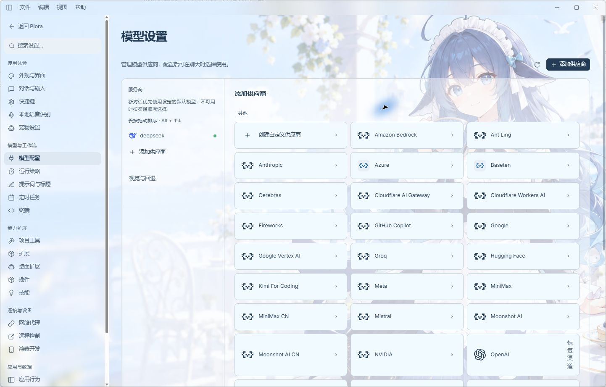

自定义供应商的表单按下面填写：

| 字段 | 怎么填 |
| --- | --- |
| 供应商名称 | 给这个连接起一个易辨认的名字，例如“我的模型服务” |
| Base URL | 原样填写服务商提供的接口基础地址；是否带 `/v1` 以服务商说明为准，不要填写聊天网页地址 |
| API 格式 | 与服务商文档一致，例如 Chat Completions、Responses 或 Anthropic Messages |
| API Key | 填写服务商控制台生成的调用密钥；此处用来保存连接，别把密钥发进聊天 |

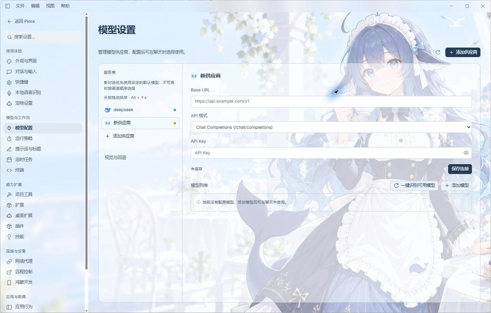
*图中的 `api.example.com` 是表单示例，不能直接用来调用模型。*

3. 填好后点 **保存连接**。点 **一键识别可用模型**，勾选所需模型，再点 **添加所选模型**。服务不提供模型列表时，点 **添加模型**，按服务商给出的准确模型 ID 填写；显示名称可以自定义，ID 不能随意起名。
4. 在模型行点击 **连接测试图标**。测试会实际请求服务，可能消耗额度；保存成功、识别成功都不代表模型调用已通过。
5. 确认模型处于启用状态；常用模型可点击 **设为默认模型**。新聊天优先使用该默认模型，不可用时再按渠道顺序选择；已有聊天保留自己的模型。渠道可长按拖动排序。

<!-- SCREENSHOT: 02-models -->
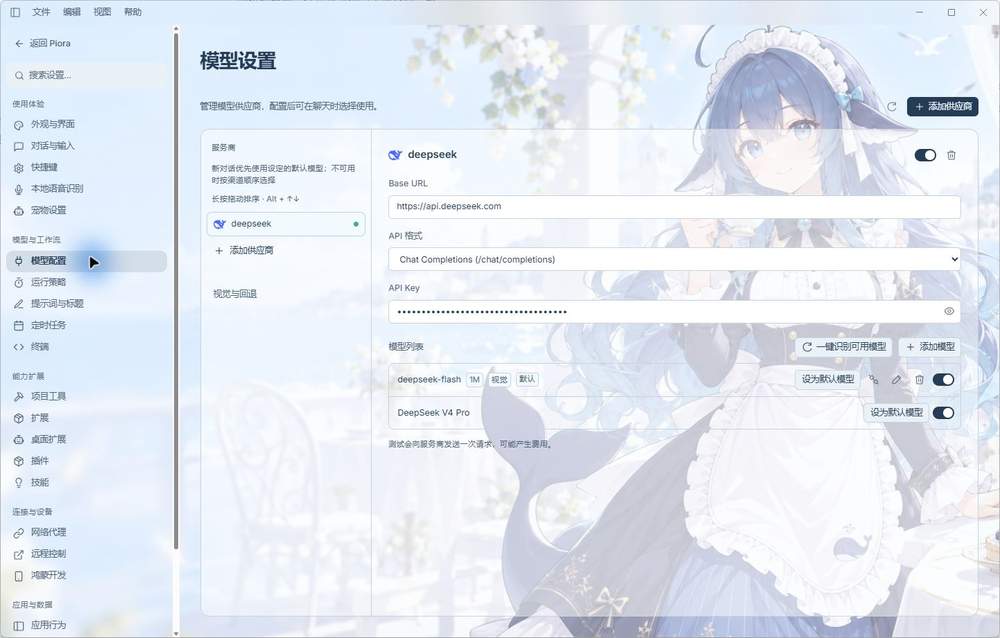
*实拍为已保存的 DeepSeek 连接，密钥保持遮盖；连接测试会实际调用服务。*

### 2. 创建项目：选择一个本地文件夹

Piora 中的“项目”就是你选中的**本地文件夹**。它不会自动创建远端仓库，也不要求文件夹已使用 Git。

1. 初次练习时，先在电脑上新建一个空文件夹，例如 `D:\Projects\Piora-Demo`；已有项目直接使用原文件夹。
2. 返回主界面，把鼠标移到左侧 **项目** 标题一行，点击右边的 **＋（新建项目）**。
3. 在弹出的 **选择项目文件夹** 中选中那个文件夹，点击 **选择文件夹**。也可以在底部“文件夹”输入完整路径。

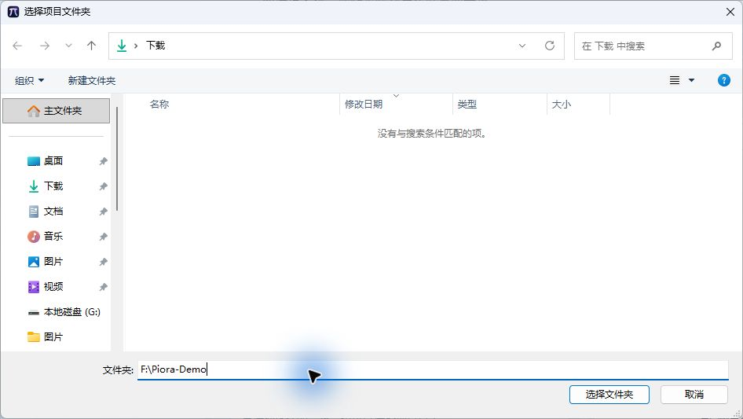
*截图中的 `Piora-Demo` 是练习文件夹；你可以使用任意有读写权限的目录。对话框中的“新建文件夹”也可以直接创建目录。*

4. 看到项目名出现在侧栏、聊天区显示对应路径，就说明项目已选中。点击项目行右侧的 **新建会话** 按钮，开始这个项目里的新聊天；点击项目名称可以展开或收起聊天列表。

只问问题或写作、不需要读取本地文件时，点击 **新对话** 即可，可以不选项目。

### 3. 发送第一条消息并核对结果

1. 看一眼输入框右下角的模型名称，点击可更换模型及可用的思考等级。
2. 在输入框写清楚“要做什么”和“有什么限制”。用已有项目练习时，可以复制：

```text
请先阅读当前项目，用三点说明它的用途、主要目录和下一步建议。
先不要修改文件，也不要执行命令。如果缺少资料，请告诉我还需要什么。
```

如果选择的是空文件夹，可以先发送“请告诉我这个文件夹现在有哪些文件；如果为空，先给出一个整理方案，不要创建文件”。下面实拍使用了含 `README.md` 和 `tasks.md` 的练习目录。


3. 点输入框右下角的 **发送箭头**，或按 `Enter`；换行用 `Shift+Enter`。开始执行后，可查看读取文件等工具过程；需要中断时点 **停止**。
4. 回复出现后，先核对它是否回答了问题。点击回复中可点击的 **文件名**，在右侧打开原文；点“处理结束”可展开本轮工具记录。


*这次实拍实际读取了两份练习文件并返回说明，没有修改文件或执行命令。不同模型的用时和措辞会不同。*

5. 确认方向正确后，再追加一个小任务，例如“只修改 README 的标题，其他内容保持原样”。完成后在右侧 **审阅** 查看差异，再决定是否暂存、提交或继续修改。

### 第一次使用遇到问题

| 现象 | 先检查什么 |
| --- | --- |
| 输入框没有可选模型 | 是否已保存连接、添加至少一个模型并启用；返回模型配置测试一次 |
| 报 401 / 403 | Key 是否正确、是否有对应模型权限，Base URL 与 API 格式是否匹配 |
| 报 402 / 429 | 去服务商控制台检查余额、配额或调用频率，按其提示处理 |
| 识别不到模型 | 服务可能不支持列出模型；按服务商给出的模型 ID 手动添加，再测试 |
| 网络错误或超时 | 检查接口地址、网络及“设置 → 网络代理”；重试前看清具体错误 |
| 找不到项目文件 | 看聊天顶部的项目路径是否正确；空文件夹本来就没有文件，可以换到已有项目 |

需要重新看引导时，进入 **设置 → 应用行为 → 重新打开引导**。

## 功能导览

### 对话、任务与工具

在对话里查看思考过程、工具调用、命令输出、任务总用时和实时生成速度。同一轮过程在任务完成后统一收起；思考生成时展开、结束后折叠，正式回答保持可见。支持 Markdown、代码、Mermaid、数学公式、图片缩放、历史搜索与 HTML 导出。用户消息和已完成回复可“从此处新建分支”，复制包含该消息的历史到独立聊天。

发送前保存文本和附件的本地恢复副本，失败时恢复原稿；运行中可补充要求、停止或恢复排队消息，刷新后重新连接运行状态。消息输入、回复辅助、超时、重试、上下文压缩、系统提示词和自动标题统一在“设置 → 对话与任务”中分组管理；模型故障回退默认关闭，开启后可在服务不可用时尝试其他可用兼容模型。

工具直接按当前启用的能力执行，无需切换批准模式。浏览器登录自动显示浏览器，检测完成后继续任务。


<!-- SCREENSHOT: 03-chat-permissions -->
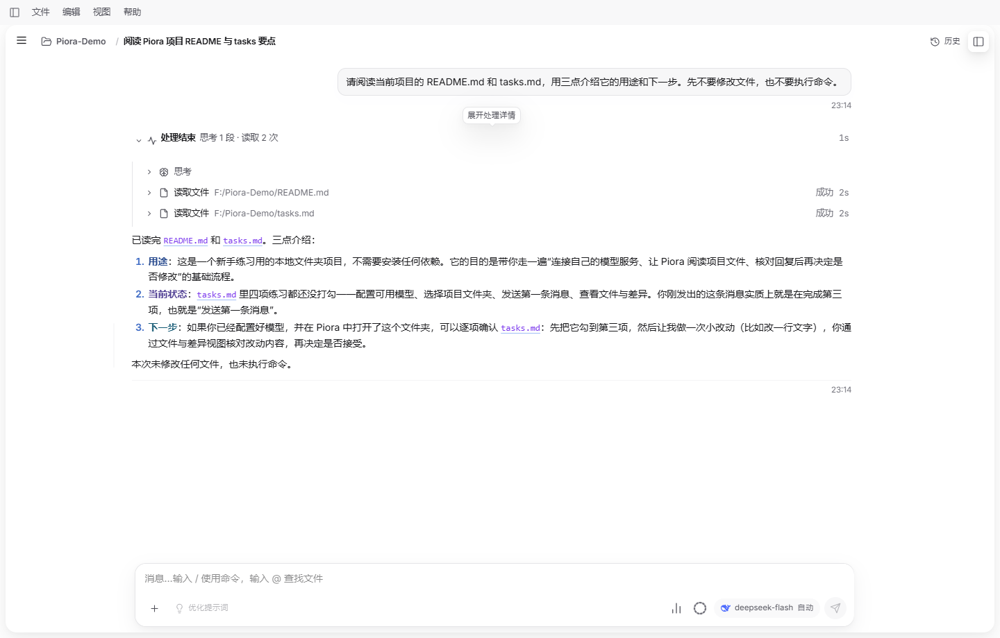
*点击“处理结束”展开本轮过程，核对读取了哪些文件、是否成功以及用时。*

“下一轮输入预测”已隐藏并停止自动请求。需要回复辅助时，可在“对话与任务”配置快捷回复提取或提示词优化。

### 项目文件、代码编辑与 Git

文件区支持文件树、多文件标签、编辑、源码 / 差异 / 预览切换，保留未保存草稿和浏览位置。Markdown、HTML 可以并排编辑和预览；代码支持高亮、折叠、查找替换，TypeScript / JavaScript 支持语义定义跳转和补全，ArkTS 提供基础符号能力。

“上一处 / 下一处改动”按区块定位 Git 变更和未保存编辑；本轮结果显示任务产生的文件净变化。Git 面板支持逐文件或逐区块暂存、提交和推送；聊天右上角“Git 工具”集中管理更改、分支和 worktree。浏览器方式的 GitHub / GitLab / Gitee 授权需要部署[授权服务](services/git-oauth/README.md)。

<!-- SCREENSHOT: 04-files-git -->
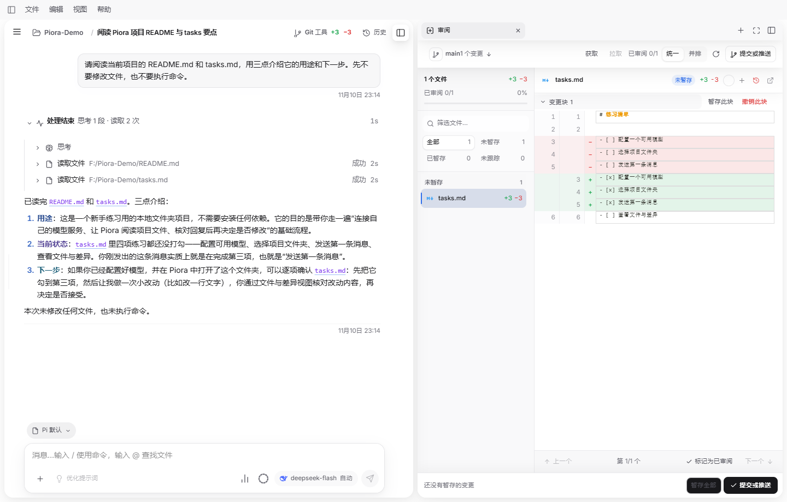
*右侧绿色为新增、红色为删除。这里只展示练习目录的本地差异，未暂存、提交或推送。*

### 终端、浏览器与 SSH

**本地终端**保留原生 Shell 提示符、历史和交互行为，支持多标签。Windows 优先使用随包 PowerShell 7，也可选择已安装的 Git Bash、命令提示符或 WSL；改变默认 Shell 只影响新标签，拖动面板时内容重新换行。

**桌面内置浏览器**默认供 Agent 与用户协作：Agent 操作当前聊天所属的标签页，打开右侧面板就能看到并接手。登录资料保存在 Piora 自己的浏览器环境，不自动继承日常 Chrome / Edge。遇到需要手动处理的页面，对话显示等待卡片，完成后点击继续。登录能保持多久仍由网站策略决定。

**后台浏览器模式及网页版**使用独立的无头浏览器，与桌面内置浏览器的页面和登录资料分开；可以查看跟随画面，但不具备同样的手动接管体验。

<!-- SCREENSHOT: 05-browser -->
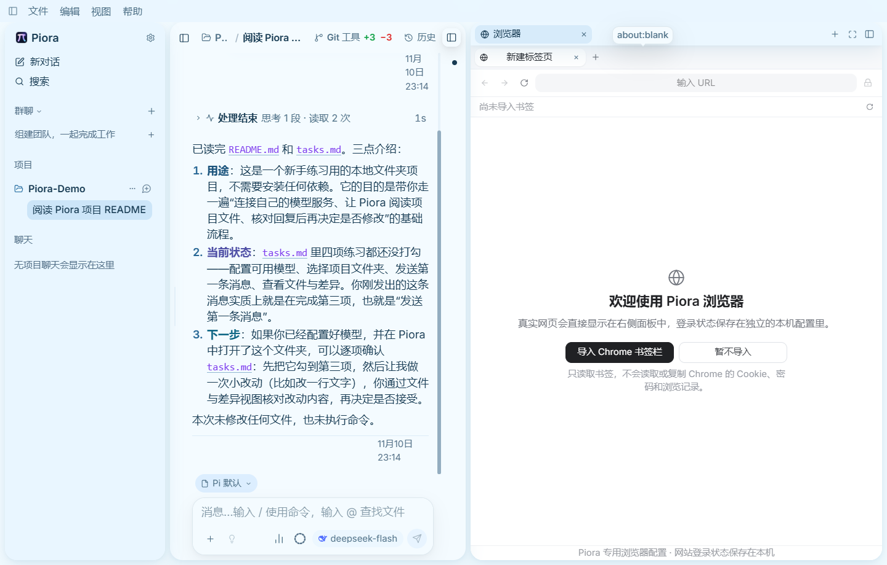
*首次打开可选择导入 Chrome 书签或暂不导入；登录资料由 Piora 独立保存。此图展示欢迎页。*

**SSH 工作台**支持多主机标签、密码 / 私钥认证、连接测试、远程终端和 SFTP 文件传输。连接后可关联当前 AI 任务，让 Agent 使用独立 SSH 工具；本地终端仍在本机执行。凭据存储方式及步骤见 [SSH 指南](docs/SSH_WORKBENCH.md)。

<details>
<summary>SSH 多主机、远程终端与文件截图（历史本地测试环境）</summary>


图中为回环地址上的测试主机，包含测试环境提示，不代表本次安装包的连接验收。
</details>

### 多 Agent 协作与定时任务

**群聊工作台**为同一项目配置成员、角色、职责、协调者与并发，通过 `@` 选择成员，查看实际响应模型、任务分派和共享产物。成员使用独立会话，群聊内可以处理各成员的运行状态和提问；发送状态持久保存，成果可以直接下载。详见[多 Agent 协作](docs/multi-agent-collaboration.md)。

<!-- SCREENSHOT: 06-rooms -->
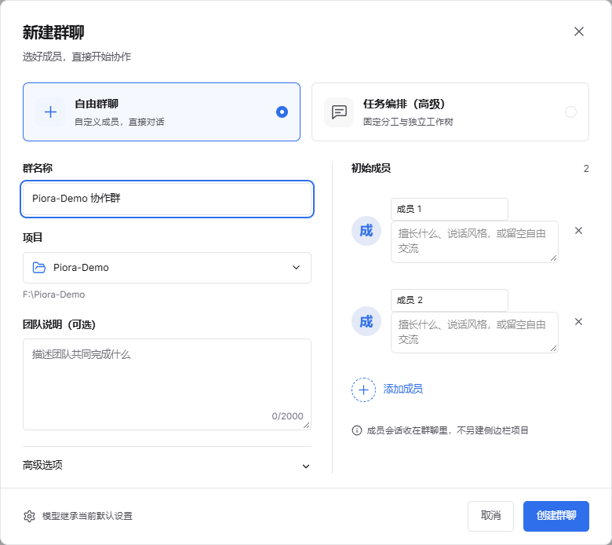
*从“群聊”右侧加号进入，先选项目，再配置成员。图中为尚未保存的创建表单。*

**定时任务**可以在当前聊天周期跟进，或每次为项目创建独立会话；支持执行记录、暂停、恢复和手动运行。调度依赖 Piora 在本机持续运行，电脑关机、休眠或完全退出应用后不会继续执行。

<!-- SCREENSHOT: 07-schedules -->
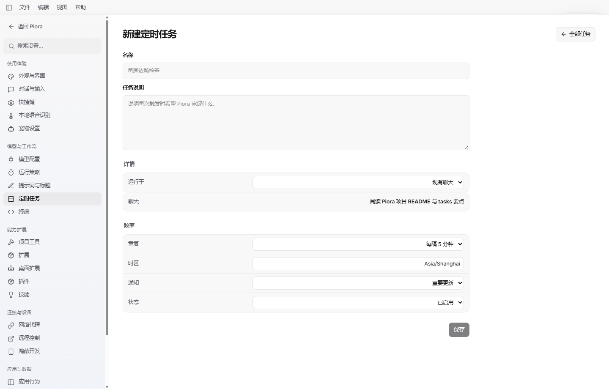
*进入“设置 → 定时任务 → 新建”，填写名称和任务说明，再选择运行范围、周期与通知。图中尚未保存，不会自动运行。*

### Skills、插件、MCP 与桌面扩展

- **技能**：从内置市场、精选仓库、自定义 Git 或兼容市场发现和安装，管理来源、启停和更新。见[技能来源](docs/skill-sources.md)。
- **Pi 插件与扩展**：管理全局 / 项目资源包，按需要启用能力；禁用扩展会从会话加载计划中移除。
- **MCP**：配置外部工具服务，查看连接及工具状态。能力、依赖和认证取决于所接服务，见[用户手册](docs/user-manual.zh-CN.md#mcp-外部工具)。
- **桌面扩展**：可选安装 [DSH Pet](docs/dsh-pet.md) 和 [DSH Meme](docs/dsh-meme.md)。前者提供独立桌宠，后者提供图库与 AI 表情工具；图库管理在设置中，聊天输入栏没有表情包发送按钮。

<!-- SCREENSHOT: 08-skills -->
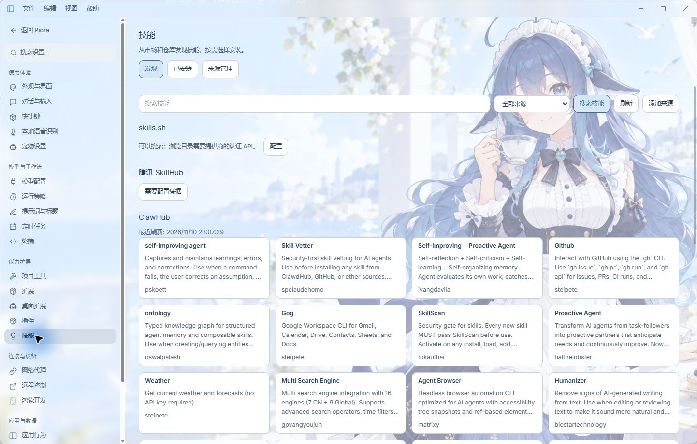
*进入“设置 → 技能”浏览来源和技能；点击安装前先了解用途与所需权限。*

<details>
<summary>已有桌面扩展截图（历史 DSH Pet 设置界面）</summary>


此图拍摄早于 DSH Meme 加入，仅说明入口；首次安装需要下载独立运行资源，上游素材另有许可证要求。
</details>

### 鸿蒙设备工作台

通过 HDC 连接兼容的 OpenHarmony / HarmonyOS 设备，选择目标后查看画面、截图和录屏，并通过应用、测试、语音、日志与记录工具处理任务。兼容设备优先使用 Windows 包内的 Hypium 原生采集库；需要手机端 HAP 的兼容路径仍需签名工具和明确初始化。

投屏可通过操控开关进行触控、拖动、滚轮和文字输入，也可以使用 AI、应用或测试工具；操作按设备状态串行执行。仅观看不会自动安装服务、唤醒或解锁设备。

<!-- SCREENSHOT: 09-harmony -->
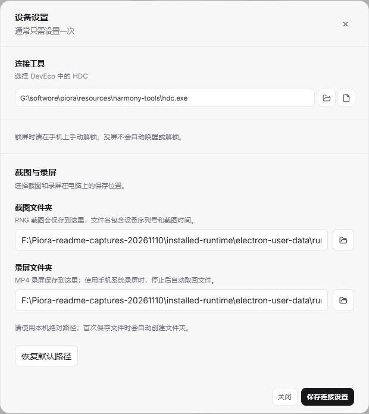
*从右侧工具菜单打开“鸿蒙设备”，点击设备操作菜单中的“设备设置”，即可管理连接工具和保存目录。此图展示设置表单，未启动投屏或录屏。*

设备型号、系统录屏、原生画质 / 延迟、平板及长期稳定性以[验收矩阵](docs/harmony/atlas-acceptance.md)为准；CI 通过不等于真实手机全部验收通过。连接步骤见[鸿蒙设备指南](docs/HARMONYOS_DEVICE_AUTOMATION.md)。

### 随身舱、听写与外观

随身舱集中放置待办、专注时钟、JSON 工具和 Markdown 中转站；中转站支持多文件、源码编辑、自动保存、恢复及导入导出。可选桌宠以独立窗口展示任务状态，也支持兼容素材导入。

本地听写首次开启时下载 SenseVoiceSmall INT8 与 sherpa-onnx 资源，也支持手动导入；资源就绪后语音转文字在本机完成。发送转写文字到模型仍使用所选服务。外观设置提供主题、背景、字体与字号，快捷键可以自定义。

<!-- SCREENSHOT: 10-companion -->
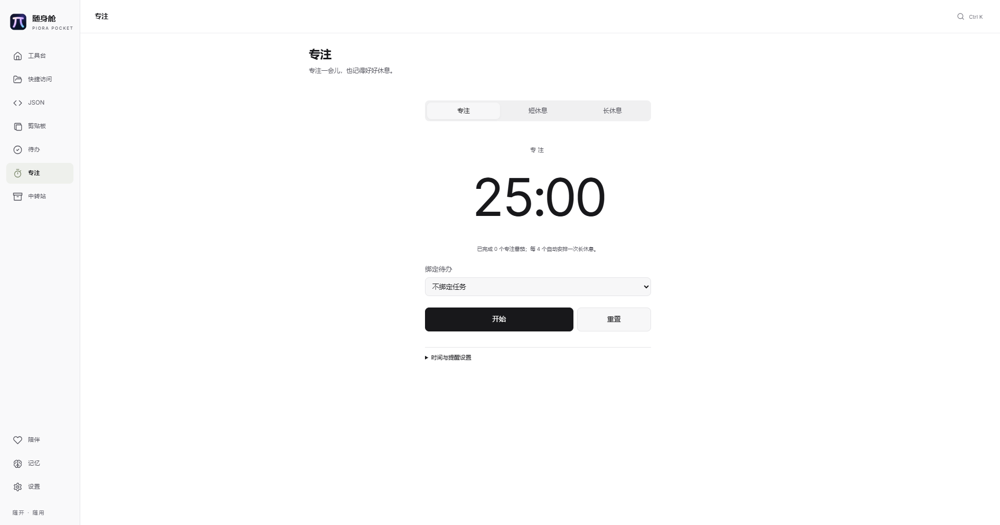
*按 Ctrl+Space 打开随身舱，选择专注时钟。图中为未启动的 25 分钟专注计时。*

### 数据、凭据与诊断

会话和应用资料保存在本机；模型请求把任务所需内容发送给你配置的服务。项目源码需独立使用 Git 或文件备份。应用提供备份 / 迁移和数据目录管理，覆盖范围见[备份说明](docs/user-manual.zh-CN.md#数据备份与迁移)。

桌面[本地凭据库](docs/credential-vault.md)在系统加密支持下保存网站账户，提供主密码验证及加密备份。自动填写默认关闭，仅对匹配的可信 HTTPS 表单填写，不自动提交；填写时暂停并隔离浏览器 Agent 的页面读取。普通会话 / 设置备份不包含凭据库的独立数据文件。

<!-- SCREENSHOT: 11-vault -->
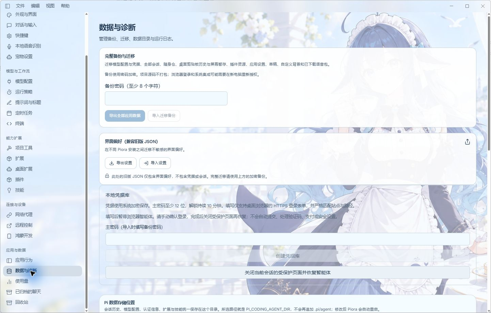
*从“设置 → 数据与诊断”进入。图中尚未创建凭据库，没有输入或展示任何账户密码。*

运行日志支持调整目录、级别、单文件大小及备份份数。遇到启动或黑屏问题，参考[排查指南](docs/open-source/BLACK_SCREEN_TROUBLESHOOTING.md)；反馈时附版本、系统、复现步骤和脱敏日志。

## 更新与内网部署

**更新来源**和**版本更新资格**相互独立；只有正式安装版启用自动更新。在设置中搜索“更新来源”，选择 GitHub 或内源，再检查更新。切换会清除旧来源的可安装状态；网络失败注明来源，允许手动切换重试。不会自动降级，也不会静默换源。

| 设置 | 当前 GitHub 发行版行为 |
| --- | --- |
| GitHub 来源 | 默认值，从本仓库 Release 获取安装包和更新说明 |
| 内源 | 已有选择与持久化能力；地址为源码占位，未配置时提示“内源更新地址未配置” |
| 稳定渠道 | 只选择稳定版 |
| Beta 测试版 | 仅手动下载安装，不检查、下载或静默安装更新 |
| 旧 Alpha / 开发版 | 不提供自动更新；Alpha 流水线已下线，请手动迁移到正式版或 Beta |

<!-- SCREENSHOT: 12-updates -->
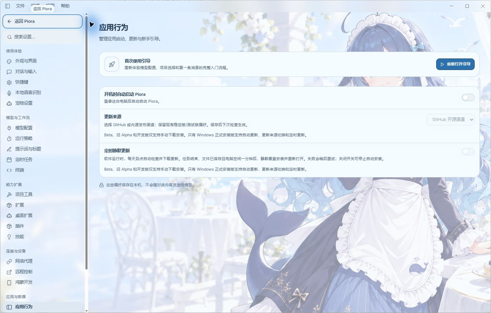
*实拍为 0.5.10-beta.18 安装版；Beta 需要手动下载安装，自动更新控件会说明不可用原因。*

内网维护者可将默认来源设为内网，并配置内部 HTTPS 发布镜像。配置点、Atom 列表、安装包目录和元数据格式见[桌面更新来源说明](docs/desktop-update-sources.md)。公网仓库不包含公司内网地址或凭据。

内外分发使用同一套版本与标签格式，例如 **`0.5.10-beta.20` / `v0.5.10-beta.20`**；同一批更新应在两端同步版本号。相同版本号不会触发升级，切换来源不会重装同版本包；以后分发新代码时，应在两端同步递增版本号，并提供对应更新说明。版本号对齐不代表两个独立维护分支的代码和安装包自动相同。

安装包由 GitHub Actions 构建和校验，Beta 候选全部自动检查通过后，由独立发布工作流上传同一批产物。Release 正文与 `beta.yml` / `latest.yml` 的更新说明统一来自 CHANGELOG。关闭主窗口通常收起到托盘，完全退出或重启使用托盘菜单。

## 开发与贡献

使用 [.nvmrc](.nvmrc) 指定的 **Node.js 22.19.0**、npm 和 Git。Windows 上执行 Agent Bash 工具还需要 Git for Windows 等兼容环境。

```powershell
git clone https://github.com/kexijiang/Piora.git
cd Piora
npm ci
npm run dev
```

浏览器访问 `http://127.0.0.1:30141`。桌面联调先停止上述服务，改用 `npm run dev:desktop`；该入口启动带认证的本地服务和 Electron，监听前端与桌面代码变化。两个入口默认共用端口；桌面端可用 `PIORA_DESKTOP_DEV_PORT` 修改。

**开发目录不要运行 `next build` / `npm run build`，也不要在本地构建发布包。** 测试所需的桌面 / worker 夹具编译可以运行；发布安装包只由 GitHub Actions 构建。Linux 源码开发的 GLib 工具要求见[桌面开发说明](desktop/README.md)。

| 目录 | 职责 |
| --- | --- |
| `app/`、`components/`、`hooks/` | 页面 / API、聊天与工作区、实时交互状态 |
| `lib/`、`extensions/` | Pi 会话运行时、模型、存储、第一方扩展 |
| `desktop/` | Electron 主进程、预加载、浏览器和更新器 |
| `scripts/`、`tests/`、`.github/` | 验证脚本、测试夹具与 CI / 发布 |
| `docs/`、`public/` | 使用及架构文档、静态资源 |

提交前阅读 [AGENTS.md](AGENTS.md) 和[贡献指南](CONTRIBUTING.md)。按改动选择相关快速检查，完整验证交给 GitHub Actions；如实记录未运行、跳过或失败的项目。常用入口：

```powershell
npm run typecheck
npm run lint
npm test
npm run licenses:check
npm run verify:hygiene
```

`npm test` 先编译桌面与 Harmony worker，再执行测试，不创建安装包。真实桌面交互测试另见[自动化测试说明](docs/desktop-automated-testing.md)。CI 在 Windows 上以六分片执行测试，另有质量、官网及发布包校验；真实设备和外部服务效果需要相应环境验收。

每次提交、推送前更新远端状态；发布同步根 / 桌面版本、锁文件、许可证清单、README 和带日期的 CHANGELOG。使用未占用的新标签，不移动已发布标签。完整步骤见[发布流程](docs/release.md)。

## 文档与反馈

- [完整中文手册](docs/user-manual.zh-CN.md) · [文档索引](docs/README.md) · [版本更新](CHANGELOG.md)
- [README 实拍截图清单](docs/readme-screenshots.md)
- [GitHub Issues](https://github.com/kexijiang/Piora/issues) · [行为准则](CODE_OF_CONDUCT.md) · [安全问题报告](SECURITY.md)

## 许可证与致谢

Piora 使用 [MIT License](LICENSE)。感谢 Pi、pi-web 及各上游项目。第三方组件、模型与素材保留各自许可证，详见 [NOTICE](NOTICE)、[第三方许可证清单](THIRD_PARTY_LICENSES.md)及[第三方声明](THIRD_PARTY_NOTICES.md)。
