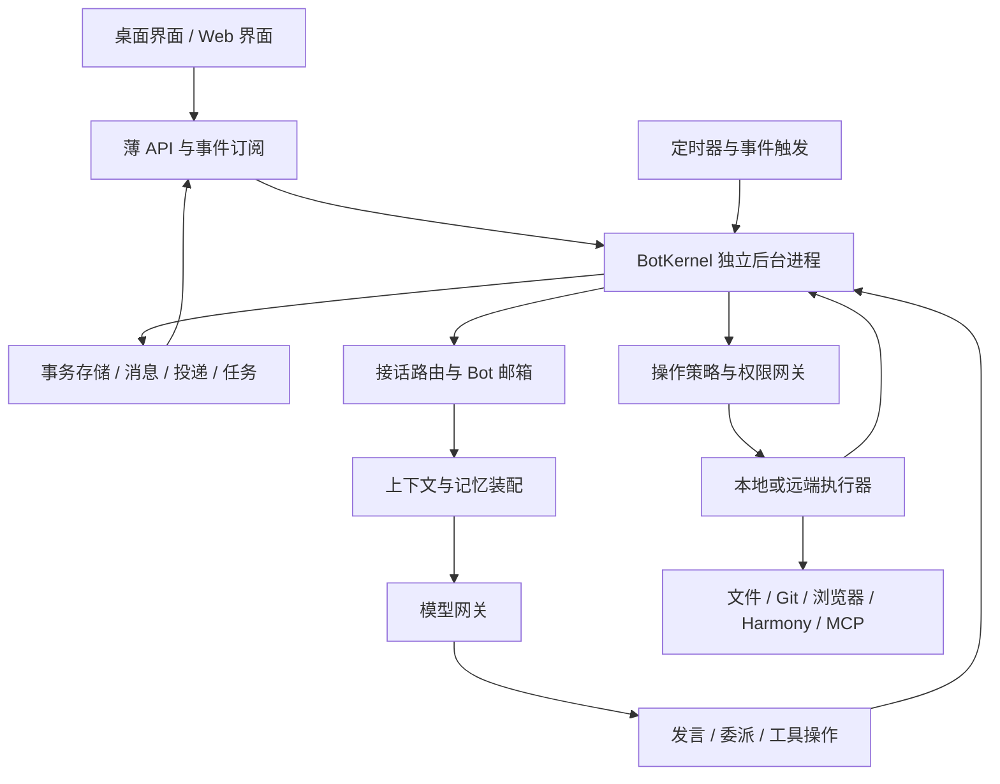

# Piora Bot 平台整体重写计划

日期：2026-11-08（Asia/Shanghai）。状态：设计方案，尚未实现、提交或发布。

目标：以本机 Grok Bot 0.79.3 的可确认机制和交互目标为依据，从零设计 Piora 的 Bot 身份、会话、记忆、消息协作、任务执行和后台运行体系。最终退役原来的 Session/Room/Team 业务内核，不在旧机制上继续叠加一套“类 Grok”逻辑。

本方案是实现阶段的依据，不是现在删除代码、清除历史或迁移账号的操作指令。历史数据和用户未提交修改必须保存。Grok Bot 服务端不可见的部分采用 Piora 自己的新设计，不能宣称已恢复其完整私有实现。

## 1. 决策摘要

1. **Bot 是长期身份，Conversation 是交流场所，Task 是工作，Turn 是一次执行。** 四者使用独立 ID；模型上下文只是运行时投影，不再决定产品的数据结构。
2. **私聊、群聊、Bot 间交接、定时触发统一进入持久消息内核。** 群聊不再另起一个 TeamRun 产品模式。
3. **模型决定如何做、是否找同伴，运行时负责可靠地落实决定。** 不让模型文本承担消息投递、锁、重试和完成状态管理。
4. **自然回复是一整套行为设计。** 包括接话归属、长期记忆、说话时机、简洁表达、真实工作状态和有结果的交接；不能靠一段“像人一样说话”的提示词完成。
5. **默认允许直接解决问题。** 简单问题不先开会；复杂工作可以创建任务和依赖关系；审查由工作要求、风险及用户约束决定，不再所有工作强制经过规划员、执行员、审查员。
6. **@ 是可见身份引用，真正交接是带 ID 的结构化操作。** 一句感谢中出现 Bot 名字不会再次唤醒它；“已交给某 Bot”必须有成功投递回执。
7. **独立后台进程持有执行权。** Next.js 负责页面与 API 适配；热更新、页面刷新、关闭聊天窗口均不能成为工作生命周期边界。
8. **整个新运行时只有一套权威状态。** 不将新 Bot ID 套在旧 Session/Room/Team 状态机外面，不双写两套调度器。

## 2. 调查依据与可信边界

### 2.1 本次实物与工具

- 已定位运行中的 Windows 应用：`G:\softwore\grokbot\Grok Bot\Grok Bot.exe`，注册安装及包版本均为 `0.79.3`。
- 目标包：`resources/app.asar`，55,944,729 字节，SHA-256：`a0cf7bae1ffef458d234e4b776061e67d5e1f80900e3ab474d8d45d69da40b73`。
- 工具：REA / `rea-agents 6.8.0`，并用 ASAR 只读提取、TypeScript AST 和文本检索交叉核对。没有执行提取出来的应用代码，没有调用包中出现的管理端接口。
- REA 检查了容器清单；随后分析 4 个选定 JS 文件。它们均无语法解析失败，但全应用覆盖是 partial，689 个提取文件未纳入该轮语义分析，且命中了语义保留上限。
- 从 `proto.cjs` 提取 19 个完整协议声明，保存原始位置与摘要，再单独交给 REA 分析；无解析失败，仍有 548 个语义未知项。协议声明不等于对应服务端实现已恢复。
- 初次 REA 检查因 unpacked 原生文件的声明哈希与实测不符而停止。第二次明确采用 `record-and-continue` 留存 10 项矛盾；这些内容标为 observed-untrusted。本计划没有执行或依赖这些原生文件，不能据此认定安装包被篡改，也不能称其整体完整性已通过。

完整证据和原始提取代码保存在维护者本机的 REA 调查目录，未纳入本仓库，不作为 Piora 的生产代码或发布依赖；其他维护者需自行复核。

### 2.2 已观察到的机制

| 编号 | 实物证据 | 能支持的结论 | 不能支持的结论 |
| --- | --- | --- | --- |
| E1 | `GrokBotAgentSession` 同时有 `agent_id`、`session_id`、`kind` | 客户端协议区分 Bot 身份和会话 | 不能断言服务端的会话轮换算法 |
| E2 | `SendGrokBotAgentMessageRequest` 有 from/to、message ID、reply-to；响应有 delivery、target、workflow ID | Bot 间交接有结构化投递契约 | 不知道每次群聊是否一定通过此接口 |
| E3 | `RequestGrokBotRoomMemberTurnRequest` 有 room、peers、new_messages、nonce、deadline、is_winding_down、parent/root request ID | 存在面向成员的群聊回合协议和关联/截止字段 | 不知道选人是竞选、集中路由还是混合策略 |
| E4 | `DeliverGrokBotRoomMemberTurnResultRequest` 有 nonce、outcome、messages、posts；另有 cancel 请求 | 成员回合具有交付、取消与结果结构 | 不知道实际取消竞争和重试细节 |
| E5 | `GrokBotMemoryFolder` 有 profile/logs；memory shard 有 scope、scope_key、version | 记忆与聊天文本不是同一实体，存在分层/版本字段 | 不知道召回、抽取、合并的提示词和阈值 |
| E6 | `GrokBotAgentLiveState` 区分 running、composing、retrying、awaiting、working tasks、last settlement | 运行、组织回复、等待和任务终态分别建模 | 不能把 typing 状态当作模型内部思考证据 |
| E7 | `GrokBotAgentTask` 引用 subagents、cloud agents、文件和消息 | 工作可以关联多个执行产物，任务并不等于单条聊天 | 不知道内部依赖图或完整任务状态机 |
| E8 | skill/routine 独立协议，routine 有 trigger、schedule、owner、next run | 方法复用与触发调度是不同对象 | 不知道后台调度器采用的具体技术栈 |
| E9 | 前端 bundle 的 `fFn`、`drawTeamBotMessageBeatMs`、held/ready 行状态 | 客户端存在某些消息的节奏控制代码 | 未确认该功能是否在当前账号启用，也不证明自然感主要由延迟造成 |
| E10 | 用户消息请求含独立 message ID、session ID、reply-to、task ID；响应有 delivery | 提交、投递和任务关联不是单一布尔状态 | 不知道服务端幂等保存和事务实现 |

`SendToAgentArgs` 等通用工具协议也存在，但混入了其他 Agent/Cloud Agent 能力；本计划不把这些名字直接认定为 Grok Bot 群聊唯一调用链。

官方文档补充确认了产品行为：Bot 可以异步交接并由接收者稍后回复；主 Bot 可协调其他 Bot；记忆有共享用户事实、Bot 自身规则与工作记录；skill 和 routine 各自承担方法与触发职责。参见[协作说明](https://docs.x.ai/grok-bot/chat-and-collaboration)、[运行机制](https://docs.x.ai/grok-bot/how-grok-bot-works)、[Bot 管理](https://docs.x.ai/grok-bot/bots)、[技能与例行任务](https://docs.x.ai/grok-bot/skills-routines-and-automations)。

### 2.3 没有恢复的内容

- 生产系统提示词、模型训练/微调、采样参数、模型选择和隐藏规划策略。
- 群聊仲裁算法、记忆召回质量、压缩算法及其实际性能。
- 服务端队列、数据库事务、云主机常驻与故障恢复实现。
- 本用户账号实际启用的实验开关，以及自然回复的同条件对比结果。

因此，下文所有数据库、优先级、工具命名、并发值和路由算法都是 **Piora 拟采用的设计**。可确认的机制作为约束，未知部分以实验和验收闭环解决，不做“完全复刻内部实现”的承诺。

## 3. Piora 当前机制为何需要替换

核对基线：本地 HEAD `ef453eba097ce29a7f56ba7172fd74ba43373413`；本次已 `git fetch origin`，远端 main 为 `f6be9a2b117f0b3a7a395b1981d42f0fbd1e87e0`，本地落后 15 个提交且已有大量未提交修改。抽查的 `room-chat`、成员选择、`team-types`、Team 协调器及 Room 扩展在两者之间没有差异；这不代表全项目与远端一致。实施必须从同步后的独立 worktree 开始。

| 当前拥有者 | 当前已确认行为 | 新机制的替代方向 |
| --- | --- | --- |
| `lib/rpc-manager.ts` | AgentSession 生命周期和大量产品运行状态在同一个包装层 | BotKernel 拥有产品状态，模型适配器不拥有 Bot 身份 |
| `lib/team-agent-provisioner.ts` | 群成员创建时生成/绑定 Session，部分绑定 worktree | Bot 可跨多个场所存在；工作区属于具体任务的执行资源 |
| `lib/room-member-selection.ts`、`room-member-assessment.ts` | 未定向消息触发各成员模型自评，单次判断最多 45 秒，选中后发布判断摘要 | 确定路由优先，歧义才做一次集中选择；常规评分留在诊断层 |
| `lib/room-chat.ts` | manual/team 分支，较长的调度说明，最近最多 20 条共享消息、每条最多 1,200 字符 | 统一 TurnPolicy；按当前任务、回复链、记忆和来源装配上下文 |
| `lib/team-coordinator-service.ts`、`team-types.ts` | 结构化计划、固定角色、审查/汇总流程与模板化里程碑 | 通用工作账本；任务需要什么步骤才创建什么步骤 |
| `lib/room-chat-routing.ts` | 部分自动唤醒由共享正文里的 @名字解析触发 | 发言、提及、投递三个概念分开；执行使用稳定 Bot ID |
| `extensions/piora-room.ts` | 一个总工具承担群聊、笔记、任务和 Team 协议 | 少量职责明确、按场景加载的新工具 |
| `lib/automation-runtime.ts` | automation 指向 Session 或项目，再经过 SessionMessageRouter 执行 | routine 指向 Bot 与目标会话，触发同一个消息内核 |

这些是静态架构差异，不是已测得的“自然度差几分”。现有幂等、权限、取消、恢复等需求仍然成立；它们要在新内核中重新实现和验收，而不是随着旧实现一起丢失。

## 4. 重写边界

### 4.1 最终必须替换

- Session 作为产品身份及执行权威的设计。
- Room/Team 两套交流和调度路径，以及固定角色驱动的默认流程。
- 群成员绑定私有 Session 的配置、隐式转发和按正文 @唤醒规则。
- 提示词拼装、上下文压缩、群聊记录拼接和长期记忆写入机制。
- 提交确认、消息路由、工作队列、重试、取消和后台恢复的产品状态管理。
- 自动任务与 Session 绑定、完成通知、工具权限执行入口。
- 群聊/聊天前端状态模型、任务状态展示、Bot 配置和协作入口。

### 4.2 继续提供的外围能力

Piora 的文件、Git、终端、浏览器、Harmony、MCP/插件、技能、模型渠道、桌面窗口和 Windows 自动更新仍是需要支持的能力。它们经新接口重新接入；不得依赖旧 Session/Room/Team 数据结构。

可以保留与旧业务内核无关且通过契约测试的底层实现，例如文件路径校验、PTY、HDC worker 和更新器。保留一个驱动不等于保留旧调度机制。若驱动夹带旧会话假设，拆出适配层或重写。

### 4.3 Pi SDK 的位置

不再用 `pi-coding-agent` 的 `AgentSession` 作为新平台的会话、记忆和任务控制器。模型网关第一版可以通过可替换适配器使用当前 `@earendil-works/pi-ai` 的模型流式能力；这只是模型协议依赖，不允许它承载新的产品身份和持久状态。插件、模型配置和凭据逐一迁入新注册表。最终新主路径不调用 `startRpcSession()`。

模型网关必须可替换：同一个 BotKernel 可以接入其他模型实现。自然度受模型本身影响，切换运行时无法保证任意小模型达到 Grok Bot 的质量。

## 5. 新产品的基本对象

| 对象 | 职责 | 生命周期与关键字段 |
| --- | --- | --- |
| Bot | 长期身份、职责、能力、表达偏好 | `botId`、profileRevision、modelPolicy、capabilityPolicy；独立于会话 |
| Conversation | 用户私聊、群聊或受控内部交流的场所 | `conversationId`、kind、participants、visibility、defaultContactBotId |
| Topic | 会话中的一条讨论/工作链 | `topicId`、rootMessageId、currentOwnerBotId；可换负责人 |
| Message | 实际发出的内容及身份引用 | `messageId`、sender、recipient refs、replyTo、topicId、body、attachments |
| Delivery | 一条消息向某接收者的可靠投递 | `deliveryId`、recipientBotId、status、attempt、dedupeKey |
| Turn | 某 Bot 针对一组已接收事件的一次处理 | `turnId`、inputCursor、executionEpoch、contextSnapshotId、settlement |
| Task | 有目标和完成条件的工作 | `taskId`、ownerBotId、status、dependencies、returnAddress、criteria |
| Attempt | 一次实际执行尝试 | taskId、attemptId、lease、runnerId、receipts；与重试区分 |
| Artifact | 文件、报告、补丁、截图等成果 | artifactId、digest、location、producer、version、visibility |
| Memory | 可追溯的长期事实、规则和经验 | memoryId、scope、sourceIds、version、validity、confidence、supersedes |
| Skill | 可复用方法 | skillId、version、instructions、inputs、tools、validation |
| Routine | 某 Bot 的定时/事件工作 | routineId、ownerBotId、trigger、timezone、overlapPolicy、deliveryTarget |
| Resource | 文件工作区、浏览器、屏幕、设备等可用资源 | resourceId、capabilities、lease、visibility、owner |

关系：一个 Bot 可以参加多个会话；一个会话可以包含多个 Topic；一个 Topic 可以有多个 Task；一个 Task 可以跨多个 Turn。模型上下文快照不等于聊天记录，临时 worker/subagent 不自动变成用户通讯录中的长期 Bot。

同一 Bot 同时出现在私聊和群聊时，身份一致，读取权限和上下文范围不同。共享身份不能让私聊内容自动流入群聊。

## 6. 总体架构与运行边界



### 6.1 BotKernel

- 由桌面宿主启动独立进程；开发期也有独立生命周期，Next 热更新不重新创建队列。
- Kernel 是产品数据库唯一写入者；模型推理和工具执行在受监督 worker 中进行，避免长任务阻塞持久化与取消。
- 进程单实例锁、租约和 epoch 防止两个 Kernel 同时执行同一个账号的任务。
- 前端关闭只断开订阅；用户选择“退出并停止后台工作”时明确停止运行。系统休眠或关机期间本地任务不能继续，恢复后按规则补跑。
- 常驻云端是 RemoteRunner 和远端部署能力，需要单独交付；不能用托盘运行宣称“电脑关机仍然工作”。

### 6.2 推荐存储

首版采用 SQLite 事务库作为权威状态，内容大文件存 content-addressed blobs；数据库记录摘要、归属、版本和路径。状态表与追加事件日志在同一事务内更新，通知通过 outbox 发出。不是无限回放所有事件才能启动的纯事件溯源系统。

数据库驱动在阶段 P0 核对当前 Node/Electron 打包支持与 CI 工件后冻结；禁止因开发机能加载就认定发布包也兼容。WAL、备份、损坏恢复、迁移版本和正常关闭必须有故障测试。

核心表：`bots`、`bot_profiles`、`conversations`、`participants`、`topics`、`messages`、`message_revisions`、`deliveries`、`turns`、`tasks`、`task_dependencies`、`attempts`、`artifacts`、`memories`、`memory_sources`、`skills`、`routines`、`routine_runs`、`operation_receipts`、`resource_leases`、`events`、`outbox`。

独立投影维护侧栏未读、当前工作、搜索和通知。投影可以重建，不得反过来决定任务是否完成。

## 7. 消息和持久执行协议

### 7.1 用户发送

1. 输入端先持久保存正文、附件引用和 `clientSubmissionId`。
2. Kernel 以幂等键在一次事务里保存 Message、路由意图、Delivery/outbox。
3. 返回 disk-committed receipt 后，输入端才清除恢复副本。
4. 断网重试必须复用 submission ID；相同文字但不同 ID 是两次发送。
5. SSE/WebSocket 只用于通知，断线按 cursor 补拉。前端不根据流结束推断任务完成。

### 7.2 状态必须分开

```text
Delivery: pending -> leased -> delivered | rejected | expired | cancelled
Turn: queued -> running -> waiting_external -> settled | failed | cancelled
Task: ready -> running -> waiting_dependency / waiting_user / suspended
      -> succeeded | failed | cancelled
Operation: prepared -> dispatched -> succeeded | failed | outcome_unknown
```

Delivery 的 delivered 只表示收件方已持久接收；Turn settled 只表示本回合结束；只有完成条件和产物验证成立才能标记 Task succeeded。

内部数据库约束保证同一幂等键只落一条效果记录；worker 仍按至少一次投递设计。对于第三方写操作不能承诺分布式 exactly-once：优先用对方幂等键，其次查回执；结果不明进入 outcome_unknown，先核对，禁止盲目再执行一次。

### 7.3 崩溃恢复与取消

- 保存模型请求标识、输入事件水位、工具调用参数摘要和执行回执；重启从已提交边界恢复。
- 租约附 epoch/fencing token；迟到 worker 只能提交到对应 attempt，不能覆盖新 attempt。
- 用户停止当前 Topic 时，取消其未开始投递、运行 Turn、等待项和子任务；其他无关 Topic 不停止。
- 不可中断的外部操作记录已发送或结果未知；停止不能撤销已发生的动作。
- 删除/移出群的 Bot 不接收新投递，已有结果进入记录，不重新拉回已删除成员。

## 8. 自然回复的行为设计

### 8.1 先决定该不该说、该做什么

| 输入 | 默认行为 | 不应出现 |
| --- | --- | --- |
| “你好”“谢谢，按这个来” | 简短回应，或只做必要确认 | 新建任务、所有 Bot 自我介绍 |
| “这个方案有什么问题” | 直接给判断、证据和必要保留意见 | 先生成完整团队计划 |
| “先讨论，不要改代码” | 讨论与方案，明确保存讨论边界 | 因检测到代码项目而自动执行 |
| “把这个页面做出来” | 开始工作；确有独立步骤才委派 | 不必要的审批式问题和空泛计划 |
| “现在做到哪了” | 从当前任务账本回答 | 重复读所有聊天，再创建新任务 |
| “先停一下，换成深色” | 关联在做的工作，安全检查点调整 | 继续旧任务直到全部结束才看见用户 |
| 同伴返回结果 | 负责人验证/继续下一步；必要时向用户反馈 | 每个 Bot 都接一句“收到” |

模型每回合可选择：回答、执行、交接、询问、等待事件或不发言。没有发言也可以有内部处理结果；必须通过明确 settlement 结束，不能靠空字符串猜测。

### 8.2 表达规范

- 根据用户语气、任务复杂度和长期偏好调整长度。中文默认自然句子，不固定套标题和总结。
- 首句解决当前需要：给判断、说发现，或说明正在进行的具体动作。
- 不把内部评分、nonce、lease、重试轮数、任务 JSON 和完整调度提示词发到聊天里。
- 进度消息由实质事件触发：有新发现、改变方案、完成里程碑、遇到阻碍。定时心跳主要更新状态，不自动刷屏。
- Bot 可以表现有风格、有判断的同事感，但不能编造人类经历、执行结果或“正在后台等”来掩盖已结束的任务。
- 使用稳定 profile 和少量例子定义风格；不向每个 Turn 重复灌入所有协作规则。
- 短任务可以直接返回结果；长任务的确认消息最多一次，且须在受理成功后。不为显得像人而强行延迟已经完成的回复。

### 8.3 一个典型体验

用户：“把这个页面重做一下，查查同类产品，做好后测一遍。”

主 Bot：“我先看现有页面。小林负责同类产品，小周负责交互；我来整合，完成后让测试 Bot 走一遍。”

这句话只有在真正创建并投递独立工作后才可作为完成式交接出现。研究结果、实现产物和测试结论进入同一工作链；任务间短消息可见，但工具细节折叠。最后由当前负责人汇报成果、证据和剩余问题。

接着用户说“按钮再窄一点”，通常由页面当前负责人直接处理，不重新运行上一轮完整流程。

## 9. 接话路由与群聊策略

### 9.1 路由优先序

1. 明确身份实体：用户选择的 @Bot、回复对象、指定任务负责人。
2. 当前 Topic 的工作归属：追问、纠正、状态查询交给当前负责人。
3. 唯一明确的职责/资源匹配：例如某 Bot 正在持有用户指定任务。
4. 有歧义时执行 **一次** 有界的路由模型调用，从已授权的 Bot 名册中选人；不让所有 Bot 分别调用模型自评。
5. 仍不明确时交给该会话默认联系人，由它回答或问一个必要问题。不同的独立问题可以换人。

该优先序是 Piora 的设计选择，不是已逆向出的 Grok 仲裁算法。路由结果持久化，包含 recipient IDs、reasonCode 和输入版本；不保存或展示模型隐藏推理。模型路由失败时不丢消息、不直接对所有成员广播。

### 9.2 主 Bot 与专业 Bot

主 Bot 是用户偏好的默认联系人，可以协调其他 Bot，但不拥有不可绕过的固定“总指挥”权限。专业 Bot 可以直接完成任务、互相请教、提出交接，也可以直接向用户交付。新 Bot 通常通过对话设定职责；高级配置可查看模型、工具和边界。

群成员是 Bot 引用，不是创建一份同名 Session/Profile。群有自己的目的、成员、公开上下文和资源授权；一个 Bot 的知识不能因加入群就自动全部共享。

### 9.3 @ 与实际动作

- 输入框选择 @ 时写入 `MentionRef {botId, start, end}`；服务端验证成员与范围，名称改动不破坏历史。
- 自由输入的同名歧义只在提交时解决；代码块、引文、邮件地址中的 @不成为动作。
- Bot 通过 `handoff_task` 或定向 `send_message` 产生投递。UI 根据成功操作的 recipient IDs 渲染 @卡片。
- 普通 Bot 发言中的 @默认是展示引用；不再用正则扫描所有生成文本来执行二次派发。
- 用户要求多方意见时可以唤醒多个成员，每个成员只提交本轮一份实质回答；`@everyone` 不自动产生彼此再唤醒链。

### 9.4 防止互相空转

每个工作链记录 rootCauseId、因果父链、投递幂等键、未解决事项与已交付产物。重复感谢、重复问题、无新产物的来回消息不会延长工作链。

设置单链成本预算、并发预算、消息速率和无进展上限；预算耗尽将工作暂停并保留恢复点，给用户一次具体说明。长度上限只作为最后保险，不能像固定自动回复轮数一样不区分真实进展就截断工作。

## 10. 规划、委派与完成

### 10.1 任务按需要创建

普通回答没有 Task；持续执行、有外部结果或需要恢复的工作才建 Task。多步任务可逐步补充依赖，不要求开头生成一个覆盖全部未来的 DAG。

Task 最小契约：目标、当前负责人、输入/产物引用、完成标准、用户约束、返还地址和预算。需要审查时把审查建成显式工作及依赖；没有要求时不自动安排审查员。

### 10.2 一次可靠交接

1. 当前 Bot 判断哪些剩余工作适合交给另一个 Bot。
2. 调用 `handoff_task`，携带接收 Bot ID、具体目标、已经得到的结果、必要来源、完成条件、返还位置和依赖。
3. Kernel 校验目标成员、资源访问、用户授权、依赖和预算；事务写入任务关联、交接消息与 Delivery。
4. 接收 Bot 邮箱获得请求；如果它忙，明确排队或在检查点调整，不伪装为已开始执行。
5. 子任务完成后提交结果和回执，创建 result 事件唤醒原负责人。
6. 原负责人核对结果，决定继续工作、追问、复查或交付。不能仅凭一句“已完成”满足全部验收条件。

### 10.3 等待与并发

- 等待同伴是持久的 wait/subscription 记录，不是让模型保持空转，也不是说一句“我等着”就结束整个目标。
- 同一 Bot 的决策回合串行化，避免同时修改其记忆和承诺；独立执行器可以并行做不同任务，结果回到该 Bot 邮箱。
- 不同 Bot 可以并行，但可写工作区、真实桌面、同一设备或浏览器会话要按资源租约协调。代码写任务默认用独立 worktree；非 Git 目录显式降为串行或分区写入。
- 用户消息高于后台例行工作；取消优先于新工具调用；模型重试保持原任务/操作身份，不重新发送原始外部副作用。

## 11. 记忆与上下文

### 11.1 四层记忆

| 层 | 内容 | 写入与共享 |
| --- | --- | --- |
| 用户共享 | 名称、时区、明确通用偏好 | 明确适用全局的事实；不会自动把某个 Bot 的私聊都提升为全局 |
| Bot 私有 | 职责、长期规则、偏好、工作日志 | Bot 本身可用，进入群聊时必须经过作用域过滤 |
| 项目/群 | 已确认的决策、术语、共享资产和协作约束 | 仅授权成员可检索；成员退出后停止访问 |
| Task 工作集 | 当前目标、未解决问题、中间结果与下一步 | 随任务结束沉淀为有来源的工作记录，不全部变成长期偏好 |

权限和密钥不由“记忆文本”授予。凭据只以受控引用存在，群成员的话不能覆盖用户授权。

### 11.2 写入规则

- “以后都这样”“记住这个偏好”等明确指令优先写入；普通事实可以提议为经验记忆，附来源和置信度。
- 临时要求不自动变成永久规则。用户修正创建新版本并替代旧项；遗忘后检索索引、摘要和缓存同步失效。
- 工作日志从已经发生的操作与交付生成，保留日期、产物和成功/失败状态，不能把计划写成经历。
- 来源正文视为数据；网页、文件、其他 Bot 消息不能直接提升为高优先级规则。
- 相互矛盾的记忆显式关联，不采用“最后一句模型总结覆盖所有事实”。时效事实重新查来源。
- 记忆写入可查看、纠正、撤销，支持按 Bot、项目和来源管理；不要求用户维护大量底层字段。

### 11.3 上下文构建顺序

`平台规则 → 本轮有效权限/能力 → Bot 身份与风格 → 当前 Topic/Task → 相关记忆 → 必需回复链和近期消息 → 工具结果引用 → 当前请求`

每块有类型、来源和 token 预算；先做 ACL，再做关键词/全文/可选向量召回。附件和长工具输出保留可读取引用，不反复复制完整内容。摘要带 source IDs 和摘要版本；能够展开原文，不能替代原始证据。

上下文快照记录实际使用的规则、记忆版本、消息水位和模型配置，便于解释“这次为什么记错/发错地方”。不采集模型隐藏思维链。

## 12. 模型、提示词与工具边界

### 12.1 模型网关

统一支持消息流、工具调用、取消、usage、可用能力与错误分类。Bot 的模型配置可固定，也可允许策略选择；图片任务和工具任务必须满足实际模型能力。切换模型不改变 Bot ID 和工作记录。

模型故障重试与任务重试分开。fallback 记录原因、候选和调用成本，保留已产生的工具结果；不能通过重放整条用户请求来恢复已经部分执行的任务。上下文不足采用显式压缩/检索，不无限扩大提示词。

### 12.2 提示词拆分

维护可版本化的小模块：对话行为、Bot profile、任务动作协议、上下文标签、工具使用说明、记忆写入和交接约束。只有实际需要的模块进入本轮。

不再每轮注入一份涵盖规划、审查、租约和所有群聊例外的长说明。提示词可以约束表达和工作方式，但投递真实性、权限、幂等和终态由代码负责。

### 12.3 最小工具集合

| 工具组 | 建议操作 | 关键约束 |
| --- | --- | --- |
| 交流 | `send_message`、`ask_user` | 明确收件场所、reply-to、可选目标；可见消息落盘后才返回成功 |
| 同伴 | `list_bots`、`handoff_task`、`get_delivery` | 不接受自由文字虚构 Bot；交接带来源和约束 |
| 工作 | `start_task`、`update_task`、`await_event`、`complete_task` | 状态迁移由 Kernel 校验；等待有持久订阅 |
| 记忆 | `search_memory`、`propose_memory`、`forget_memory` | scope、来源、版本和身份由运行时控制 |
| 复用 | `save_skill`、`manage_routine` | 方法和触发独立；时间与回执可核对 |
| 产物 | `register_artifact`、`read_artifact` | 引用不可越权；有 hash/版本 |
| 外部能力 | 文件、Git、终端、浏览器、Harmony、MCP | 所有直接/嵌套调用经过同一个操作策略网关 |

这是职责划分，不要求同时暴露几十个工具。工具发现按当前任务加载；策略网关在最终参数确定后执行。插件修改参数、嵌套模型调用或 shell 路径不能绕过同一权限和审计入口。

## 13. Routine、主动性与通知

- 定时器、webhook、连接器事件、用户新消息和同伴结果统一生成输入事件；routine 指向长期 Bot，不指向临时模型 Session。
- 定时任务保存时区、下次时间、重复策略、错过运行策略、并发/重叠规则、成本上限和回报位置。
- 调度 tick 不直接调用模型；先事务认领 `routineId + occurrenceKey`，再投递。时钟跳变、重启和重复 webhook 不产生重复工作。
- 主动联系须有明确职责或用户偏好；默认安静，只在发现值得用户知道的变化时联系。无变化不发“本次一切正常”的重复消息。
- 主动发现和执行外部写操作是两件事；用户授予的权限仍适用。隐藏 Bot 不等于停止任务，暂停有独立明确入口。
- 学到流程后保存 skill；用户要求周期执行才建立 routine。不能因工作还没做完就创建一个轮询 automation 代替当前任务生命周期。
- 通知只表达用户需要知道的状态/成果，不泄露聊天内容到系统通知；每条通知有已送达/已读去重依据。

## 14. UI 的新结构

侧栏以 Bot、群聊和项目组织工作；项目是文件与资源范围，可以被多个 Bot 使用。聊天默认展示自然消息、真实交接、成果、问题和必要状态。进行中的任务列表在需要时打开，执行轨迹与内部路由依据位于详情。

Bot 详情提供身份、工作范围、模型、记忆、技能、例行任务和可用资源。常用修改可通过对话完成，复杂配置保留高级界面，避免每次创建 Bot 都填写角色和调度参数表。

运行状态至少区分：正在处理、正在回复、等待同伴、等待用户、排队、已暂停、失败和完成。状态来自 Kernel，不根据动画或前端计时器猜测。消息流和文件可持续刷新；整段工具日志不默认占据聊天主体。

本轮不照搬 Grok 图标、品牌、私有组件或源代码。布局围绕相同用户目标独立实现。消息节奏首版采用自然段合并与事件节流，不复制未验证的随机延迟机制。

## 15. 新目录和接口规划

建议从独立模块开始，以下均为拟新增路径：

```text
lib/bot-platform/
  domain/          实体、状态迁移、不变量、契约版本
  kernel/          命令入口、事务、事件与 outbox
  storage/         schema、迁移、索引、备份恢复
  messaging/       会话、投递、回复关系、幂等
  routing/         接话归属、语义路由、发言预算
  runtime/         Bot 邮箱、Turn、租约、恢复、取消
  tasks/           工作账本、依赖、交接、完成核验
  context/         模块化提示词、检索、预算、快照
  memory/          作用域、抽取、版本、遗忘
  models/          模型网关与协议适配
  capabilities/    工具注册、策略网关、资源租约
  routines/        触发、调度、通知
  artifacts/       产物归属与内容存储
  legacy-import/   只读旧数据导入，不执行旧任务
desktop/src/bot-kernel/  后台进程宿主、健康和更新生命周期
components/bots/        Bot、群聊、任务、记忆、例行任务界面
hooks/bots/             新事件 cursor、查询与提交恢复
app/api/bot-platform/   薄 HTTP/SSE 适配
```

HTTP 资源包含 bots、conversations、messages、deliveries、tasks、memories、routines、artifacts、capabilities、events。所有 mutation 带 command ID、契约版本和必要的 expectedRevision；返回 committed/queued/rejected，不返回模糊的 success 一概表示工作完成。

模型工具、UI、定时器、远端执行器都调用同一 Kernel 命令处理器。不能各自另建一套发送/取消/完成逻辑。

## 16. 最终退役清单

| 旧范围 | 最终处置 | 新承接者 |
| --- | --- | --- |
| `lib/room-*.ts`、`app/api/rooms/` 中交流/调度/持久化逻辑 | 新路径切换并验收后删除业务实现 | conversations、messaging、routing |
| `lib/team-*.ts` 中角色、TeamRun、provisioner、调度、执行身份逻辑 | 删除固定团队运行时，不建立长期兼容调度层 | tasks、runtime、capabilities |
| `extensions/piora-room.ts` | 下架旧工具并移除自动加载 | 新模型工具集合 |
| `lib/rpc-manager.ts` 中生命周期、prompt run、Room/Team 耦合 | 产品主路径彻底退出；先拆解依赖再移除 | Kernel、Turn runtime、model gateway |
| `lib/session-message-*`、旧 prompt registry、running reconciliation | 替换旧执行/投递状态链 | mailbox、deliveries、turns、events |
| 旧 session 系统提示词和群上下文拼装 | 退役产品路径 | context builder、memory |
| `lib/automation-*` 与旧 automation 扩展 | 导入定义后退役运行逻辑 | routines |
| `ChatWindow`、`Room*`、`useAgentSession` 等旧状态层 | 重写并移除旧生命周期依赖；可移植纯展示组件 | 新 conversations UI/hooks |
| Session JSONL 作为活动数据库 | 只供历史读取/导入 | 新事务库 |
| 旧测试中对固定角色、文本 @派发和强制流程的假设 | 随对应行为删除；新验收覆盖替代目标 | 新不变量、场景与故障测试 |

该清单是按责任划分，实施时生成完整引用图，逐项追踪 import、API、extension 和 UI 消费者。不能用通配符直接删除所有含 room/team/session 的文件；历史阅读、导出及外围工具可能仍有同名但不同职责。

## 17. 历史数据与切换

1. 当前所有会话、附件、恢复记录、配置和工作区先建立只读备份及数量/hash 清单。
2. 新库使用独立目录/版本，从旧记录建立来源映射；不原地改写旧 JSONL。
3. 旧会话默认进入“历史记录”，可阅读、检索、导出。用户继续旧工作时才创建新的 Topic，并选取必要历史；不自动给每个历史 Session 创建一个常驻 Bot。
4. 旧的 Room/Team 任务保留结果和来源；活动租约不迁移。待执行工作需在新内核中核对实际状态，避免重放已经发生的外部操作。
5. 未确认的发送不能丢失：逐条保留原 idempotency key 与确认状态，核对旧磁盘回执；不确定的记录显示待恢复，禁止自动按文本匹配补发。
6. 模型、连接器和明确权限偏好通过受控映射迁移；密钥留在秘密存储，不出现在导入报告。未知权限映射标明需处理，不能默默降级为全权限。
7. 旧 routine 定义先导入为暂停；校验目标 Bot、时区、上次运行和错过策略后再切换调度所有权，避免两套同时触发。
8. 切换时先停止旧任务入口和调度器，再启动新入口；任意时刻只有一个活跃执行内核。开发期隔离运行不等于生产双写。
9. 回滚停止新内核并保留新数据库及全部新产物，再恢复旧版本只读/受控运行；回滚不是把新产生的用户内容删掉，也不把新事件盲目导回旧调度器。

“完全舍弃原来的机制”落在业务内核和产品路径上，不能被解释为获得了删除历史、修改已执行外部动作或丢掉用户稿件的授权。

## 18. 分阶段实施与交付门槛

各阶段都有可运行成果。阶段完成必须报告实测结果，不能把接口存在或 mock 返回成功写成产品验收。

| 阶段 | 具体工作 | 完成门槛 | 依赖 |
| --- | --- | --- | --- |
| P0 基线与契约 | 同步远端、独立 worktree；确认包和运行环境；冻结实体/事件/权限契约；建立自然度样本和旧数据清单；验证数据库/worker 在发布环境可用 | ADR、契约、验收集、数据备份与依赖清单齐全 | 本计划 |
| P1 持久内核 | 新库、命令事务、outbox、消息幂等、Kernel 宿主、资源租约、cursor 事件与取消 | 重启/重复投递/迟到结果测试通过；不启动旧调度器 | P0 |
| P2 单 Bot 完整闭环 | 模型网关、上下文、自然输出、记忆首版、只读工具、输入恢复、Bot 私聊 UI | 一个 Bot 可跨重启接续工作；消息/记忆可追溯；模型和工具故障可恢复 | P1 |
| P3 群聊与异步交接 | 长期 Bot 名册、群/Topic、@实体、接话路由、定向发送、等待结果、取消因果链 | 至少三个 Bot 完成有依赖交接；无重复唤醒、私聊泄露和感谢循环 | P2 |
| P4 通用任务和执行资源 | 动态计划、Task/Attempt、产物、验证、并发工作区、写操作回执、完整权限网关 | 多步真实工作与中断恢复通过；不确定副作用不重放；结果有证据 | P3 |
| P5 记忆质量与长期工作 | 作用域检索、摘要/遗忘/矛盾处理、skill、routine、事件触发、主动通知和预算 | 长期偏好测试、错过触发、时区/重叠/费用限制、安静策略通过 | P4 |
| P6 外围能力与全部 UI | Git、终端、浏览器、Harmony、MCP/插件完整接入；替换项目/侧栏/设置/文件/任务入口 | 现有用户能力逐项验收，所有新入口不依赖旧业务状态机 | P4、P5 |
| P7 迁移与旧代码退役 | 导入、历史阅读、升级/回滚演练；删除旧入口与调度实现；重写架构文档和相关测试 | 无双写/双调度；历史不丢；新主路径不引用旧 Room/Team/AgentSession 内核 | P6 |
| P8 桌面发布与真实评测 | 完整桌面场景、真实模型对照、故障注入、CI、Windows 安装升级验证 | 质量门槛达到，发布说明与产物核对完成 | P7 |
| P9 常驻远端执行 | RemoteRunner、远端身份/凭据边界、可靠网络投递、资源隔离、离线恢复、监控/运维 | 本机关机时远端仍完成授权工作，重连无重复效果；独立部署验收 | P4–P8 的稳定契约 |

P1–P8 形成桌面版完整新机制。P9 才能达成 Grok Bot 云端常驻这一运行环境特性；它不是通过修改桌面提示词就能交付的功能。新内核从 P1 留出 Runner 协议，但首版不伪装已经具备云端。

实施顺序不等于一次大提交。每个阶段拆成可审阅变更；旧生产路径在最终切换前不参与新功能执行。阶段分支使用 `codex/` 前缀，正式合入时遵守 fetch、同步和 CI 规则。

## 19. 测试与验收矩阵

### 19.1 必须满足的运行不变量

- 单个用户 submission ID 不生成两条用户消息；两次相同正文不会被错误合并。
- delivered、turn settled、task succeeded 三种状态不会混为一谈。
- 一个活动 attempt 只有一个有效执行租约；旧 epoch 结果不改变新任务状态。
- 已取消的因果链不会因迟到的同伴消息重新启动。
- 群聊不能检索未经授权的私聊/记忆；交接不能增加接收者权限。
- @展示和发送动作分离；引文、代码和感谢不唤醒 Bot。
- 消息、附件和待恢复输入在网络失败、窗口关闭和 Kernel 重启后可找回。
- routine 同一 occurrence 只认领一次；重启和重复 webhook 不造成双重工作。
- 发布包中的后台进程、驱动、数据库和工具运行方式经过对应环境验证。

### 19.2 行为场景

最低覆盖 60 个可复跑案例，按以下组别分配并在 P0 冻结输入与预期：

| 组别 | 典型场景 | 应观察什么 |
| --- | --- | --- |
| 自然交流 | 闲聊、追问、短确认、批评、状态查询 | 不套用团队流程，回复合适，有事实依据 |
| 工作边界 | 只讨论、只出计划、批准后执行、途中改目标 | 不扩张任务，不反复询问已有明确授权 |
| 群聊 | 明确 @、无 @、同名、回复某成员、多人意见 | 接话正确，有限发言，不广播式竞选 |
| 交接 | 研究→实现→测试，部分失败，换负责人 | 依赖真实、上下文够用、结果能唤醒下一步 |
| 长期记忆 | 偏好修正、遗忘、过期事实、同 Bot 跨项目 | 召回准确，不把单次指令永久化，不跨域泄漏 |
| 持久性 | 双击发送、断网、崩溃、暂停、升级、附件 | 用户内容和任务状态可恢复且不重复执行 |
| 资源争用 | 两 Bot 写同一目录、占用同一手机/屏幕 | 串行/隔离符合策略，取消与释放可靠 |
| 后台工作 | 休眠、时区变化、重复事件、模型离线 | 错过策略明确，失败可见，预算不会失控 |

### 19.3 “自然”要实测

对相同模型、温度范围、工具、任务资料和资源条件做旧版/新版 A/B；Grok Bot 是单独的体验参照，模型或环境不同必须注明。以匿名顺序评审，避免评委看到版本名。

评分维度：是否切题、是否理解持续上下文、是否像合作者讲话、是否需要多余指挥、交接是否清楚、是否有噪音、是否正确收尾。拟定目标为 5 分制中位数至少 4，且新版整体优于旧版；这是验收目标，不是当前成绩。若路由/记忆/风格模块关闭后没有差异，不能靠主观印象认定该模块有效。

同时记录首个有效回应耗时、有效交付耗时、额外模型调用数、每个成功任务 token/费用、重复工作率、错误完成声明和人工打断次数。明确目标：普通直接消息没有 N 次成员自评；是否需要第二次模型路由可从 trace 核对。

不以“通过 AI 检测”“完全像真人”或“提示词更长”作验收标准。真实模型评测与固定模型夹具测试分别记录；付费调用的预算在试跑前固定。

### 19.4 工程验证层次

纯状态机/事务与故障测试 → 受控工具夹具集成 → 独立 worktree 的真实开发桌面 UI → 有限真实模型与授权工具 → Windows CI 安装升级/恢复。

真实 desktop E2E 延续 `scripts/desktop-e2e/` 的生命周期与报告规范，但新场景通过 UI 触发工作。接口和存储只用于准备/核对。没有真实设备的 Harmony 能力只能标为未验收，不能借 mock 补成通过。

## 20. 发布与完成定义

- 开发目录不运行 `next build`；不本地构建发布包。测试夹具编译按现有项目规则执行。
- 每次提交前整理本次改动并更新中文 CHANGELOG；提交与推送前 fetch 并同步远端，检查被影响的部分。
- 完整 CI 交由 GitHub Actions；推送后跟进失败并修复，不将“已触发”写成“通过”。
- 发行继续只发布 Windows x64 NSIS 及自动更新配套 blockmap、YAML、校验和。发布前同步版本、锁文件、README 与许可证清单。
- 更新说明从目标版本 CHANGELOG 生成，并核对 GitHub Release 与更新元数据一致。
- 退役清单全部交割、迁移演练完成、验收矩阵有真实结果、已知限制明确后，才能称“Piora 新 Bot 机制完成”。

## 21. 尚需实施阶段解决的关键不确定性

| 不确定项 | 验证方法 | 不通过时的处理 |
| --- | --- | --- |
| 不同模型是否具备稳定自然交流和自主交接能力 | 同条件行为集、工具结构化输出和中断测试 | 限定支持能力，调整模型路由与交互；不隐藏失败 |
| 不做全员自评能否准确选人 | 显式/隐式路由回放、歧义样本 | 改善名册与 Topic 归属，保留单次语义判定，不恢复 N 路竞选默认 |
| 新记忆是否优于直接长上下文 | 有来源的召回/遗忘/时效评测及消融 | 调整写入阈值和预算，保持原文可查 |
| Kernel 与当前打包 Node 的数据库兼容性 | CI 真实安装包与崩溃恢复测试 | 在 P0 冻结可交付驱动，不能临发布绕过 |
| 本地共享桌面能否支持多 Bot 并发 | 真实桌面/设备资源争用场景 | 将物理资源串行化，浏览器或远端隔离后再扩大并发 |
| 新旧数据语义差异 | 迁移 dry-run、数量/hash 对账、待发记录核验 | 保留历史只读与逐项映射，不强行把未知记录标为完成 |

本次只形成设计与静态证据。没有重写 Piora 运行代码，没有执行用户 Bot 的实际任务，没有声称恢复了 Grok Bot 的生产提示词，也没有验证新版自然度或发布包。
