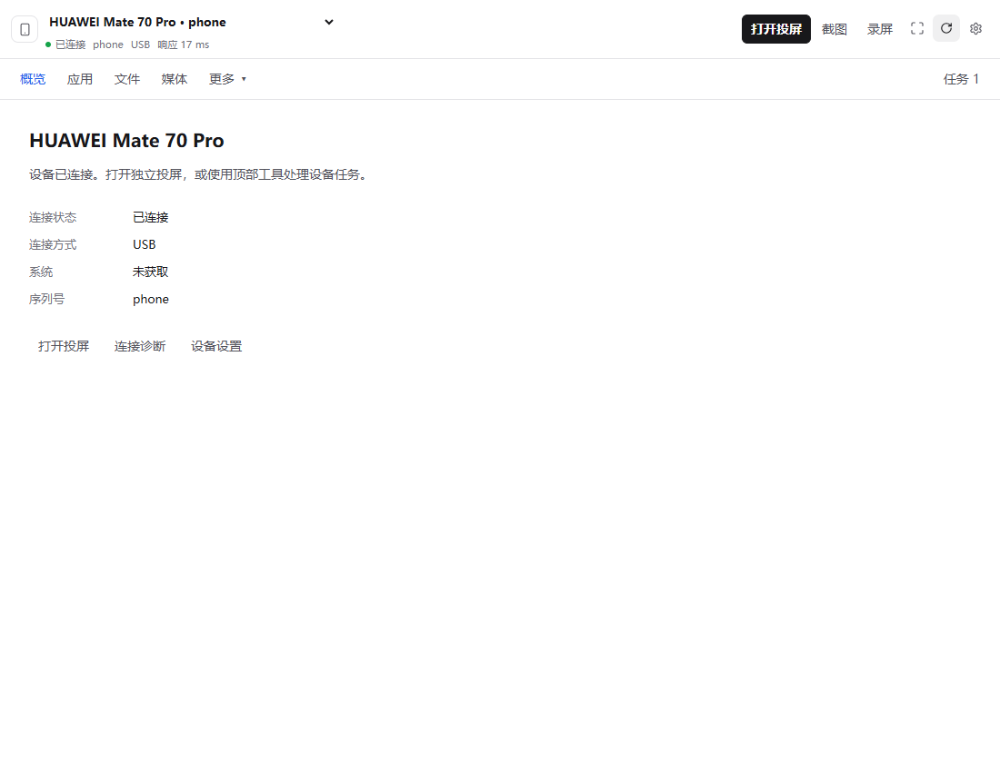
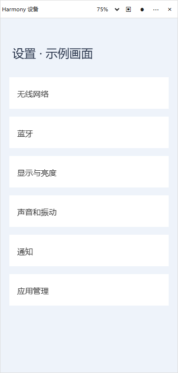
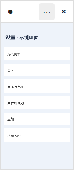
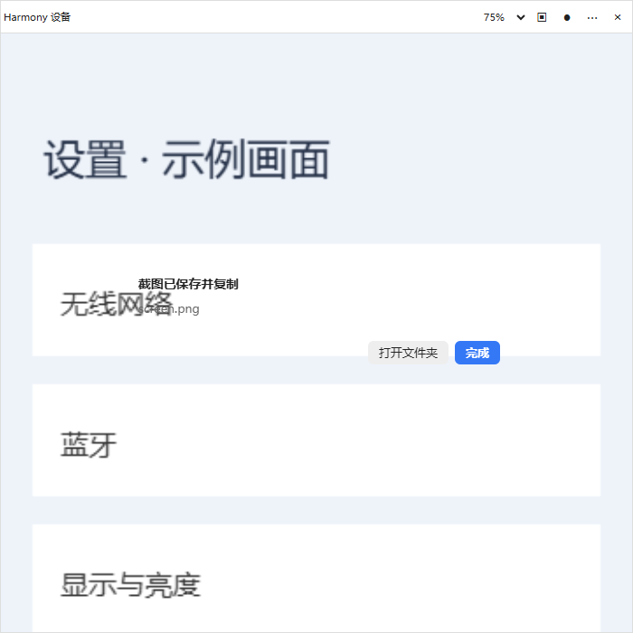

# 鸿蒙设备设计与实现截图

## 用户确认的方案预览

以下是原有 imagegen 设计图，保留用于对照，不作为实际 UI 截图或缩放尺寸依据。

- [工作台和独立投屏](approved-workbench.png)
- [缩放方案](approved-scales.png)
- [通用提示](approved-messages.png)

## 已实现组件

以下通过真实 React 组件和 CSS 的 Playwright 夹具生成，手机画面、设备和文件数据为测试示例。它们展示实现布局，不是连接真实手机或原生 Electron 外窗的验收截图。

| 75% 投屏组件 | 25% 投屏组件 |
| --- | --- |
|  |  |

- [文件三栏](implemented/files-three-pane.png)
- [数据库](implemented/database-workspace.png)
- [SQL 结果](implemented/database-results.png)

尺寸公式由主进程决定；图片像素尺寸不代表所有显示器的实际 DIP 大小。窗口运行截图、真实设备录屏与性能记录待有手机连接后补充。

实现说明：[工作台与投屏](../../harmony/workbench-and-mirror.md)。验证结果：[验收记录](validation.md)。
