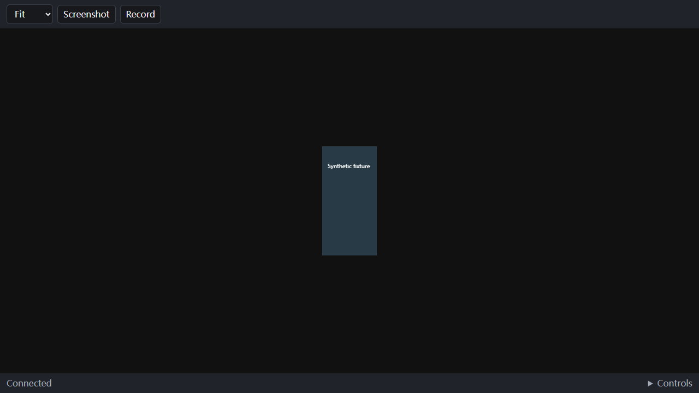

# Minimal Harmony mirror

The default workspace mounts `MirrorPanel`, not the retained legacy workbench. It automatically selects a single online device; once selected, disconnection never silently selects another phone. The normal toolbar contains zoom, screenshot and recording controls. Multiple devices add a compact selector. Recording disables device switching until the session is stopped/saved. The on-demand Controls area contains standard/fluent selection, navigation, supported physical-key holds and semantic text submission.

This screenshot uses the production panel/CSS and mocked device/video hooks. It is UI evidence only, not real-device or performance evidence.

## Capability boundary

`lib/harmony/mirror-mode.ts` permits discovery, authenticated metadata, video/frame/geometry, media, manual input ownership and bounded direct input. Tool routes (logs, terminal, files, databases, scenarios, audio and associated jobs) reject new requests by default. The Harmony Agent extension registers no tools in this mode. `PIORA_HARMONY_WORKBENCH=1` is an explicit developer compatibility setting for retained backend tools and their tests; it does not switch the visible page back to the legacy UI. Apply mode changes by restarting the service so existing subscriptions are not left running under an old module. No user histories, recordings, transfer data or phone media are deleted.

Device polling and recording-state polling are serial, abortable and active-panel scoped. The mirror page does not mount history, log or tool components. Input leases are acquired only for user input, not viewing, screenshots or recording. Media operations use their own pending state and exact recording owner/ID.

## Connection, authorization and first use

Connect an HDC-authorized device, unlock it yourself and start/authorize the Piora screen-sharing component on the phone. A missing component must be prepared manually using the existing documented setup process; this page does not install, update, wake or unlock a phone. It shows connection/authorization failures and retries after readiness changes. No new component-install button is included.

The default action allowlist also rejects `initialize_mirror`; the existing installer action is retained only behind the explicit workbench compatibility boundary. This change does not grant installation permission.

Native binary H.264/WebCodecs remains primary. Standard mode uses the existing bounded screenshot endpoint. Automatic fallback keeps refreshing while one bounded native probe runs; valid configuration alone does not replace the displayed fallback. The first decoded keyframe completes the handoff and cancels fallback polling. Failed probes are cleaned before retry; teardown fences both pumps by device generation and attempt. Reconnect delay is capped at two seconds, inside the current five-second phone absence grace. Socket setup and first-frame budgets still apply, so this is not a guaranteed two-second recovery deadline. This short overlap does not start a second native encoder.

A device generation change fences old requests, pixels and controls. A fresh codec configuration invalidates old geometry even when its dimensions match; decoding waits for a fresh matching keyframe. The 15-second fresh-pixel watchdog remains: static-display behavior needs real-device validation before changing its semantics.

Standard mode intentionally closes its video subscription. If no other video/recording subscriber remains for five seconds, the phone's consented native capture can stop. Returning to fluent mode can then require the user to start/authorize phone sharing again; the host does not bypass this permission boundary.

## Capture and backpressure

Preview and stream recording open separate transport subscriptions to the existing phone broadcaster. This is not evidence of two ScreenCapture instances. This change does not introduce a `ReadableStream.tee()` broker. Each subscriber keeps its own cancellation and resource boundary.

Phone **source changes**, not a deployed component: a preview GOP exceeding the 500ms queue-age policy is compacted at whole-packet boundaries, restoring current configuration and waiting for IDR. Partially transmitted bytes and control/status packets remain intact; byte/packet hard caps remain. Recording sends control `0x44`; a compatible component acknowledges `0x21` with byte `1`, requests a fresh IDR, and disables preview-style GOP dropping for that subscriber. A recording subscriber exceeding the hard cap is closed instead of silently dropping encoded samples. Stream recording requires that acknowledgment within one second and fails with an explicit manual-update message on old components. Preview remains compatible. Huawei system recording remains the existing first choice and is unaffected by this negotiation. The optional HOS preview transport is not used for the newly isolated stream-recording path.

The current native helper tests execute the production queue and codec helpers. They do not prove a newly built HAP, the full phone server, permission equivalence or physical device behavior. No DevEco code/binary is reused. Its static 500ms buffered-delay configuration is inspiration for a queue budget, not an end-to-end latency benchmark.

## Recording outcomes and recovery

Recording begins only after encoded-frame confirmation. Duplicate start/stop is fenced independently from input and screenshot work. A lost response is reconciled through media state, never by blindly repeating a phone recorder toggle. Unknown system-recorder state remains retrieval-only after the user stops it on the phone. Closing/hiding preview does not intentionally stop the server-owned recording.

Recording-state reads are fenced against mutations that start or settle after the read was issued; a late pre-start/pre-stop snapshot cannot undo a confirmed result. Fresh reads after timeout still reconcile uncertain operations. Screenshot ownership is scoped to the selected device/generation and individual request: another device need not wait, old completions cannot release a newer request, and switching view mode on the same device preserves its visible busy state.

State reads have a 15-second request budget, other device requests 25 seconds, recording start 30 seconds and stop/retrieval 180 seconds. A half-open request therefore releases its pending UI state; subsequent polling reconciles the server's current phase, including a queued start whose recording ID is not yet public. These are host request budgets, not guarantees of device completion or permission to repeat an ambiguous command.

The existing two-minute, 256 MiB and frame limits remain. Dimension/codec changes end the recording at the existing complete samples; uninterrupted rotation and automatic long-recording segmentation are not implemented. On transport/configuration failure, the stream recorder attempts to finalize those samples. Successful partial recovery is reported as interrupted, not successful recording. A failed copy/finalization retains the owned temporary file and reports whether it finalized; an unfinalized MP4 is not promised to be playable or repairable. The outcome journal retains that recovery path across service restart. The UI shows the exact path and offers copying it for manual recovery; it does not browse arbitrary local files, automatically retry disk writes, or delete the retained file. Temporary-file retention does not guarantee protection against operating-system cleanup.

Automatic limit stops and background failures are surfaced by metadata-only media polling. A successful stop is shown only after the backend finishes saving; clipboard/path copying is a separate outcome. A process crash during muxing still needs a future durable incremental recording/recovery design.

## Input coverage and remaining acceptance

Implemented host-side: point click, a bounded completed drag gesture, Escape/Enter navigation on the focused canvas, on-demand Back/Home/Recents, capability-dependent calibrated power/volume holds, semantic whole-text submission, zoom, standard/fluent view selection, expand/restore, screenshot shortcut and recording.

Not implemented or not validated: continuous low-level mouse down/move/up streaming, arbitrary desktop keypress injection, full Chinese IME composition on the remote field, uninterrupted long/rotating recordings, device audio, multi-screen concurrent UI, or all emulator combinations. Text submission can send Unicode as one semantic action; this is not full remote IME support. Physical-key controls retain the existing calibration requirements and may explicitly reject an unsupported device.

Before release, build/sign/update the phone component through the established release pipeline and explicitly authorize hardware testing. Validate USB reconnect, lock/authorization cancellation, rotation, slow preview versus recording, disk failure/recovery, static and moving screens, and long-session resource counts. This draft does not claim zero failures or measured superiority to DevEco.
