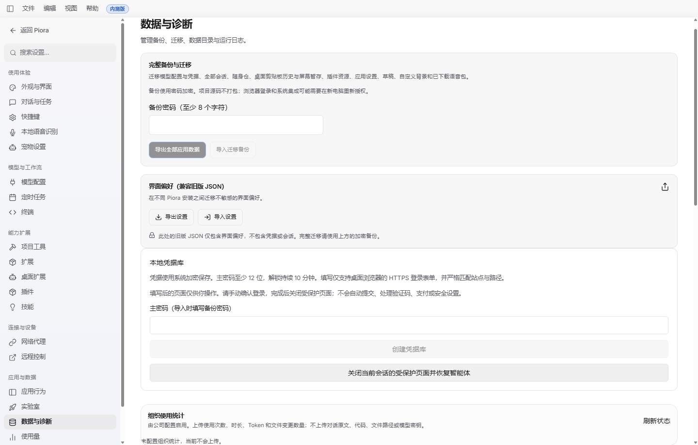

# Windows 组织使用统计

配套后端为独立私有仓库 [piora-analytics](https://github.com/kexijiang/piora-analytics)。其中包含需求分析、成熟方案比较、51 个 API 的 OpenAPI/字段示例、29 表 PostgreSQL 设计、React 管理看板和 10 张 UI 图。

## 启用范围

只有企业显式在 %LOCALAPPDATA%\Piora\telemetry\config.json 配置 enabled=true 与 HTTPS backend_url 才启用。首次注册还需 enrollment_key，随后使用本安装凭证。普通用户没有配置时不采集、不上传。

~~~json
{"enabled":true,"backend_url":"https://analytics.example.com","enrollment_key":"由企业安全分发，不能提交到仓库"}
~~~

后台地址只接受 HTTPS origin；不接受用户名/密码、查询字符串或任意路径。配置变更后重启客户端。设置 > 数据 > 组织使用统计显示队列、上次成功、下一次同步和错误码；不向 renderer 返回接入密钥或安装秘密。Windows 用户名只用于管理员匹配员工，不能用 C:\Users 文件夹数量或重名账号推算人数。

## 实现入口

| 文件 | 责任 |
|---|---|
| desktop/src/analytics-store.mts | SQLite WAL/FULL、安装 UUID、事务序号、稳定事件键、白名单、ACK/隔离/容量清理 |
| desktop/src/analytics-uploader.mts | 异步 Electron safeStorage/Windows DPAPI、注册与轮换、持久同步时间、网络退避 |
| desktop/src/analytics-desktop.mts | 5 秒采样、每分钟合并、前台/空闲/锁屏/休眠、明确唤起 |
| lib/analytics-telemetry.ts | Query journal、run、provider stream、内置 write/edit、恢复与上下文 |
| lib/session-control-store.ts、lib/room-store.ts | 在业务数据持久写入后计数；群聊人工根消息只记一次 |
| lib/prompt-run-registry.ts、lib/rpc-manager.ts | 任务身份/结束、异步上下文、工具重载后重新安装观察器 |
| instrumentation-node.ts | 每分钟补扫启用后的命令 journal，重启恢复 pending 调用 |
| lib/analytics-status.ts、app/api/analytics/status/route.ts | 本机只读摘要，继承现有桌面/同源 API 认证 |
| components/OrganizationAnalyticsSettings.tsx | 组织统计状态与采集范围说明 |

API/Worker 与客户端事件契约在后端仓库维护。客户端只上传统计元数据：人工 Query、冷启动/明确唤起、非休眠运行时长、前台活跃时长、任务/模型调用和 Token、文件工具落盘行差异。提示词、回复、代码、diff、文件路径和模型密钥不上传。

## 同步与恢复

- 每轮在后台保存的间隔范围内独立随机，默认建议 25–35 分钟，可设置任意正整数分钟，不再限制 25/35/120 分钟。只校验正值、顺序和可表示的安全时间范围；长间隔分段计时，避免系统定时器溢出。首次 1–5 分钟，休眠恢复 2–10 分钟，网络错误指数退避和抖动；没有逐 Query 网络上传或整点全员同步。
- 每次注册/上报携带 X-Piora-Capabilities: configurable-sync-interval 声明新策略能力；后台对未声明能力的旧客户端下发其可接受的兼容范围。无需重置已有安装 ID 或重新注册，升级后下一轮上报即可获取自定义范围。
- 单批最多 500 条/256 KiB；每轮最多 5 批，批间 10–30 秒，剩余积压延后 5–10 分钟。
- 本地默认保留 30 天/256 MiB；超限丢最老数据并报告缺口。只在完整、无陌生 ID 的服务端 ACK 后移除本地事件。源键 receipt 默认保留 90 天，避免 journal 重放重复。
- 设备秘密先 DPAPI 持久保存再请求注册/轮换，注册响应丢失仍保有秘密；401/403 暂停上传并显示状态，不自动重新注册绕过撤销。
- 组织暂停后保留已排队数据，新的业务源键被标为抑制，避免恢复后从 journal 回填暂停期间的提交。继续常规低频健康请求读取恢复策略。
- 退出只写本地，不等待网络。崩溃后无法确认的模型/run 结果报告 interrupted 与 null，用量未知不伪造零。

## 指标边界

人工聊天提交按持久 commandId 幂等；同一文本再次提交新 ID 算新 Query，模型重试不增加人工 Query。群聊根消息与子命令分开，多个模型/Agent 扇出仍只增加一个人工 Query。Steer 的实际消耗无法确认时 query_id 为空并报告质量码；群聊根消息暂不推断所有分支的统一终态。

Windows 新设置的开机自启携带 --piora-autostart，自动启动不增加手动打开次数。已有无参数自启项继续显示启用；未带来源参数且旧自启项存在、或系统配置读取失败时，仅计冷启动并标 STARTUP_ORIGIN_UNKNOWN，不猜测成手动打开。重新启用自启后使用新标记；不依赖 macOS 专属的 wasOpenedAtLogin。

NSIS 安装或更新后以 --updated 自动拉起时记为 update，只计冷启动，不增加手动打开；二次进程携带上述自动启动标记时同样不会增加手动打开次数。

模型在实际 provider stream 边界计数；普通输入、输出、缓存读取、缓存写入按 SDK 非重叠桶累计。全零默认值不能确认是供应商真实报告时标 unknown。辅助模型入口已接入；压缩/自动任务等没有专属上下文的调用归为 system，真实供应商覆盖仍需试点核对。

代码只计内置 write/edit 实际 execute 前后读取的文件；配置、文档单列。>2 MiB、二进制、读失败、并发漂移和工具失败标不可计量。shell/MCP/外部编辑器不保证覆盖；文件数/行数不是最终 Git 接受量。活跃时间为 5 秒采样估计，后台任务、锁屏和休眠不算前台活跃；服务端对同员工多设备活跃区间取并集。

行差异还受 50ms 搜索预算和 4,000 编辑长度上限约束；大幅重写超过预算时仍保留文件工具成功结果，统计标 too_large、行数 null。预算不含文件读取和分词，不能把它解释为整个工具的 50ms 延迟保证。回归测试覆盖 20,000 行完全改写及其后的正常计量。

## 验证与后续上线

~~~powershell
node --test lib/analytics-telemetry.test.mjs lib/prompt-run-registry.test.mjs lib/session-control-store.test.mjs
node scripts/test-organization-analytics.mjs
node scripts/test-organization-analytics-ui.mjs
node_modules/.bin/tsc --noEmit
node_modules/.bin/tsc --noEmit -p desktop/tsconfig.json
~~~

新测试覆盖持久/幂等/ACK、队列限制、抖动、失败补传、暂停、未知 Token、群聊去重、provider 观察器、真实文件前后 diff、重启未知终态；原生测试运行真实 Electron、SQLite 和 Windows DPAPI，电源事件是注入夹具。没有把它描述为真实睡眠/锁屏操作或安装包验收。

14 项采集测试及 50 项会话/任务相关回归已通过。首轮完整 CI 发现生产 Webpack 未处理共享 .mts、旧启动/托盘/模型采样测试夹具缺少统计依赖；已增加编译规则、更新夹具且保留原有断言，并补测共享模块的真实 Webpack 编译与 SQLite 重开、统计模块导入/初始化失败、Windows 自启来源识别。本轮 55 项定向复测、根与 desktop 类型检查通过。Webpack 测试仅编译单模块夹具，不执行 next build 或安装包构建。

第二轮 CI 六个 Windows 测试分片与生产构建通过；独立包校验发现扩展的源码加载路径缺少 diff 和共享存储文件。已补齐 standalone 清单，并通过 16 项打包相关定向测试：隔离目录故意省略 diff 时失败、补齐后成功，实际 Electron 从 ASAR 测试夹具加载统计模块也通过。完整安装包不在本地构建，最终验证交给后续 Actions。

另已在真实开发 Electron 中通过设置导航、未配置状态、刷新和重载检查，未发生 renderer error。报告：.verification/desktop-e2e-czepTB/report.md（含完整状态卡截图复测）；首次成功记录为 desktop-e2e-mCYUsq。前两次启动因 worktree 共享依赖超出 Turbopack root 而中断；成功复测临时按当前 Next.js 文档配置 additional root 指向共享依赖，结束后已恢复 next.config.ts。没有修改主工作目录或在其中运行开发服务。

本次不在主开发目录运行 next build、不构建发布包、不启用现有用户统计。上线仍需部署后端、企业安全配置、5 台试点及 GitHub Actions Windows 发布。
