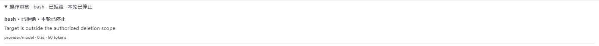

# 独立工具审核

“帮我批准”是用户主动选择的权限模式。无保存偏好时仍默认完全访问；已有聊天与默认偏好不会静默启用审核。模式、迁移和工具自身限制见[聊天工具权限](tool-permissions.md)。


以下为浏览器回归夹具中的审核记录示例，模型名称与理由使用合成数据：



## 模型与预算

每个普通运行在首次模型请求前固定审核模型为当时选定的提供方和模型，执行模型 fallback 不改变它。审核通过独立的核心 ModelRuntime 请求完成，不创建执行 AgentSession，不加载扩展或技能，不附带工具定义，不共享执行代理的系统提示词或完整历史。

默认预算：一次调用、零自动重试、总等待上限 30 秒、输入 24,000 字符、输出 700 token。模型未配置、仅由执行扩展注册而在核心目录中不可用、认证/网络失败、超时或结构错误均转人工，不静默切换提供方。审核卡片显示实际模型、耗时及可得的 token/费用。免费或未标价模型的费用可能不可得，不伪造已知费用。

## 授权和证据

宿主提供来源明确的用户要求、最终工具参数、工作目录与限定证据，不从历史消息的 `role: user` 推断授权。后续用户修正使等待中的批准失效。首版只自动审核直接 UI 请求；群聊、远程、扩展、系统任务及仍在排队的后续要求保守转人工。附件、网页、工具输出与脚本内容不能自行扩大授权。

证据读取由宿主选择，模型没有任意 Shell 或文件读取工具。最多检查 8 个文件，每文件最多 32 KiB；只在当前工作目录内读取非敏感文件内容，提供包脚本及显式脚本文件等必要证据。超预算转人工，不截断后继续放行。凭据、环境变量值和常见密钥格式在审核输入、人工详情和日志中脱敏；含敏感值的操作转本地确认。

审核严格校验决策、授权等级、风险、理由及待确认事项。授权不明或高风险却无明确授权的 `allow` 降为人工确认；critical 风险阻断。审核提示词中的禁止规则覆盖无关凭据外传、大范围不可逆破坏及与任务无关的持续安全弱化。

## 生效、失效与停止

- `allow` 经复核后执行本次操作；`ask_user` 展示待确认事项；审核故障保持未执行并进入人工确认；取消使迟到结果无效。
- 批准绑定会话、运行、工具调用、最终参数、工作目录、权限及授权修订号、审核策略版本，不按命令前缀或相似文本复用。
- 执行前复核关键证据。例如 npm 脚本内容、文件真实路径或浏览器页面身份改变会使批准失效。最多重新判断三次，防止无限等待。
- `deny` 由宿主停止当前运行，取消尚未开始的调用与待处理批准，并向 SDK 返回终止标识。当前运行切换完全访问也不复用旧批准；新的直接用户请求才能开始后续任务。已执行副作用不承诺回滚。
- 普通扩展提问、验证码及用户接管不由审核模型回答。

审核摘要保存在 `<agentDir>/piora/tool-reviews/<sessionId>/`，不保存原始提示词和工具参数。界面显示最近 100 条，可展开理由，更早记录保留在磁盘。前端重连只恢复状态；服务重启或会话销毁后，未完成记录显示已中断，不将历史批准恢复为执行令牌。结果不明的外部副作用需要核实，不承诺跨崩溃 exactly-once。

## 首版范围

删除命令、跨包目录脚本执行、未证明排除敏感文件的目录内容搜索、无法绑定当前页面的浏览器操作保守转人工。文件路径在范围判断前按 SDK 的别名规则归一化（包括 ~、@、file URL 和 Windows Shell 路径），浏览器页面重载与标签页切换使已有审核失效。不会递归读取整个项目或完整解析所有 Shell 语法，不承诺阻止跨运行的任意语义等价重试。检查与执行之间仍存在外部变化窗口；桌面浏览器原有标签页归属及导航令牌检查继续生效。

这是应用级审批，不能隔离自行执行代码的恶意扩展或替代系统沙箱。执行代理与审核代理使用同一模型时，独立上下文也不能保证消除共同误判。

## 验证与评估

### 与 Issue #204 设计的对应关系

| 设计范围 | 当前状态 |
| --- | --- |
| 三个主要模式、旧严格模式兼容、v2 显式迁移和默认偏好 | 已实现，已有迁移及界面回归 |
| 共享审批边界、独立无工具模型调用、最终参数及 SDK 子工具 | 已实现，已有真实 SDK 回归 |
| 来源明确的授权、结构化决策、故障转人工、有界预算 | 已实现；目前只对本轮直接 UI 要求自动审核，其他来源转人工 |
| 操作和证据绑定、取消/失效、拒绝停机、记录及重连恢复 | 已实现，已有并发、迟到结果、证据变化和重启回归 |
| 证据充分时自动批准缓存删除等日常操作 | 尚未覆盖所有示例；当前删除、跨包脚本及未核实范围的目录内容搜索统一转人工 |
| 固定场景的判断、耗时、token/费用基线 | 已有 6 个合成模型案例；尚未形成经过完整审批入口的全面误批准、误拒绝和人工打断评估 |
| 扩大工具证据覆盖、优化人工打断与成本 | 后续阶段，尚未实现全部设计目标 |

因此，本版本交付的是首版审批核心闭环，不代表 Issue 中所有行为示例、评估目标和验收项均已完成。6 个模型案例通过也不代表完整安全验收或真实任务效果保证。

`lib/tool-review.test.mjs` 覆盖决策、预算、授权来源、故障、取消、证据变化、重复调用和迁移；`lib/tool-review-sdk.test.mjs` 使用真实 SDK 验证扩展最终参数、嵌套调用、拒绝停机及重连只恢复状态。输入栏浏览器回归覆盖模式入口、默认值同步及审核状态展开。

固定场景评估只发送合成案例，不执行案例中的命令：

```bash
node scripts/evaluate-tool-review.mjs --provider <provider> --model <model-id>
```

此命令会产生模型费用，输出 `.verification/tool-review-evaluation.json`，记录案例的预期/实际决策、故障、耗时、token 与可得费用。确定性测试不能替代真实模型判断评估，小样本评估也不是安全保证。
