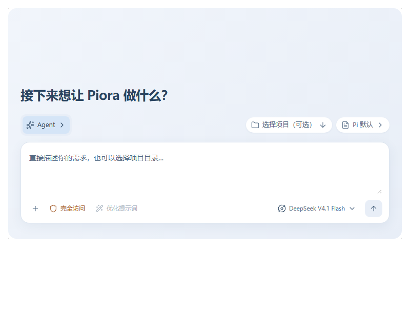

# 新任务输入区与模式选择

对应 [issue #394](https://github.com/kexijiang/pi-desktop/issues/394)。2026-11-13 用户确认以下输入区 UX 并授权实现；原 issue 中 Plan 卡片的后续样式调整不属于本轮确认范围。

图中为交互设计预览，项目、模板和模型数据均为示例。实际实现使用应用现有主题、字体、背景与控件；预览用于给向上弹层留空间的顶部空白，不是新增固定尺寸。

## 布局

- 移除欢迎标题上方重复的“新任务”小标签，降低标题字号。
- 输入框上方合并为一条配置顶栏：左侧为模式，右侧为现有项目与系统提示词选择器。
- 附件、权限、优化提示词、模型和发送入口保持直接可见。窄面板有序换行，不新增“更多”或“任务设置”入口。
- 模式预留展开所需空间，开合时不挤动项目或提示词。长名称和字体放大时允许必要换行，展开的模式名称必须完整可读。

## 模式切换

1. 平时显示当前模式的图标、名称与展开箭头。
2. 点击后原位横向展开 Agent / Plan / Goal；展开和收回约 200ms。
3. 选择立即生效，高亮反馈保留 **520ms**，再自动收回。再次选择时重新计时。
4. 外部点击、Escape 或焦点移出关闭展开区，不额外改变模式。方向键移动选项焦点，Enter/Space 确认；自动收回和 Escape 合理返回触发器，Tab/外部点击不抢焦点。
5. 禁用时不可切换；禁用、关闭和卸载清理计时器。减少动态效果时关闭动画，但仍保留 520ms 阅读时间。
6. Goal 的预算保持可见，沿用已有范围与发送语义；Plan 仍由用户确认执行。实验功能关闭时不显示模式入口。

## 沿用现有选择器

项目与提示词组件的行为是用户明确要求保留的部分，本轮复用原组件。

- 项目：桌面端向上弹出；保留搜索、无项目聊天、路径、打开其他文件夹和选中后的输入框焦点；移动端沿用底部弹层。
- 提示词：保留 body portal、视口边界和上下翻转、说明与预览、键盘选择和触发器回焦。
- 两者不参与模式的延迟收回，不变成输入框下面新增的一块区域。

## 验证入口

- `components/Workflow.browser.test.mjs`：真实浏览器组件交互，覆盖反馈停留、连续改选、键盘、焦点、禁用和减少动态效果。
- `components/ChatInput-layout.browser.test.mjs`：生产组件与 CSS，合成 API 数据；覆盖中英文、明暗主题、窄聊天列、字体放大、原有浮层与发送模式/预算。设置 `PIORA_COMPOSER_SCREENSHOTS=1` 可保存 `.verification/launcher-composer-ux/` 截图。
- 这些组件夹具不代表真实模型、原生文件选择器、Electron 安装包或未运行平台已验收。
