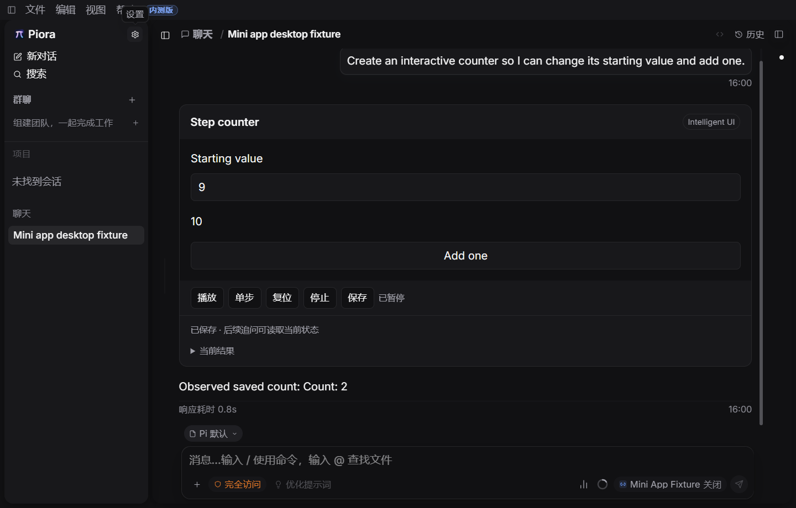
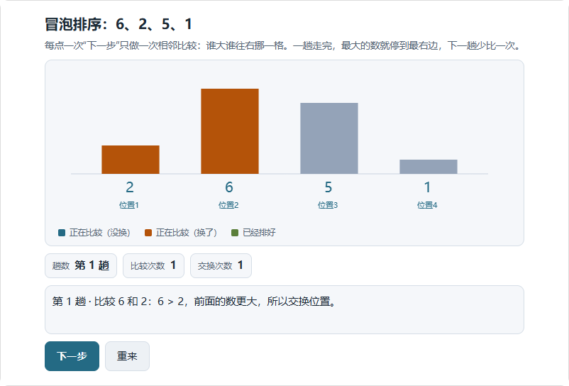

# 第三阶段：外观同步与真实生成验证

2026-10-31 | 3B 实施进展 | 第三阶段尚未完成

## 1. 本批交付

小程序与只读预览现在跟随宿主的深浅色、字号、字重和字体。外观通过固定消息同步，不重建 Worker，不重置输入、随机种子或进度。本地 Inter 字体由宿主读取固定资源后传递字节，隔离页面仍禁止网络与任意字体地址。像素字号按 16px 设计基准转换为 rem；几何尺寸保持不变。

补齐常见语义标记、有界绑定属性 CSS 选择器、font:inherit、字距及普通字符串正则解析。HTML/CSS 支持清单由编译器与模型提示共同引用，没有放开任意脚本或外部动作。

实际 SDK 请求确认公共选择规则只出现一次。SDK 已有去重，本批没有增加新装配机制，并修正了 v3.5 最初的判断。

### Windows 开发桌面

固定模型场景通过 9 步：启动、开启 Beta、生成、操作保存、主题字号切换、刷新、追问、关闭 Beta、重新开启。通过真实设置页与小程序控件操作，页面错误和清理错误均为 0。输入 9、结果 Count: 10 在外观切换与刷新后保留。

上图来自真实 Electron 开发窗口，模型为本机固定夹具。它证明外观与恢复流程，不代表真实模型生成质量或发布包验收。

<!-- pagebreak -->

## 2. 真实模型失败、修复与复测

配置为 deepseek/deepseek-flash，名称 DeepSeek V4.1 Flash，未调用 V4 Pro。服务返回 deepseek-flash，未返回独立的 4.1 发布标识，因此记录“配置名称已核对，服务返回别名”。仅发送隔离环境中的合成任务，未加载文件、Shell、浏览器或外部动作工具，未复制用户凭据。

任务：“冒泡排序我没看懂。拿 6、2、5、1 这几个数，让我一步步点着看它怎么排好，每一步告诉我在比较谁、为什么交换。”

| 试验 | 结果 | 后续处理 |
| --- | --- | --- |
| 首次，8,192 输出预算 | 全部输出用于推理，stopReason=length，没有答案 | 保留失败；后续独立试验用 32,768 上限，不改产品纠错预算 |
| 第二次，32,768 | CSS 属性选择器、header 标记被拒绝，之后预算耗尽 | 支持有界绑定选择器与常见标记；重放还发现并补齐正则运行能力 |
| 第三次，32,768 | font:inherit 被拒绝；纠错漏掉 purpose | 支持安全字体继承简写，明确纠错须重提完整计划 |
| 第四次，32,768 | letter-spacing 被拒绝；纠错又漏掉 purpose | 支持有界字距；编译器与提示引用共用清单 |
| 第五次，32,768 | 首次工具调用成功，发布 committed | 2 次模型请求、1 次工具调用、0 次纠错，进入实际输出交互核对 |

五次是修改过程中的开发试验，不能当成同一版本的重复样本计算成功率。前四次均未发布小程序；早期探针的 completed 只表示请求结束，本报告按实际输出与发布记录判为失败。

探针记录请求、参数、诊断、输出和发布。低推理强度，最多 4 次请求，无自动模型重试或替换。产品内 3 次接纳、1 次纠错及时间窗口继续共用。

### 首次失败及夹具修正

SDK 新断言首次读取旧式 context.tools 失败，已改为核对系统消息 toolsAdded；公共规则只出现一次的断言保持。桌面首次遗漏进入字体页签，修正为真实导航后通过。浏览器夹具首次资源路由与哈希字段不匹配，修正后另存复测结果。离线重放的早期命令调用名、启动参数错误未计作产品检查通过。

<!-- pagebreak -->

## 3. 真实模型输出的独立核对

将第五次发布的原始计划交给生产 MiniAppController、Worker 与 iframe，通过浏览器实际点击。HTTP 服务和恢复检查点属于隔离夹具，未把模型程序直接作为浏览器 JavaScript 执行。

| 比较次数 | 独立预期数组 | 实际 |
| --- | --- | --- |
| 1、2 | 2,6,5,1；2,5,6,1 | 一致 |
| 3、4 | 2,5,1,6；2,5,1,6 | 一致，第四次不交换 |
| 5、6 | 2,1,5,6；1,2,5,6 | 一致，总共交换 5 次 |

元素不丢失、完成后再点不推进、重置与检查点恢复均通过。本图只展示小程序；原始报告另保留带夹具按钮的全页截图。

**仍有已验证问题：宿主“单步”只推进 tick，没有推进排序。** 模型将推进逻辑放在 reduce 的按钮事件中，advance 是空操作。需统一离散过程与宿主控件契约，或明确哪些控件适用；本任务尚不能记为完整交互验收通过。

<!-- pagebreak -->

## 4. 检查范围与后续任务

| 检查 | 结果与边界 |
| --- | --- |
| 相关自动检查 | 27 / 27：编译、QuickJS、服务器试运行、实际 SDK、浏览器渲染与控制器 |
| TypeScript / ESLint | 类型检查通过；本批 14 个模块、探针与场景 lint 通过 |
| Windows 开发桌面 | 9 步通过，固定模型外观及恢复；之后扩展的 CSS 属性由相关测试核对 |
| 真实模型 | 当前版本一次生成发布成功，单一开发任务，不能推断泛化率 |
| 实际输出 | 六步与独立预期一致，重置/终态/内存恢复通过；宿主单步问题保留 |

主要命令及完整源码摘要另存同名 JSON：

- node --test lib/mini-app-runtime.test.mjs lib/mini-app-server-trial.test.mjs lib/mini-app-document.test.mjs lib/mini-app-generation-runtime.test.mjs lib/mini-app-renderer-browser.test.mjs lib/mini-app-controller-browser.test.mjs
- node_modules/.bin/tsc.cmd --noEmit
- node scripts/run-desktop-e2e.mjs --scenario intelligent-ui-mini-app --timeout-ms 600000 --step-timeout-ms 60000
- node scripts/probe-mini-app-generation.mjs sorting 32768

### 尚未完成

下一批优先处理宿主控件与程序语义一致性，完成首批 8 个自然语言任务的固定版本重复验证。继续推进能力验证开放、完整恢复、草稿分页、迁移与动作、动态列表、拾取/相机、持续模拟及三维教学。Canvas/三维语义色、完整字号布局、无障碍和性能仍需专项验证。

人工语义验收与完整 CI 留到三阶段开发完成后。本批没有提交、推送、完整 CI 或本地发布包构建，不代表第三阶段完成。

### 证据位置

专用 worktree 为 C:/Users/shengjiajun/.codex/worktrees/intelligent-ui/Piora，分支 codex/intelligent-ui，HEAD b41fa2ffd33f2b603a7863b3ea7d3c2e958e9146，含未提交修改。已有成果保留。

- 当前日志：.verification/phase3-appearance-generation-current.log、phase3-appearance-typecheck-current.log、phase3-appearance-lint-current.log。
- 桌面：desktop-e2e-R9OEFU 失败、desktop-e2e-N1H3Gf 复测通过，各有 result.json、截图和清理状态。
- 真实模型：mini-app-live-2PJTPa、NroUSL、uNwq5S、17R6q9、1uNRvv；最后一个为当前成功生成证据。
- 实际输出：.verification/phase3-live-sorting-browser-v2/result.json，含六步数组及 hostStepChangesAlgorithm=false。
