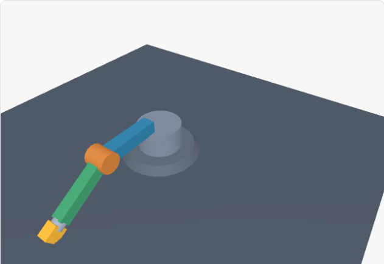

# 第三阶段：机械臂泛化与界面读数

2026-11-03 · Windows 开发桌面 · 第三阶段尚未完成 · 本批未提交

## 当前界面算出的结果，现在能进入模型上下文

本批用自然表达生成两节机械臂：底座左右转、肘部上下折，点选部件、绕着观察，并能一起回到起点。首轮 Fc48Tc 一次工具调用发布成功，但模型声称归零后末端高度为 1.53 米，实际界面显示 0.88 米。原上下文主要包含参数、状态和摘要，缺少摘要未覆盖的计算读数。

新增 projectionText：从已编译文档声明的 data-text 绑定提取当前投影文字，保留数值和单位。初次试运行回执明确尚未保存；后续解释使用当前确认检查点的投影。同一绑定只出现一次，不混入 SVG 属性、未声明值和动态列表行数据。

每个应用最多 32 项，每项最多 1000 字符，序列化后最多 2000 字符；超限整项省略并计数，不截断数值或单位。后续上下文仍受原有 11000 字符总预算限制，不增加模型调用。绑定文字只是程序计算的值，不能证明公式正确或元素实际可见。策略版本更新为 mini-app-intent-26。

| 验证 | 结果与边界 |
|---|---|
| 完整能力 | 1Ceb9F：60 个文件，535/535 通过；14 项能力证据更新 |
| 定向检查 | 19/19 通过，与完整能力检查重叠，不累计 |
| 静态检查 | 仓库 tsc 入口、定向 ESLint、运行器语法、差异检查通过 |
| 来源核对 | 518 个桌面来源、176 个能力来源以及运行器摘要一致 |
| 真实重放 | LKVV1e：7 组姿态、70 项几何断言、14 个检查点、13 次显式 UI 保存、1 次刷新 |
| 交互 | 2 次实际点选、2 组相机按键、1 个归零预设；无页面、运行或清理错误 |
| 模型 | DeepSeek V4.1 Flash 配置，deepseek/deepseek-flash，任务思考开启，无 Pro/回退 |

首轮完整任务未通过：测试默认选中第一个非空对象“工作面”，该程序明确把工作面点选解释为取消选择。现允许在重放绑定中明确指定任务部件 foreArm，断言仍要求准确选中；不自动尝试其他对象直到成功。运行器新增独立追问文件，避免其他对象沿用飞机措辞。原始失败保留，重放不作为新生成成功率证据。

<!-- pagebreak -->

## 独立几何成立，生成的附加假设仍有反例

从原始计划读取尺寸和轴约定，用独立关节链方程核对：底座绕世界 Y 轴，肘部绕父级局部 Z 轴；肘部半径为 1.6、高度为 0.88，夹爪端面中心沿第二节臂方向距肘部 1.65。预期值不调用生成程序的 project、Three.js 或产品变换函数。

核对归零、底座 90°、肘部 90°、两关节均 90°、底座 -90°/肘部 -30°、45°/60°和再次归零。每组检查八个点及两个有正负方向的单位向量，覆盖固定基座、肘部连接、前臂端点和夹爪。最大误差约 4.97e-16，小于 1e-7 容差。

上图是原样程序的真实画布。生成说明称肘部下限 -30° 可防止末端穿地，但夹爪下沿的采样点 Y=-0.074904，工作面 Y=-0.01，已穿入约 0.064904 个场景单位。该点的变换计算正确，恰好构成附加假设的反例；不能把全部几何断言通过解释成模型的全部描述正确。

样本使用浅色主题，场景、部件颜色和控制区可辨识；这不是深色、窄屏、减少动画、长期资源稳定或其他 GPU/平台的完整验收。原始归零画布另保存在同目录的 arm-home 图片中。

<!-- pagebreak -->

## 真实追问改善了当前读数，整体语义仍未通过

重放原始程序后，模型收到四项当前文字，实际上下文为 5020 字符。最终选中夹爪、两关节均为 0°、读数为 0.88 米。模型正确回答这些事实，并主动纠正此前的 1.53 米。这个样本证明新上下文已送达且被使用，不能外推为普遍正确率。

| 回答要点 | 独立核对 |
|---|---|
| 当前值、对象和镜头距离 | 0°/0°、夹爪、0.88 米和约 6.48 场景单位均正确 |
| 保留的角度变化 | 两个参数分别列出的序列与保存记录一致；模型说明更早 17 条差异未知 |
| 高度范围 | 错将 120° 时约 2.31 米当作上界；范围内 90° 时实际达到 2.53 米 |
| 最近一次相机变化 | 误把相对默认值的方位差当作最新变化；实际最后保存的方位约 54.444° 不变，仰角从 37.685° 降至 22.685° |
| 最后一次角度归零 | 模型说两个关节同时归零；实际版本 31→32 只有肘部 -30°→0°，底座此前已为零 |

本轮最终状态版本为 33，保留最近 16 条确认保存差异、省略 17 条，最大持久历史 5999 字节。自动保存会合并多次输入事件；状态版本和差异条数不是用户点击次数。最后一条 32→33 的确只改变相机，但其高度也发生变化，不能用当前与默认的对比替代该条记录。

## 首次失败、复测和剩余任务

新增文字上下文测试首轮 1/2：夹具调用文档编译器时漏传必需选项，补齐后定向 19/19、完整能力 535/535 通过。首次类型检查误用了旧的 typescript/bin/tsc 路径；改用仓库声明的 node_modules/.bin/tsc.cmd 后通过。没有删除断言或放宽产品门禁。

本批生成程序保持原样，穿地假设、极值回答和历史归因仍需继续修复。3B 原始任务语义问题、3C 完整恢复/修订/动作/互转组合以及 3D 持续模拟、游戏和视觉/键盘/资源矩阵仍未全部完成。完整 CI、封存集和双人人工验收按用户安排延后；未运行 next build、本地发布包或其他平台验收。

已同步代码、中文 CHANGELOG、运行说明、脱敏 JSON、画布和本报告。本批未提交或推送，没有新增 CI 结论。原始模型回答、几何反例、保存记录和复测来源见[脱敏证据](intelligent-ui-phase3-arm-2026-11-03.json)。
