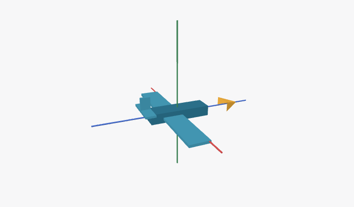

# 第三阶段成果：生成契约与场景恢复

2026-11-02 | 专用 worktree：intelligent-ui/Piora | 分支：codex/intelligent-ui

## 1. 本批改动

**工具字段现在直接说明受限程序和 CSS 的写法；场景恢复合并为一次有界启动操作。** 同一自然语言飞机任务在本批实测中首试通过校验并发布，随后发现加载限时与生成内容的语义问题。第三阶段尚未完成。

| 改动 | 实际作用 |
| --- | --- |
| 靠近字段的生成规则 | program 与 document.css 说明合法示例；当前运行上下文补充完整提交检查项 |
| 诊断给出修复方向 | 未知字段列出允许键；常量与 CSS 给出合法写法；网格错误精确到场景、对象索引及顶点数量 |
| 单次恢复操作 | 一次执行旧按键/拖动清理并投影；不重新 init 业务状态，不重复计算初始画面 |
| 发布前对象选择试运行 | 抽样选择与清空已声明对象，提前发现对象 ID 与选中状态约束不匹配 |
| 原始程序重放 | 从已有成功发布的记录复制到隔离桌面，保留原件摘要；只在追问时调用真实模型 |
| 追问证据范围 | 明确保存的是当前快照；恢复到默认值不能证明用户从未改动，镜头位置不能证明操作方式 |

规则适用于所有小程序任务，没有飞机关键词分支。模块顶层仍只允许原始值常量；CSS 仍只支持 200 至 1999 像素的顶层 max-width 媒体查询。自定义网格明确区分顶点、三角索引与多边形边界，给出四顶点的合法三角化示例，不自动改写几何。未知字段、非法代码和超限仍被拒绝；共同纠错次数与窗口没有增加。策略版本为 mini-app-intent-14，既有程序版本保持不变。

恢复原先先投影，再以普通事件清理焦点并再次投影；实际桌面加载捕获到 TIME_LIMIT。现在把清理和投影放在一次 restore 启动操作里，继续使用既有 200ms 启动限额。后续 restore、点击和步进仍遵守普通 8ms 限额；死循环仍被中断，宿主传入的其他事件不能冒充恢复动作。

## 2. 开发验证

相关能力检查 165/165 通过，24 个测试文件，最终证据目录 mini-app-capabilities-Lh2b8c。新增检查核对规则示例与真实编译器边界、未知字段诊断、恢复清理、输入/进度/镜头保留、后续操作不能续领启动额度、对象与选中状态匹配，以及网格诊断与合法三角化。TypeScript 通过；此前 17 个相关文件 lint 通过，几何改动 4 个文件、最后上下文与脚本 2 个文件分别通过。

选择试运行最多覆盖 32 个初始场景选择/清空事件，按视口分配并覆盖后部对象。各样本使用独立 VM，实际事件保留 8ms 限额，整体工作器仍受 5 秒上限约束；返回的发布检查点不受试验事件影响。这是有限抽样，不能证明所有输入和后续状态。

此前的 160/160、162/162 和 164/164 是较早快照，不与本批累计。一次直接运行契约测试因源码变化导致能力证据过期而失败；经正式隔离入口重新构建、验证并更新证据后，上述 165 项通过。完整 CI、两人独立语义验收、发布包及其他平台仍未执行。

<!-- pagebreak -->

## 3. 真实模型与原始桌面重放

任务仍是：“飞机的俯仰、偏航和横滚我总分不清。让我转一转飞机看看区别，也想点选飞机或坐标轴，换个视角观察。”固定配置 DeepSeek V4.1 Flash，实际 provider/id 为 deepseek/deepseek-flash，thinking: disabled；未使用 Pro 或回退。供应端返回 ID 不能独立证明精确版本。

本批生成记录 desktop-e2e-7IpPDW 首次调用即提交并发布成功，没有使用纠错。桌面首次加载出现运行错误；原始程序保留，后续重放捕获到 TIME_LIMIT，并发现测试脚本只识别数字框、按钮名称未包含场景前缀和合成选择事件的问题。测试现支持合法滑块、完整宿主标签与真实键盘选择，没有改写模型输出。

原始程序未完成全部操作、保存、刷新和追问。首次加载错误和各次复测分别保留，不把重新加载等同于首次成功。

真实键盘选择进一步复现 STATE：模型提供 fuselage 等机体部件，但 selected 枚举只允许 aircraft 和坐标轴。新发布试运行现会提前拒绝同一原始程序，返回 state/selected 与 airspace/fuselage；已有保存记录读取仍通过，不回写原始程序。一次旧脚本在运行错误后等待已移除的 iframe，已确认错误后关闭该隔离测试窗口并保留中断记录；新脚本并行监测宿主错误，立即记录失败。

随后新生成 desktop-e2e-9ssen7 失败：四顶点机翼没有三角索引，第一次与一次纠正均报“三角形不完整”；第三次调用被共同预算拒绝，模型最后给出文字解释。本批因此补全三角网格契约与定位诊断，未增加重试额度。

修复后 desktop-e2e-z5O1Y0 在一次常量语法纠正后生成成功，角度、选择、镜头及保存通过；刷新时测试监测器因导航导致旧文档销毁而失败。修正监测器后，原样重放 desktop-e2e-f1c49P 通过操作、保存、刷新和真实追问，原件未变。一次重放预检还误将 state 文件算作程序记录，已按正式文件名区分；该启动失败另保留日志。以上重放通过不等于新生成首试通过。

追问读取了 nose、三个 0° 与保存镜头，但错误断言“一个都没改”“只有视角动过”，实际本轮俯仰从 45° 改成了 0°。本批增加快照证据范围提示；原回答仍记为内容失败。最终原样重放 2nxlR8 同样通过完整流程，追问没有再明确断言用户从未调整，但仍有方位措辞疑点，未判为语义验收通过。

<!-- pagebreak -->

## 4. 已确认的语义缺陷与后续工作

对原始程序进行独立数学核对：俯仰 45 度时，机身绕原点旋转，但座舱中心仍是 [0,0.24,-1.55]。按同一刚体绕 X 轴旋转，其中心应约为 [0,1.266,-0.926]；误差超过 1 个场景单位。程序里的“角度归零”按钮没有 reducer 分支，点击对应事件后俯仰仍保持 45 度。该核对使用服务端投影和真实 QuickJS，不等于实际点击或两人语义验收。

因此，发布成功或操作流程通过都不足以把这个教学任务判为正确。后续需用通用的刚体组合变换、参数复位/预设契约及独立结果核对解决这类问题，不能只替这个样本手工改坐标或删掉无效按钮。

新程序 z5O1Y0 也有几何缺陷：零姿态机头与机身间距约 0.98 个场景单位；俯仰 45° 时左翼中心没有随机身旋转，独立坐标核对误差约 0.276。数据来自真实保存的生产投影，未修改生成程序。这说明合法三角网格、选择及保存协议仍不足以保证组合模型正确。

图：f1c49P 原始程序重放，俯仰改回 0°、选中机头并恢复用户镜头。该画面用于记录缺陷，不是正确性示范。

第三阶段仍包括完整自然任务操作与恢复、连续仿真和游戏、候选迁移及组件/小程序切换、登记动作与权限回执、32 个开发任务和 16 个封存任务各 3 次、最后的 CI 与人工验收。本批代码尚未提交或推送。
