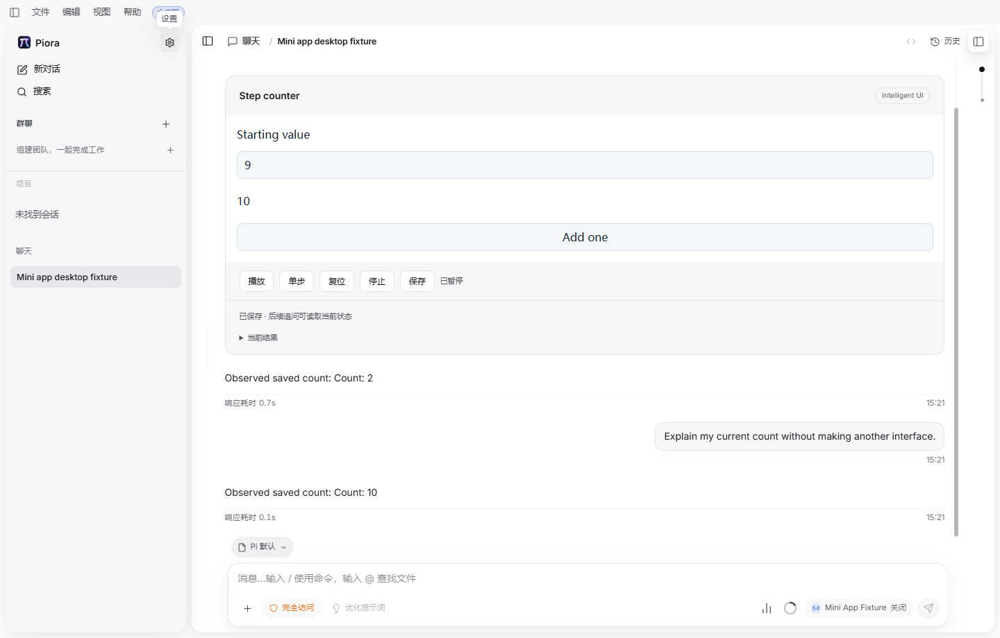

# 第三阶段：小程序聊天接入与桌面流程

2026-10-31 | 3B 实施进展 | 固定模型夹具验证，第三阶段尚未完成

## 1. 本次已经接通什么

小程序已进入生产聊天工具、生成适配器、预览和正式交互界面。真实 AgentSession 与 Windows 开发桌面验证了生成、操作、保存、刷新和追问；组件与小程序可以共存，共用生成预算。真实模型生成质量与复杂任务仍待验证。

| 变化 | 当前证据 |
| --- | --- |
| 工具与界面接入 | piora_render_mini_app 由 Beta 控制加载，生产扩展执行 QuickJS 试运行；真实桌面加载 WASM 和 iframe 渲染资源 |
| 发布与追问 | 工具成功先是候选，磁盘上的 SDK turn_end 回执确认后才发布；追问读取已确认输入、结果与 tick，不重生成解释任务 |
| 共同预算 | 组件与小程序共用 3 次接纳、1 次纠错、60 秒窗口；切换工具不能重新获得纠错次数，原始参数在类型转换前校验 |
| 关闭并重开 Beta | 中止试运行、未提交保存与候选发布；启动阶段尚在加载的旧运行时也失效。重新开启后，新请求可正常工作 |
| 分叉与修订 | 生产 wrapper 的 fork 保留确认状态；新程序修订仍作为待确认候选，旧程序和已保存参数继续有效 |
| 桌面自动化 | 新增 intelligent-ui-mini-app 场景；启动阶段 Electron 重启后可重新连接，进入场景后的重启仍计为失败 |

### 完整桌面过程

通过设置开启 Beta，在聊天发送计数器请求；初值为 2。通过 iframe 输入框改为 9，点击加一得到 10，保存后刷新，起始值仍为 9、计数仍为 10。继续追问时，固定模型从生产上下文读到 Count: 10，并在界面回答；没有新建第二个小程序。

关闭 Beta 后，交互界面替换为已确认文字结果，明确断言快照包含 Starting value: 9 和 Count: 10；重新开启后恢复同一检查点。测试通过 UI 执行操作，配置读取只用于核对保存。截图中的初次回答 Count: 2 是保留的历史消息，后续追问使用当前已保存的 Count: 10。

### 源码身份

专用 worktree 为 C:/Users/shengjiajun/.codex/worktrees/intelligent-ui/Piora，分支 codex/intelligent-ui，HEAD b41fa2ffd33f2b603a7863b3ea7d3c2e958e9146。本批修改尚未提交或推送；相关文件摘要、命令和日志索引记录在同名 JSON，不能仅凭 HEAD 重现这些未提交修改。

<!-- pagebreak -->

## 2. 实际检查与失败复测

| 检查 | 结果与范围 |
| --- | --- |
| 相关 Node 测试 | **58 / 58 通过**，来自 7 个文件，含真实 wrapper、共同接纳、Beta、状态保存及桌面测试生命周期；计数包含 Node 的父测试 |
| TypeScript | node_modules/.bin/tsc.cmd --noEmit 通过，使用仓库当前的原生 TypeScript 入口 |
| ESLint | 本批 19 个实现及测试文件通过；完整文件列表和命令见 JSON |
| Windows 开发桌面 | 最终 8 个步骤通过（含启动），无未捕获页面异常，清理无错误，测试锁释放；不代表安装包或跨平台通过 |

Node 文件为 answer-output-generation-runtime、answer-output-generation、mini-app-generation-runtime、beta-features、mini-app-state、mini-app-admission、desktop-e2e 对应的 lib/*.test.mjs。日志：.verification/phase3-chat-final.log、phase3-chat-typecheck-final.log、phase3-chat-lint-final.log。

桌面命令为 node scripts/run-desktop-e2e.mjs --scenario intelligent-ui-mini-app --timeout-ms 600000 --step-timeout-ms 60000。最终记录在 .verification/desktop-e2e-3cxdea/result.json；模型身份为本机 mini-app-fixture，未使用任何真实服务凭据。

### 首次失败和修复过程

- 会话测试最初对二次 JSON 编码的上下文做字符串匹配，导致断言失败；改为解析实际模型消息中的状态对象，并精确断言输入、摘要和 tick，保留原验证要求后复测通过。
- 首次 TypeScript 命令误用了不存在的 typescript/bin/tsc；按仓库 .bin/tsc 指向的原生入口复测通过。失败日志保留，未将首次执行计为通过。
- 桌面 DlG7IP 在开发编译两次重启 Electron 后停留于旧 CDP 连接。只读检查确认新窗口已经挂载；核对进程身份后停止该测试窗口，让启动器与测试器清理。该次结果为失败，业务流程未执行。补充启动重连和启动器退出测试，复测继续进入实际场景。
- 桌面 e5cMyD 使用 setChecked 立即检查异步开关，早于服务端回执；改成点击后等待 UI 确认及持久配置一致。SKACd5 使用了渲染器有意剥离的 data-* 属性；改为用户可见标签和精确文本，保留数值断言。
- QLedla 首次流程通过；截图检查发现关闭后还需等待异步快照更新，随后增加最新快照的输入与结果断言、等待保存操作结束。3cxdea 最终再次通过。所有尝试单独保留，未覆盖失败报告。

本次没有运行完整 CI、人工语义验收、真实模型或本地发布构建。按用户安排，完整 CI 和人工验收在三个阶段开发完成后进行。

<!-- pagebreak -->

## 3. 桌面证据与下一步

图：最终场景重新开启 Beta 后，输入为 9，计数为 10；下方追问回答读取同一确认结果。模型响应固定，计算、渲染、保存、恢复和聊天接口为生产代码。该图是流程证据，不是自由生成效果或视觉验收样例。

### 第三阶段仍需完成

- 3B：使用用户指定的 **DeepSeek V4.1**，核实模型身份后执行首批自然语言开发任务；补齐真实模型触发、生成稳定性及基础主题、字号和窄屏检查。
- 3C：完整多窗口和断网恢复、草稿分页、修订确认、状态迁移、登记动作权限及故障矩阵；当前待确认候选尚不能等同于完成迁移。
- 3D：动态列表、三维拾取与相机、持续模拟和小游戏、三维关系教学；同时完成主题、无障碍、性能和独立正确性核对。
- 3E：开发范围完成后运行三阶段综合回归、封存集、完整 CI 与人工语义验收，输出最终成果报告。

设计依据为 v3.4。本次证明基本产品链路已能在真实桌面运行，不证明第三阶段已开发完成，也不证明自然语言泛化成功率。后续仍保持 Beta 独立适配、普通聊天解耦和全部既定能力范围。
