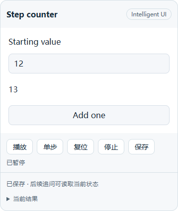

# 第三阶段：客户端保存与交互界面

2026-10-31 | 3B / 3C 进展报告 | 第三阶段仍在开发

## 1. 本次实现与实际边界

正式 React Surface 已实现播放、暂停保存、单步、复位、停止、检查点恢复和另存入口。它与真实 Worker、QuickJS、IndexedDB、SDK 会话文件及状态 API 连通，浏览器夹具已验证操作、磁盘保存、刷新和后续上下文读取。

**尚未登记聊天中的小程序工具，未完成真实聊天与真实模型闭环。** 本次不将浏览器夹具等同于 Next 开发桌面、Electron 窗口或安装包验证。实现依据为 [第三阶段方案 v3.2](../intelligent-ui-phase3-design-v3.2.md)，完整范围仍覆盖 3A 至 3E。

| 改动 | 解决的问题 |
| --- | --- |
| 浏览器恢复记录与保存客户端 | 检查点先写 IndexedDB，再请求服务端；回执丢失可查询确认，未确认内容不自动删除 |
| 保存中的后续修改 | 旧写入确认后更新新草稿的预期版本；新修改不会一直依赖已经完成的旧请求 |
| 输入冻结与队列排空 | 追问前处理完最后一次指针事件及 Worker 队列，避免保存上一次操作结果 |
| 服务器分支恢复校验 | 恢复请求必须属于当前分支祖先；历史视图或兄弟分支不能借参数绕过检查 |
| 独立客户端缓存 | 交互视图被虚拟列表卸载后，待保存内容和通用保存门禁继续保留 |
| 正式交互界面 | 默认暂停；提供恢复、重试、明确采用已保存状态和检查点导出；未解决草稿不启动新实例 |
| 本机存储失败 | 明确提示保持页面开启，允许另存内存中的当前检查点；不声称未落盘内容能在刷新后恢复 |
| 播放与尺寸 | 同组播放暂停前一个实例；iframe 按内容高度测量，短内容可收缩，避免默认高度留下大块空白 |

状态确认后重新读取服务器投影，显示的“已保存”不以客户端计算结果或防抖结束为依据。明确选择服务器状态时，旧稿保留在本机；刷新后仍可再次核对。

## 2. 已执行检查

mini-app、通用快照 API 与回收站合并测试 **62 / 62 通过**，包含测试容器本身的 Node 计数。新增浏览器客户端有 11 个场景，连同父测试计为 12 项。应用 TypeScript 和本轮 14 个源文件的 ESLint 均通过。

390 px 窄窗口没有横向溢出，保存状态、控件与恢复后的数值可读。检查命令及本轮日志如下：

```text
node --test lib/mini-app-*.test.mjs lib/answer-output-route.test.mjs lib/session-trash.test.mjs
node_modules/.bin/tsc.cmd --noEmit --pretty false
.verification/phase3-client-surface-tests.log
.verification/phase3-client-surface-typecheck.log
.verification/phase3-client-surface-lint.log
```

ESLint 的完整 14 文件命令、检查结果及对应源码哈希见 [机器可读验证记录](intelligent-ui-phase3-client-2026-10-31.json)。日志是本地执行记录；这份 JSON 不替代实际测试。

<!-- pagebreak -->

## 3. 浏览器场景与故障证据

测试使用真实无头 Edge、真实 IndexedDB、生产状态路由处理函数及隔离计算；HTTP 服务器提供确定性发布夹具和故障注入。控件操作通过 UI 执行，直接读取状态用于核对。后续上下文检查读取真实发布日志中的已保存参数，未调用回答模型。

| 场景 | 核对结果 |
| --- | --- |
| 操作、保存、刷新、追问 | 磁盘结果与显示一致；刷新默认暂停；后续上下文读取确认值 |
| 断网修改后刷新 | 草稿保留；未选择处理方式时阻止追问；明确恢复后保存 |
| 视图卸载与重新出现 | 待保存门禁继续存在，重新出现保持正确检查点 |
| 成功响应内容截断 | 通过请求回执确认，重试不再发第二次 PUT |
| 连接断开后的浏览器重试 | 即使浏览器重发 PUT，服务器仅产生一次状态修订 |
| 自动保存期间继续调整 | 后一份修改正确接续前一回执，两次状态版本顺序一致 |
| 写入途中关闭 Beta | 服务器不提交失效写入；本机草稿保留，可在重新开启后恢复 |
| 兄弟分支恢复旧稿 | 返回冲突，源稿保留，当前分支状态不被覆盖 |
| 两窗口修改同一版本 | 后写窗口收到冲突；明确采用服务器状态后仍保留自己的旧稿 |
| 正式 React Surface | 保存、单步、刷新、窄窗口和断网恢复通过真实组件执行 |
| 本机写入失败 | 注入 IndexedDB 写异常后停止实例；导出内存检查点，恢复存储后可重试保存 |

原有控制器浏览器测试另补：最后一次拖动后立即检查点，先冻结输入再排空计算；冻结期间单步不生效，解除后继续操作。同组另一个实例播放时，前一个实例暂停。

### 首次失败及修复

类型检查首先发现客户端给资源读取函数传入了尚不支持的第三参数。现在通过明确的选项读取有界错误响应；静态运行资源仍默认拒绝非成功响应。

“丢失成功响应”首次测试未出现预期错误。诊断记录显示 Chromium 自动重发 PUT，最终状态已保存。现在分开覆盖 socket 断开和响应内容截断；保留原有磁盘、幂等、草稿与回执断言，没有把错误路径改成无条件通过。

接入 React 夹具后，TypeScript loader 首次把普通 `.ts` 中的泛型当作 JSX。已将实际文件名传给转译器，使 `.ts` 与 `.tsx` 分别解析，随后重新运行全部相关测试。

截图检查发现 iframe 初始 300 px 高度无法收缩，因为测量了包含视口高度的 documentElement。现改为测量内容根节点，并新增短内容高度断言。合并 62 项验证发生在上述修复之后。

<!-- pagebreak -->

## 4. 实际界面与后续工作

下图来自真实 React Surface 的 390 px 浏览器夹具：输入值为 12，单步后计数为 13，已保存并刷新恢复。它是确定性计数器测试，不是自然语言模型生成效果，也不是 Electron 原生窗口截图。



### 尚待完成

聊天工具、生成策略、共同预算和输出登记仍待接通；真实 Next 开发桌面中的首条产品流程尚未验证。随后继续完成 fork/复制/导出来源、迁移确认、登记动作与权限，以及动态列表、三维拾取/相机、模拟和持续小游戏的产品流程。

主题与字号同步、完整无障碍/性能矩阵、更多历史草稿的分页恢复、开发集及封存集也仍在第三阶段范围内。模型验证按用户要求使用 DeepSeek V4.1，不使用 V4 Pro；本轮没有真实模型调用。

人工语义验收与完整 CI 仍留到三个阶段开发完成后。未运行发布包、本机打包、其他平台及原生 GPU 验收；本报告不代表第三阶段完成或发布。

本轮工作位于独立 worktree `C:/Users/shengjiajun/.codex/worktrees/intelligent-ui/Piora`，分支 `codex/intelligent-ui`，HEAD 为 `b41fa2ff`，另有未提交修改。本轮没有提交或推送，前期报告保持历史快照。后续状态见 [第三阶段实施进展](../intelligent-ui-phase3-progress.md)。
