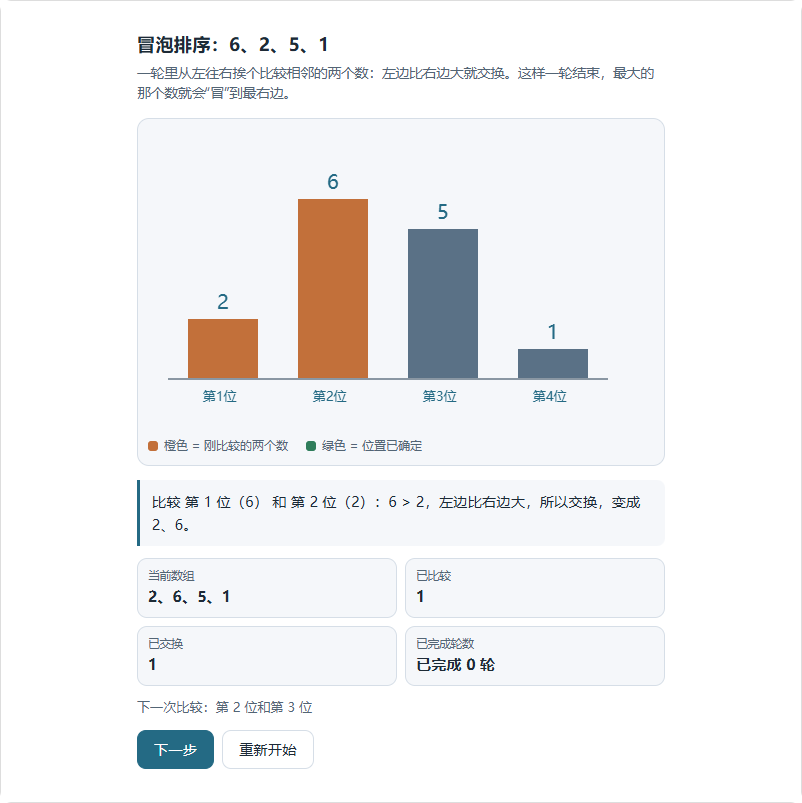

# 第三阶段生成契约与边界验证报告

2026-10-31 | 3B 实施进展 | 第三阶段尚未完成

## 本批实际改动

针对上一批真实模型暴露的契约错误，已实现完整工具示例、顶层只读常量、多问题诊断和组件输入边界检查。全部改动在专用 worktree 的 codex/intelligent-ui 分支，尚未提交或推送；继续依据第三阶段方案 v3.6 实施。

| 问题 | 现在的行为 |
| --- | --- |
| 示例不完整或混淆版本 | 组件和小程序各有一份完整 JSON 示例，直接通过对应工具 schema、编译器和运行检查。小程序示例包含 purpose、playback、initialSnapshot 和有界状态 |
| 绘图常量被当作隐藏状态拒绝 | 接受简单 const 名称及有限原始字面量；拒绝可变模块变量、对象、调用和计算初始化。局部变量仍可用 |
| 一次纠错才发现下一个问题 | 收集独立的元数据、状态、文档和程序错误，最多返回 8 条，并指明工具、版本和完整重提要求 |
| 默认数值正常，改参数后除零 | 在 SDK 接纳及候选创建前检查合法边界、零、离散选项、步长邻近值及有限组合；异常返回可纠错诊断 |

### 状态与历史兼容

使用新常量语法的程序标识为 mini-app-1.2；已有 mini-app-1.0 和 mini-app-1.1 的版本推导保持不变。常量每次计算重建且不可变，不替代显式 state。重新创建运行时后，原检查点投影与下一步结果仍一致；赋值常量会失败。

输入采样策略 input-boundaries-1 最多 128 个状态，先轮流覆盖各输入，再补组合，记录是否截断。求值保持 if 的惰性分支，不改价格、公式或输入范围，也不把除数改成 1。采样不是连续空间的完整证明，业务语义仍需独立验收。

本批没有修改共享的 3 次接纳、1 次纠错、60 秒生成窗口，也没有添加按任务关键词触发的规则。新边界检查只用于生成接纳；历史已保存的 Surface 不因新策略而被改写。

<!-- pagebreak -->

## 固定版本真实模型复测

沿用完全相同的 8 个自然表达任务，每个运行 3 次，共 24 次；每次是独立会话，最多两个并行。旧批和新批分别冻结源码，未用新结果替换旧失败。下面每个 UI 单元格依次是“首试发布 · 最终发布”。

| 任务 | 旧基线 | 本批 |
| --- | --- | --- |
| 一次性均分 | 3/3 无 UI | 3/3 无 UI |
| 提成规则未定 | 3/3 无 UI | 3/3 无 UI |
| 出行费用对比 | 3/3 · 3/3 | 3/3 · 3/3 |
| 满减总价与均价 | 2/3 · 2/3 | 2/3 · 3/3 |
| 排序逐步演示 | 0/3 · 3/3 | 3/3 · 3/3 |
| 三角形拖动 | 1/3 · 2/3 | 2/3 · 3/3 |
| 倒水状态转换 | 1/3 · 1/3 | 3/3 · 3/3 |
| 棋盘轮流落子 | 0/3 · 3/3 | 0/3 · 3/3 |

旧批 UI 首试 7/18、最终 14/18；本批首试 13/18、最终 18/18。另有 6/6 次文字/澄清请求没有调用 UI。相同小样本下的变化不等于产品总体成功率，也不能证明所有输出已可用。status=completed 只表示请求流程结束。

本批工具诊断：board-1: SYNTAX；discount-2: PLAN_TYPE；board-2: SCHEMA；triangle-3: SCHEMA；board-3: SCHEMA。每次原始结果、诊断、耗时和发布回执都保留，失败继续计入分母；本批预期形式和独立核对值没有发送给模型。

配置模型名称为 DeepSeek V4.1 Flash，provider/modelId 是 deepseek/deepseek-flash；服务返回只确认 deepseek-flash，不能独立证明 4.1 版本身份。没有调用 V4 Pro，也没有切换备用模型。

组件独立核对沿用人数 2/4/6、满减数量 5/6/8 的预设轨迹，并另查初值、声明边界及合法零值。本批 6/6 份组件匹配指定数值轨迹，额外采样发现 0 份运行错误。这些检查只支持所列数值和采样点，不替代标签、单位、文字说明、交互恢复或人工判断。

<!-- pagebreak -->

## 一份真实排序程序的浏览器验证

本批 sorting-1 来自真实模型，包含顶层 const，并在 headless Edge 中运行生产 Controller、Worker 和可信渲染器。通过 UI 点击应用按钮、宿主单步和播放，独立预期的六步序列为：

6,2,5,1 → 2,6,5,1 → 2,5,6,1 → 2,5,1,6 → 2,5,1,6 → 2,1,5,6 → 1,2,5,6。

六步数组、元素守恒、比较数和交换数核对通过；应用按钮与宿主单步的完整检查点相等，自动播放到达同一终态并停止。暂停后重建运行时、继续下一步，以及终态重建均通过；浏览器和控制器未报告错误。

范围明确：这是一个真实生成程序的实际浏览器操作；HTTP 资源由夹具服务提供，检查点重建使用夹具内存。它不代表本批 18 次 UI 请求全部通过，也不代表真实桌面磁盘会话、刷新保存和追问已逐样本验收。

<!-- pagebreak -->

## 本地验证与剩余工作

| 检查 | 结果与边界 |
| --- | --- |
| 相关集成回归 | 91/91 通过，覆盖真实 VM、历史版本、SDK 接纳、发布、取消和会话记录 |
| 补充 SDK 诊断 | 6/6 通过，其中 5 项与上项重叠；新增多错误一次纠正场景，不重复累计数量 |
| 浏览器回归 | 2/2 通过：真实浏览器 Worker 常量、恢复、停止，以及 Controller 指针、键盘和播放路径；使用夹具 |
| 真实生成浏览器核对 | sorting-1 六步独立结果和四条操作/恢复路径通过 |
| 类型检查与 lint | 当前类型检查、修改模块及补充测试 lint 通过；首次类型检查曾失败，修正联合类型收窄后复查通过 |
| 完整验收 | 完整 CI、人工语义验收、跨平台、原生 GPU 和安装包验证未执行 |

第一轮 19 项快速检查通过后扩大到上述相关范围。原始类型失败日志保留，未把失败写成通过，也未为通过检查删除断言。没有运行 next build 或本地发布包构建。

### 第三阶段仍需完成

首批任务还需逐样本完成语义、浏览器操作、保存、刷新与追问；能力清单的 planned/implemented/verified 门禁尚未实现。3C 仍需草稿分页、完整恢复矩阵、迁移确认和登记动作；3D 仍需动态列表、完整三维拾取/相机、持续模拟/游戏和教学语义、主题及无障碍检查。完整开发集、封存集及综合验收不能由本批替代。

下一步根据本批剩余诊断继续处理共性问题，并接通能力验证与首批完整任务；不以生成发布率代替完成标准。人工验收和完整 CI 继续按用户安排留到三阶段开发完成后。

### 可追溯记录

- 新批：.verification/mini-app-evaluation-di2ENh/result.json；旧批：mini-app-evaluation-tCm2dL/result.json。
- 新源码摘要：d1906fc861e8a7015cb862247212538e89a6d326587a2a662a3c4999e51080ac，运行期间及报告生成时一致。
- 检查日志：phase3-contract-integration.log、phase3-contract-sdk-diagnostics.log、phase3-contract-browser.log、phase3-contract-typecheck-current.log、phase3-contract-lint-current.log、phase3-contract-extra-lint.log。
- 配套记录：docs/verification/intelligent-ui-phase3-contract-2026-10-31.json，保存逐样本结果路径和摘要、源码指纹、数值核对及浏览器证据。
