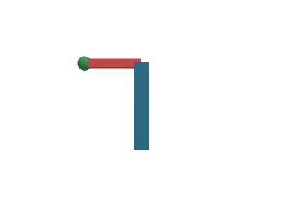

# 第三阶段成果：组合模型与局部关节

2026-11-02 | 专用 worktree：intelligent-ui/Piora | 分支：codex/intelligent-ui

## 1. 实现了什么

**三维小程序支持有界的父子变换，整体旋转不再要求模型逐个计算所有部件的位置。** 部件保留局部偏移，共同父组带动整体；子组放在关节支点，表达局部转动。该能力适用于组合物体和关节结构，没有飞机关键词分支。第三阶段尚未完成。

| 契约 | 实际行为 |
| --- | --- |
| 开启方式 | 当前窗口 sceneGroups 可用，scene3d 视口声明 groups:true |
| 场景数据 | groups 提供 id、可选 parent、位置、旋转、缩放；网格可引用父组 |
| 坐标关系 | 变换相对父节点，根节点相对场景；局部缩放、XYZ 弧度旋转、平移 |
| 资源上限 | 全帧最多 64 个组，最多 8 层；无循环、悬空父引用或重复 ID |
| 选择与恢复 | 仍选择具体网格；父关系变化不替换部件 ID，镜头独立保存 |
| 版本兼容 | 使用新契约时为 mini-app-1.5；旧场景仍按原版本编译 |

渲染器先断开变化的父关系，再建立新关系，避免父子关系反转时出现临时循环。删除组、将部件移回场景根部、重新建立父关系都保留明确的对象生命周期。模型不直接操作 Three.js、DOM 或 GPU。

生成策略 mini-app-intent-15 提供可执行的组合结构示例，描述支点和局部坐标。模型上下文、参数接纳、执行及发布沿用同一能力检查；没有当前 WebGL 环境或能力证据时不能使用新能力。分组不会自动修补初始几何间隙、错误比例或解释。

## 2. 开发验证

相关能力检查 **174/174 通过**，26 个测试文件，最终证据目录 mini-app-capabilities-xZPDlo；其中包含本批新增的 6 项协议检查、1 项真实浏览器流程和 2 项诊断回归，不与既有 165 项或本批较早的 172 项累计。TypeScript 通过；13 个相关文件及后续 5 个诊断相关文件 lint 分别通过。

协议检查覆盖旧版本身份、能力门禁、完整示例发布试运行与恢复、无序父声明、循环/未知父引用、ID 冲突、非法变换、8 层边界、全帧组数预算，以及删除后必须明确重新归属。浏览器使用真实 Controller、QuickJS、隔离 iframe 和软件 WebGL，操作经过原生输入控件与真实点击。

一次测试准备读取了错误的清单文件，另一次测试调用了错误的 Controller 构造入口；这两次夹具失败保留日志，修正后通过。它们不计为产品验证成功，也不隐藏于最终结果中。完整 CI、两人独立语义验收、安装包及其他系统/真实 GPU 尚未执行。

<!-- pagebreak -->

## 3. 独立坐标与真实拾取

手写开发夹具中，关节位于 (1.5,0)，末端相对关节位于 (2,0)。关节绕 Z 轴旋转 90°，末端变为 (1.5,2)；整体再绕 Z 轴旋转 90°，结果为 **(-2,1.5,0)**。测试由此独立计算屏幕位置，真实点击命中末端；旧位置不再命中。

图：绿色末端被实际射线选中。主体、活动臂和末端仍在同一层级关系中；这是手写协议夹具，不是真实模型生成质量的证明。

同一流程通过保存、刷新恢复、父关系反转、全部脱离、删除部件、恢复原结构。每次都重新核对拾取和对象列表，最终没有页面或运行器错误。保存边界采用 localStorage 夹具，本测试不冒充生产保存接口或原生窗口验收。

## 4. 真实模型任务与剩余范围

固定 DeepSeek V4.1 Flash 配置（deepseek/deepseek-flash，thinking: disabled），没有 Pro 或回退。供应端返回 ID 不能独立证明精确版本。

首轮 desktop-e2e-nJMA50 已主动采用 groups:true，但未发布成功：首次含不支持的 !important 和顶层 var；一次纠正后，在清空选择的试运行中触发 TIME_LIMIT，后续多余调用被共同预算拒绝。原始第二次提交离线诊断重跑 3 次均通过，每次约 415–478ms。这说明该限时故障尚未稳定复现，不能把桌面失败改写为通过，也不能据此提高普通 8ms 限额。

本批修正诊断：明确指出 !important 后缀，而非把 flex-direction 误报为不支持；执行超时保留原错误，不再附带错误的状态枚举修复建议。新增相应回归检查。

最终 desktop-e2e-41J5TZ **通过新生成、操作、生产保存、刷新和真实追问**。首次因选中字段枚举非法被拒绝，一次纠正后发布。模型采用两个组、10 个网格；七个机体部件共享 airframe 父组，三根世界轴保持在另一个组。实测俯仰 -57°、选中机身和用户镜头均保存并恢复，追问读取当前值。该结果为预算内生成通过，不是首次调用通过。

独立语义核对仍有失败：Y/Z 标签对应的圆柱方向对调；“角度归零”事件只改变 cameraRevision，俯仰仍为 -57°。后者使用原始程序经 QuickJS 执行已校验的点击事件，未冒充实际原生点击。共同父组关系已核对，但完整教学任务不能判为正确。几何轴方向、生成按钮承诺、解释及参数预设仍需继续处理。

第三阶段仍需完成完整自然任务操作与独立结果核对、连续模拟和游戏、参数复位/预设、候选迁移与组件/小程序切换、登记动作与权限回执、开发和封存任务评估，以及最后的 CI 和人工验收。本批未提交或推送。
