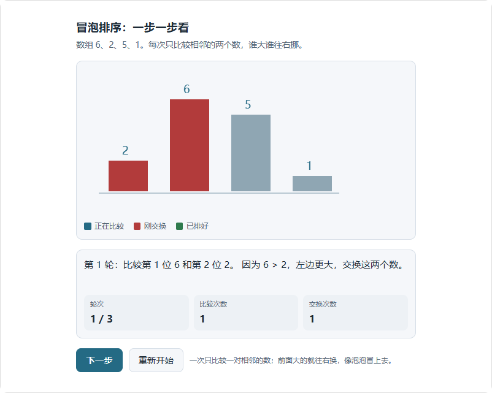
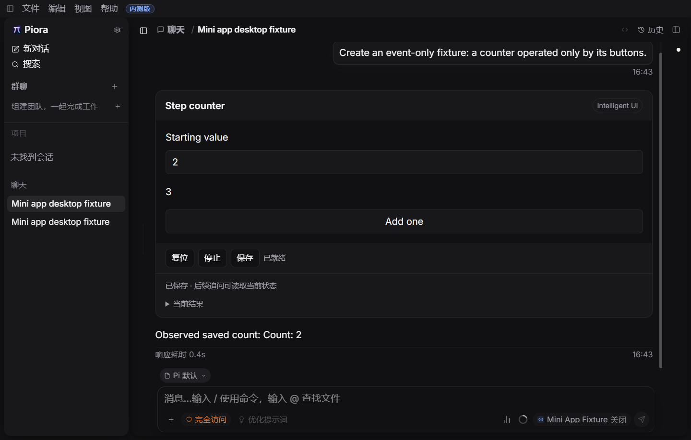

# 第三阶段：统一单步与播放契约

2026-10-31 | 3B 实施进展 | 第三阶段尚未完成

## 1. 修复了什么

此前真实模型生成的排序界面把“下一步”写在按钮事件中，宿主单步却调用 advance，导致时钟增加、排序不动。本批让新程序显式声明推进方式，并让离散任务的按钮、宿主单步、自动播放和服务器试运行调用同一个事件分支。

| 推进方式 | 使用场景 | 宿主行为 |
| --- | --- | --- |
| none，仅响应操作 | 输入、按钮、拖动驱动的工具 | 不显示播放与单步；保留复位、停止、保存；调用时间推进接口也不改变状态 |
| discrete，离散步骤 | 排序演示、逐步流程 | stepEvent 绑定真实按钮；所有推进入口调用同一 reduce 分支，每步 tick 加一；自动播放间隔 750ms |
| continuous，连续模拟 | 随时间变化的模拟 | 继续通过 advance，以固定 1/30 秒逻辑步推进；调度受现有资源预算限制 |

可播放程序每帧返回 playback.finished。完成后宿主暂停并禁用播放和单步；继续点应用步骤按钮也不会再推进。复位或有意义的参数变化可重新开始。手动点击离散步骤按钮会暂停正在进行的自动播放，避免两种操作叠加。

新生成程序使用 mini-app-1.1，缺少推进声明会收到可修复的诊断。历史 mini-app-1.0 程序保持原始程序摘要、检查点和 advance 语义，不猜测旧按钮含义，也不改写已发布记录。旧程序需要重新生成或后续修订才能获得新契约。

### 当前检查

| 检查 | 结果与范围 |
| --- | --- |
| 相关自动检查 | 75 / 75，通过编译、实际 Worker、运行时、发布回执、保存、继承、预览和浏览器交互检查 |
| TypeScript / ESLint | 类型检查通过；小程序模块、相关测试、Surface 和桌面场景 lint 通过 |
| Windows 开发桌面 | 11 步通过，真实 Electron 与 Next，使用本机固定模型；页面与清理错误均为 0 |
| 真实模型输出 | 一次新生成发布成功；六步排序独立核对，按钮、宿主单步、播放、暂停恢复一致 |

代码和证据位于本任务专用 worktree，分支 codex/intelligent-ui。完整命令、文件摘要和原始结果路径见同名 JSON。本批没有提交、推送、完整 CI 或本地发布包构建。

<!-- pagebreak -->

## 2. 真实模型生成与独立核对

任务仍为“冒泡排序我没看懂。拿 6、2、5、1 这几个数，让我一步步点着看它怎么排好，每一步告诉我在比较谁、为什么交换。”未在生产代码中加入排序或提示词专用分支。

配置为 deepseek/deepseek-flash，名称 DeepSeek V4.1 Flash；服务返回 deepseek-flash，未返回独立的 4.1 发布标识。未使用 V4 Pro 或自动换模型。此次采用 32,768 输出上限和低推理强度，2 次模型请求、1 次工具调用、0 次纠错，发布为 committed。

| 比较次数 | 独立预期数组 | 验证 |
| --- | --- | --- |
| 1、2 | 2,6,5,1；2,5,6,1 | 一致 |
| 3、4 | 2,5,1,6；2,5,1,6 | 一致，第四次不交换 |
| 5、6 | 2,1,5,6；1,2,5,6 | 一致，共交换 5 次 |

通过浏览器分别操作应用按钮与宿主单步，六个完整检查点逐个相同，包含 state、inputs、rng 和 tick。自动播放得到相同终态并停止；暂停后等待不推进，重建实例再继续得到正确下一步；终态恢复保持不变。

此核对使用真实生成计划和生产 Controller、Worker、iframe；HTTP 服务及恢复检查点为隔离夹具，不代表完整桌面磁盘历史恢复。单一样本不构成泛化率，首批 8 个任务各 3 次仍待完成。

<!-- pagebreak -->

## 3. 桌面证据、失败记录与下一步

完整场景覆盖：启动、开启 Beta、生成、操作保存、主题字号切换、宿主单步与结束停止、刷新、追问、关闭 Beta、重新开启，以及另一个仅响应操作的工具保存并刷新。全部通过，共 11 步。

截图来自 Windows Electron 开发桌面，使用固定本机模型。它验证真实产品界面的控件与状态流程，不承担模型选择质量、发布包或其他平台的验证。

### 失败与复测保留

- 首轮核心检查 15/16。新增字段改变了预览夹具中 program 的位置，原位置断言因此失败；调整夹具字段顺序，保留原断言和预览依赖检查。
- 首轮集成检查 62/63。新增浏览器检查读到了旧场景故意触发的 BINDING 错误；先明确断言这条预期错误，再独立核对后续场景。最终相关检查 75/75。
- 首次桌面运行在开启 Beta 时遇到开发编译触发 Electron 重启，页面连接关闭；保留 desktop-e2e-Xqyft3 的失败结果，停止改动后重新运行 desktop-e2e-DZShdg，通过且清理无错误。

### 后续范围保持

下一步完成首批自然语言任务的固定版本重复验证，以及 planned、implemented、verified 能力声明与开放条件。继续开发完整恢复矩阵、草稿分页、多窗口冲突、迁移确认与登记动作；动态列表、几何拖动、持续模拟/游戏及三维拾取、相机和教学仍在第三阶段范围内。

Canvas/三维语义色、完整字体布局、无障碍与性能仍需专项验证。人工语义验收、封存任务和完整 CI 留到三阶段开发完成后。本批修复推进契约，不代表第三阶段完成。
