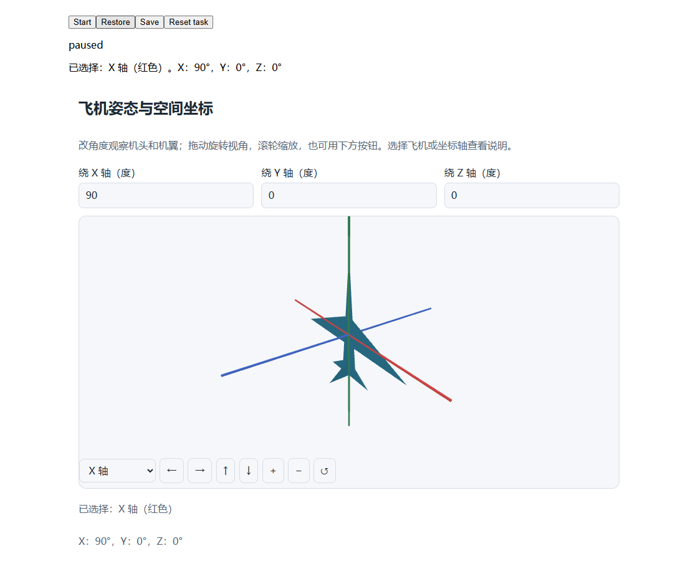

# 第三阶段成果：三维拾取与镜头恢复

2026-11-02 | 专用 worktree：intelligent-ui/Piora | 分支：codex/intelligent-ui

## 1. 本批实现及开放范围

**三维运行器已有可用的对象选择和独立镜头状态，普通新生成仍等待窗口环境协商。** 本批是第三阶段增量，尚未完成完整三维任务或第三阶段验收。

| 用户操作 | 现在的行为 |
| --- | --- |
| 点击三维对象 | 宿主对真实网格求交，传递稳定对象 ID；选择框提供键盘替代 |
| 拖动、滚轮或键盘 | 旋转观察镜头、缩放；拖动不误作对象点击 |
| 修改任务参数 | 对象及解释更新，用户刚调整的镜头保留 |
| 保存、刷新、恢复 | 镜头、参数和选中对象恢复；重新创建后保持暂停 |
| 复位与失去上下文 | 显式复位区分任务与镜头；图形上下文丢失后停止并保留检查点 |

用飞机与三轴示例验证空间行为：初始机头朝 -Z；X 轴旋转 90 度后机头朝 +Y。射线点击的像素位置由独立透视公式计算；没有调用产品的 Three.js 投影或拾取函数作为预期结果。示例明确右手坐标系和 XYZ 欧拉角约定，不声称模拟飞行动力学。

本批没有真实模型请求，也未启动原生 desktop。测试仍遵守后续模型固定为 DeepSeek V4.1 Flash、不使用 Pro 的约定。现有 DeepSeek 配置名称不能单独证明供应端的具体 4.1 版本。

<!-- pagebreak -->

## 2. 实现与验证证据

拾取和镜头控制均为显式 viewport 能力。新增 `mini-app-1.4` 仅用于声明新交互的计划，旧计划保留原身份。选中对象与任务解释来自任务状态；镜头保存在独立、版本化的 `snapshot.view`，生成的生命周期函数不能直接写入。服务端重新投影、保存文件及回执链路均保留该数据。

对象身份按有界帧历史核对，删除后重用 ID 不会接受旧点击。镜头事件按序进入宿主队列；保存屏障等待未发送镜头及计算完成。普通投影不会拉回镜头，显式 cameraRevision 变化及整体复位才清除相应视图。相机边界同时处理浮点误差及坐标截断，不增加原有执行预算。

| 验证 | 结果与范围 |
| --- | --- |
| 相关能力验证 | 83/83 通过，18 个测试文件；含真实 QuickJS、浏览器、状态服务及既有基础能力回归 |
| 三维浏览器流程 | 软件 WebGL；真实点击、键盘、改角度、保存刷新、拖动中断后续用、缩放边界及上下文丢失均通过 |
| 恢复正确性 | 恢复前后 Canvas 截图逐像素相同；服务端另测真实文件、回执、重复保存和非法视口拒绝 |
| 开发检查 | TypeScript 通过；本批 22 个代码文件 lint 通过 |
| 未执行范围 | 原生桌面、真实模型生成及追问、物理显卡和其他系统、完整 CI、人工语义验收 |

首次浏览器运行使用了 HTML 中的 aria-label，而编译器会采用计划里的输入 label，定位失败；已使用实际可访问名称。第二次未等待异步保存结束且复用了滚动前坐标；夹具已加入保存忙态并重新读取位置。第三次把“任务复位”误认为“恢复默认输入”，与现有“用当前参数重新初始化”契约冲突；已核对并断言保持 90 度、清空选择和用户镜头。失败日志均保留，没有跳过相关操作或降低恢复断言。

最新能力证据：`.verification/mini-app-capabilities-hI9pxz/result.json`。此前 83/83 为上一源码快照，不与最新结果累计。同名 JSON 记录源码哈希、日志、截图和验证边界。代码仍未提交或推送。

<!-- pagebreak -->

## 3. 实际画面与后续工作

画面来自真实浏览器运行器与 QuickJS，顶部 Start/Restore/Save 属于开发夹具。此图显示 X 轴角度 90 度、选中 X 轴以及恢复后的用户镜头；不能据此宣称模型生成质量或原生桌面验收通过。

下一步按原方案继续：将可信渲染端的 WebGL 检测、窗口实例、环境代次和运行资源版本绑定到原始提交请求，并在生成接纳、发布和加载时复核。完成后再运行固定模型的完整三维任务、桌面操作和保存后追问，补不同空间关系的泛化证据。

持续模拟/游戏、完整恢复矩阵、候选迁移、登记动作、原始任务及封存任务验收仍在范围内。CI 和人工验收仍留到三个阶段开发完成后；本报告不缩减这些要求。
