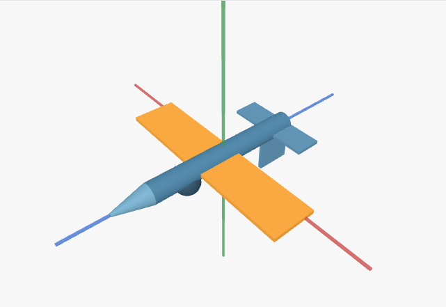

# 第三阶段：三维姿态与独立几何核对

2026-11-03 · Windows 开发桌面 · 第三阶段尚未完成 · 阶段性提交资料

## 本批成果

三维验证从“能生成、能保存”扩展到真实程序的几何关系和实际点选。新增不依赖 Three.js 或产品变换函数的数学核对工具，按人工审阅的任务约定绑定具体原始计划，检查部件世界坐标、固定轴方向、连接点和屏幕投影。它没有飞机关键词判断，也不把生成程序自己的结果当作预期答案。

产品侧补充通用语法诊断：区分被双重转义的换行，并报告出错位置内层尚未闭合的括号及其行列位置。只返回标点与位置，不回显私有源码或堆栈；不自动改写程序，不增加纠错额度。生成规则建议复杂投影先建立局部数据，再返回较小的帧对象。策略版本为 mini-app-intent-24。

| 范围 | 已取得证据 |
|---|---|
| 基础能力 | jqvK9v：58 个测试文件、528/528 通过，14 项能力证据更新 |
| 定向检查 | 语法、独立数学和请求分类组合 11/11；其中语法检查已包含在能力检查中，不累计 |
| 类型与静态检查 | Web 类型、定向 ESLint、脚本语法和差异检查通过 |
| 新生成 | d15Mfx 首次工具调用发布成功；前一新样本 uWtRmh 因 CSS、换行和缺括号失败，仍保留 |
| 最终完整重放 | JzCyrg：7 组姿态、56 项几何断言、17 个状态检查点（含 16 次 UI 保存）、1 次刷新、2 次实际点选 |
| 模型边界 | 固定配置名 DeepSeek V4.1 Flash，实际 deepseek/deepseek-flash；任务 thinking=enabled，无 Pro/回退 |

最终重放的一个后台标题请求使用 disabled、一个任务追问使用 enabled，均返回 200；分别记录，不把后台请求计入任务生成。配置名称及返回别名不能独立证明供应端内部版本。测试操作通过原生控件、键盘和实际鼠标完成，接口读取只用于核对。

528 项能力检查不代表自然任务语义通过；一次新生成首试成功也不能证明成功率提升。真实原始输出、副本重放和每次失败保持独立记录。

<!-- pagebreak -->

## 七组姿态与实际点选

原始计划声明 X 朝机头、Y 向上、Z 朝右翼，旋转矩阵采用 Rx·Ry·Rz。每组核对机头中心、机头与机身两个连接点、座舱中心、右翼采样点和三条固定轴，共 8 项。误差上限为 1e-7 场景单位；预期从基准尺寸和明确的旋转规则独立推导。

| 姿态 | 机头中心预期 | 结果 |
|---|---|---|
| 三轴为零 | (2.45, 0, 0) | 通过；实际点击选中座舱 |
| 俯仰 +30° | (2.122, 1.225, 0) | 抬头，连接点一致 |
| 俯仰 -30° | (2.122, -1.225, 0) | 低头，连接点一致 |
| 偏航 +90° | (0, 0, -2.45) | 通过；固定轴不随动 |
| 横滚 +90° | (2.45, 0, 0) | 机头不变，右翼向下 |
| 三轴各 +90° | (0, 0, 2.45) | 通过；实际点击选中机翼 |
| 再次归零 | (2.45, 0, 0) | 参数、几何和保存恢复一致 |

图：JzCyrg 原始程序重放，改变镜头后的实际画布。不是重新绘制的效果图。

角度修改保留已保存镜头；两组相机按键改变视角，同时保持任务输入、状态和选择。四个参数预设逐个点击并核对。刷新恢复完整快照和选中对象，真实追问收到当前参数、机翼选择和用户镜头。各姿态保持 9 个网格、1 个组，没有宿主运行错误、页面错误或清理错误。

这些是有界任务轨迹与资源数量证据，不能外推到长期内存稳定、所有 GPU 或其他平台。视觉审阅覆盖本样本的浅色桌面画布与面板；深色、窄屏、减少动画和其他对象尚未构成完整视觉矩阵。

<!-- pagebreak -->

## 失败、语义问题与剩余任务

| 记录 | 事实与处理 |
|---|---|
| uWtRmh | CSS place-items 不支持；程序双重转义换行，纠正后仍少闭合括号。未发布，预算未扩张 |
| 首轮定向语法检查 | 两项失败：转义错误偏移处理和测试列号。修正后通过，保留首轮日志 |
| KOhZSY | 长聊天中 iframe 自动滚动与虚拟列表相互影响，截图定位超时；未进入几何检查 |
| d15Mfx / znc3xL | 机械流程通过，但旧运行器误认后台标题请求并拒绝；分别有 4 / 18 次中继失败，不能计为干净的完整运行 |
| MTyNOT / Gw0q8a | 几何通过，但标题请求保留工具、附加或合并上下文，分类仍错；完整流程失败 |
| JzCyrg | 按实际标题协议修正分类后完整重放通过；当前值追问仍有语义错误 |

JzCyrg 的最终角度确为 0°，但模型声称“这一轮没有改动任何姿态角度”，与七组实际操作相矛盾。模型还把镜头距离解释为 10.40→11.10；独立计算默认及最终空间距离均约 11.543。当前参数和选中对象正确，不代表历史或额外数学解释正确。宿主快照不能证明用户从未改动，cameraRevision 为 0 也不足以证明完整历史。

对历史 SgQpdj 原计划另外执行 QuickJS 投影并独立计算：其说明称正俯仰抬头，但 +30° 时机头 y=-1.8；称正横滚右翼下沉，但 +30° 时右翼 y=+1.175。这是未改写原程序的服务端反例，不冒充本轮实际 UI 操作。旧样本问题没有被新样本成功覆盖。

下一步仍需解决追问对操作历史和镜头关系的错误推断，补充可核对的上下文证据与真实复测；扩展其他三维对象、不同参数、连续模拟/游戏、动态列表，以及完整视觉、键盘和资源矩阵。3B 通用生成质量与原始任务失败、3C 恢复/动作/互转组合仍未全部完成。

提交准备时合并 upstream/main 的 9 个提交至 3c74ff18。同步后 72/72 项相关回归、Web 类型及定向 ESLint 通过；172 个能力来源仍匹配。桌面记录的 516 个来源中，515 个未变，锁文件仅跟随主线更新版本号；主线另外修改了原生桌面和浏览器代码，因此没有把同步前的真实桌面结果冒充合并后的重跑。许可证清单按合并锁文件重新生成。

完整 CI 修复、封存集和双人人工语义验收继续按用户安排延后。上一 head 的 CI #933 已失败；本批推送后的状态以 upstream Draft PR #238 为准。未运行 next build、本地发布包或其他平台/硬件验收。测试中的历史描述和几何解释由开发审阅判定，不能替代双人人工验收。

- [脱敏记录](intelligent-ui-phase3-spatial-audit-2026-11-03.json)：逐项预期、实测、来源摘要、失败和语义审阅。
- [运行说明](../intelligent-ui-recorded-task-testing.md)：生成、原样重放及显式几何绑定。
- [阶段进度](../intelligent-ui-phase3-progress.md)：第三阶段范围及各批历史记录。
