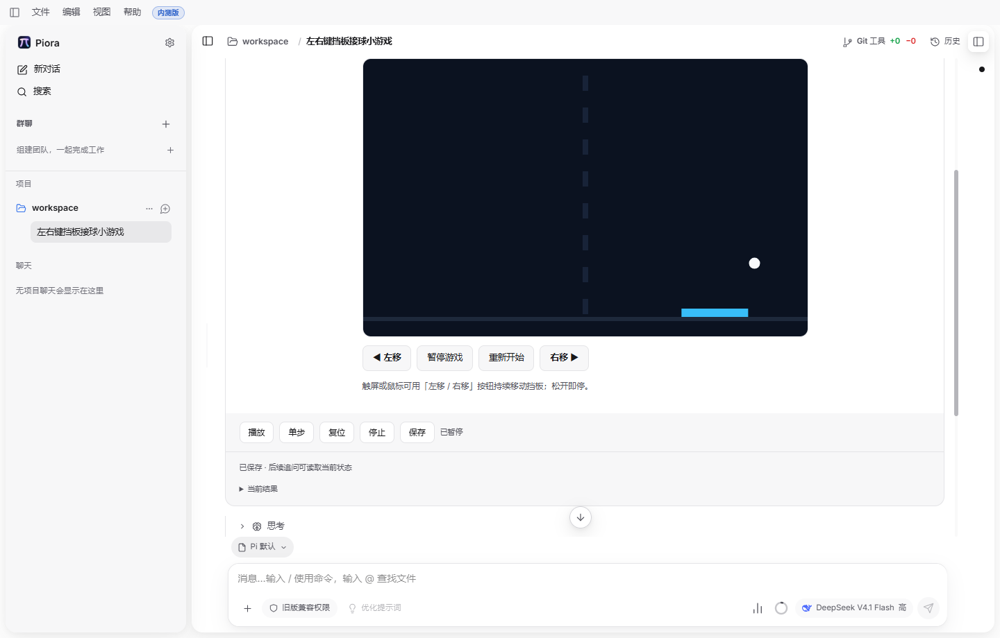

# 第三阶段完成报告：复杂功能可用 Beta

2026-11-03 · 方案 v3.9 · Windows 开发桌面及已注明的浏览器范围

## 交付结论与范围

**按用户确认的新目标，第三阶段功能交付完成。** 代表任务可以操作、计算、保存和刷新续用，主要修订、迁移、宿主动作与组件互转流程已有验证。第四阶段继续处理系统性可靠性与泛化；原有失败保留，不因阶段调整写成已修复。

生产代码基线为 6c59034c，已有代码位于 upstream Draft PR [#238](https://github.com/kexijiang/Piora/pull/238)。本批没有修改生产运行时，新增连续游戏的桌面重放能力、验证证据和文档，尚未提交或推送本批改动；此报告是交付时快照。

| 功能 | 已核对的代表性证据 |
|---|---|
| 动态列表 | 3Gxxsc：购物清单编辑、勾选、重排、增删、保存刷新及真实追问 |
| 算法与二维交互 | sorting-2：16 个检查点、4 次刷新；triangle-3：12 个检查点、3 次刷新。三角形坐标采用明确的 0.01 鼠标量化容差，面积仍精确核对 |
| 三维交互 | JzCyrg：7 组姿态、56 项几何断言、实际点选与镜头操作、复位和刷新；JVNyaH：机械臂 70 项几何断言及独立输入试算 |
| 持续小游戏 | 原始生成接球游戏，qlXUas：16 个检查点、4 次刷新，详见下一页 |
| 状态与会话 | RV39D2：复制、分支、导出、回收恢复和继续操作；lJHHGD：丢失响应、取消、过期核对、迁移与刷新；FCn6fg：原生隐藏/最小化恢复 |
| 修订与迁移 | hHAybn：真实模型修订、取消、过期拒绝、重新核对保留进度及追问；相关浏览器检查继续保留 |
| 宿主动作与互转 | 真实浏览器控件、SDK、文件和生产接口验证参数读取/明确采用、报告保存及双向互转；使用确定性计划，不等于新模型生成成功率 |
| 基础可读与交付 | 已查看代表场景和主要控件；完成试用说明、阶段计划、证据 JSON 及两份 PDF。完整视觉/可访问性矩阵归第四阶段 |

最近相关能力检查 tojLhp 为 **61 个文件、538/538 通过**。本批复核其 **178 个源码摘要全部匹配**，复用原结果，未重新执行完整套件。新桌面运行的 **519 个实现源码摘要**及重放脚本摘要也匹配，运行期间未修改实现。

既有开关、隔离、权限和关键数据恢复检查继续保留。这里的完成结论覆盖上述功能范围，不表示所有自然语言任务都能一次生成正确结果，也不表示安装包、全平台或完整 CI 已验收。

<!-- pagebreak -->

## 连续游戏：实际操作与保存恢复

自然表达：“做个能用左右键移动挡板接球的小游戏，接住加分，漏掉扣一条命，能暂停继续和重新开始。”Ju40zR 原始生成一次工具调用发布成功，无纠错调用；实际模型为 deepseek/deepseek-flash（用户选择的 DeepSeek V4.1 Flash），未使用 Pro 或回退。

| 核对项 | 实际结果 |
|---|---|
| 接球与加速 | 分数 1、生命 3、球速 264；刷新后完整检查点相同 |
| 内部暂停 | 宿主时钟推进 20 tick，全部游戏状态不变；恢复后继续 |
| 漏球与终局 | 首次漏球生命变 2；终局分数 1、生命 0，宿主播放/单步禁用；等待和方向键不再改变终局快照 |
| 重新开始 | 分数 0、生命 3、球速 250、挡板与球复位；内部重开保留宿主时钟，宿主重置则精确回到初始快照 |
| 松键与刷新续用 | 刷新后继续推进 17 tick，挡板保持原位，左右按键均已释放；共 4 次刷新与保存前快照一致 |

截图展示实际场景和主要控件；部分顶部内容在聊天滚动视口外，不据此声称完整布局矩阵通过。

首次桌面运行 9HG10f 失败：夹具误以为挡板停在左边缘不会再次接到球，终局实际得分 3，预期 1。复测通过 UI 将挡板移至两条发球路线外的中间区域，保留得分 1 和生命 0 的原断言；没有修改原游戏或产品实现。复测 qlXUas 通过，清理错误为空。

<!-- pagebreak -->

## 当前状态追问与已知限制

实际追问：“现在是多少分、还剩几条命？先别改游戏，按当前保存的状态告诉我。”模型回答 **0 分、3 条命**，与保存状态一致；追问后快照和状态版本未改变。

附加回答仍有问题：模型说“未暂停”，描述的是程序内部 paused=false，宿主实际处于暂停；还依据存档变化解释具体点击历史，超出证据范围。这两点明确移入第四阶段，不将整段回答标为完全正确。两次生成请求启用思考；桌面追问启用思考，后台标题请求关闭思考，均为 Flash。生成记录中的实际 reasoning_effort 为 high。

## 可以直接这样试用

设置中开启 Beta Features > Intelligent UI，选择 DeepSeek V4.1 Flash。每次新生成的布局和操作细节可能不同；以下是自然语言试用，不承诺固定外观或首试成功率。

| 可以这样说 | 看什么 |
|---|---|
| “帮我弄个买菜清单，能勾掉买过的，也能调整顺序。” | 改动、勾选和顺序保存刷新后仍在 |
| “冒泡排序我没看懂，拿 6、2、5、1，让我一步步看。” | 单步和播放有效，最终 1、2、5、6 |
| “让我拖一拖三角形，看看底和高变了面积怎么变。” | 面积符合底乘高除以二，点位保存恢复 |
| “飞机的俯仰、偏航和横滚总分不清，让我转一转看看。” | 改姿态、点选、换镜头和复位；换镜头不改变姿态 |
| “做个能用左右键移动挡板接球的小游戏。” | 点宿主播放并聚焦游戏区域，再用左右键；保存和刷新后需再次播放 |

修订可以说“这个提示不太对，帮我改一下，保留我现在的进度”，先核对预演再确认。只有提供迁移的同类小程序修订支持保留进度；组件与小程序互转会重新开始进度。完整动作边界及测试步骤见[试用说明](../intelligent-ui-phase3-testing.md)。

## 第四阶段接续与本批检查

第四阶段分为形式选择/生成稳定性、业务语义、历史与运行状态解释、复杂恢复组合、视觉/键盘/资源，以及综合验收六组。保留 48 题（32 开发、16 封存，各 3 次）的计划；完整 CI、历史失败修复、封存集和两人独立人工验收均未在本批执行。

重放脚本语法检查、定向 ESLint、文档相对链接和 git diff --check 通过；本批仅脚本与文档增量，未重复 Web 类型及完整能力套件。两份 PDF 已逐页检查。未执行 next build、未构建或验收发布安装包；没有自动开始第四阶段。

证据入口：[脱敏 JSON](intelligent-ui-phase3-usable-2026-11-03.json)、[原始任务矩阵](intelligent-ui-phase3-task-matrix-2026-11-03.md)、[宿主动作报告](intelligent-ui-phase3-actions-2026-11-02.md)、[互转报告](intelligent-ui-phase3-conversion-2026-11-02.md)、[第四阶段计划](../intelligent-ui-phase4-plan.md)。JSON 保存本批来源摘要、实际检查点、首轮失败与复测、请求分类及各项验证边界。
