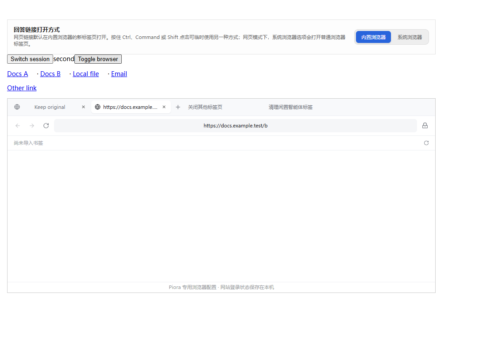

# 回答链接打开方式验证

日期：2026-11-06。基线：`8d5a5f73`。本机 Windows / Node 24.5.0 / headless Edge，在 `.verification/issue-346-answer-links` 独立工作区完成；主工作区原有未提交修改保留。

## 行为

- 普通助手回答（包括普通群聊回复）中的绝对 HTTP(S) 链接默认进入内置浏览器新标签页，不覆盖当前页面。
- 设置 → 对话与输入 → 回答链接打开方式支持内置/系统浏览器；浏览器本地存储保存偏好，存储失败时仍对当前窗口生效。
- Ctrl、Command 或 Shift 点击临时反转目标，回车和中键也可打开链接；系统方式使用用户点击触发的新窗口，在 Electron 中沿用系统浏览器处理，在网页模式下打开普通浏览器标签页。
- 文件链接继续交给文件面板，邮件等非 HTTP(S) 链接及非助手 Markdown 保持原有行为。内置路由拒绝带凭据、控制字符及非网页协议的地址。
- 连续点击的请求等待面板和桌面会话就绪后打开；切换会话会取消尚未开始的旧会话请求。失败请求不因面板重挂载而自动重放，现有标签上限及错误提示保留。
- 显式点击从只读“跟随 Agent”模式进入可操作浏览器，不改写保存的跟随偏好。默认桌面联动后端仍按会话关联标签；Playwright 跟随视图保持只读，不新增写接口或跨会话访问。
- 可疑域名提示是 issue 中的可选项，本次未实现。

## 测试结果

68 项定向测试分次通过：

| 测试文件 | 通过 |
| --- | ---: |
| lib/answer-links.test.mjs | 2 |
| components/MarkdownBody.test.mjs | 14 |
| lib/settings-search.test.mjs | 6 |
| lib/browser-mode-browser.test.mjs | 1 |
| components/AnswerLinks.browser.test.mjs | 1 |
| lib/browser-agent-control.test.mjs | 44 |

Web 类型检查、改动范围 ESLint、`git diff --check` 通过。完整远端 CI 及最终提交的审查结果记录在 PR 中。

新 UI 用例运行六组组合（英文/中文 × 桌面联动/桌面 Playwright/网页），使用真实 Markdown、设置、队列 hook 和浏览器面板组件及 CSS，通过 UI 点击/回车/中键执行操作。覆盖冷启动连续两次点击、旧标签保留、Ctrl/Command/Shift 双向切换、文件及普通链接、偏好保存和刷新、取消跨会话待处理链接、标签上限错误与重挂载不重放、存储被拒和 390px 窄屏。

桌面桥接与网页浏览器 API 使用合成夹具，不连接模型或真实账号。截图中的原生页面区域为空是桥接夹具边界，不代表真实 Electron 网页渲染验收。桌面控制器测试使用真实控制器和模拟宿主，确认本会话用户标签可被列举、快照读取，同时拒绝其他会话及独立手动浏览器。

## 失败、修复与边界

- 首次沙箱运行的两个浏览器测试被临时路径中的 `!` 阻断，webpack 尚未执行 UI 场景。改用正常本机临时目录重跑；没有改动 webpack 检查规则。
- 首次真实 UI 测试在初始点击后失效。检查发现新队列依赖仅安全上下文提供的 `crypto.randomUUID`，现改用当前队列内部的递增标识，普通 HTTP 网页测试覆盖该路径。
- 随后修饰键弹窗断言失败；最小 Edge 探针确认默认 Ctrl/Shift 点击没有产生可观察的新页。系统目标现明确使用用户点击中的 `window.open`，保留全部修饰键新页断言，最终六组组合通过。
- 本地复用主工作区 Next 16.4.3 依赖；锁文件所需组合由 GitHub Actions 的 `npm ci` 验证。没有运行本地 `next build`、发布包构建、真实模型、原生 Electron 交互或其他平台/硬件验收，没有发布或部署。
- #344 仍无新增评论或复现步骤；本次未继续改动其剩余项目选择现象，也不声明该现象已修复。
