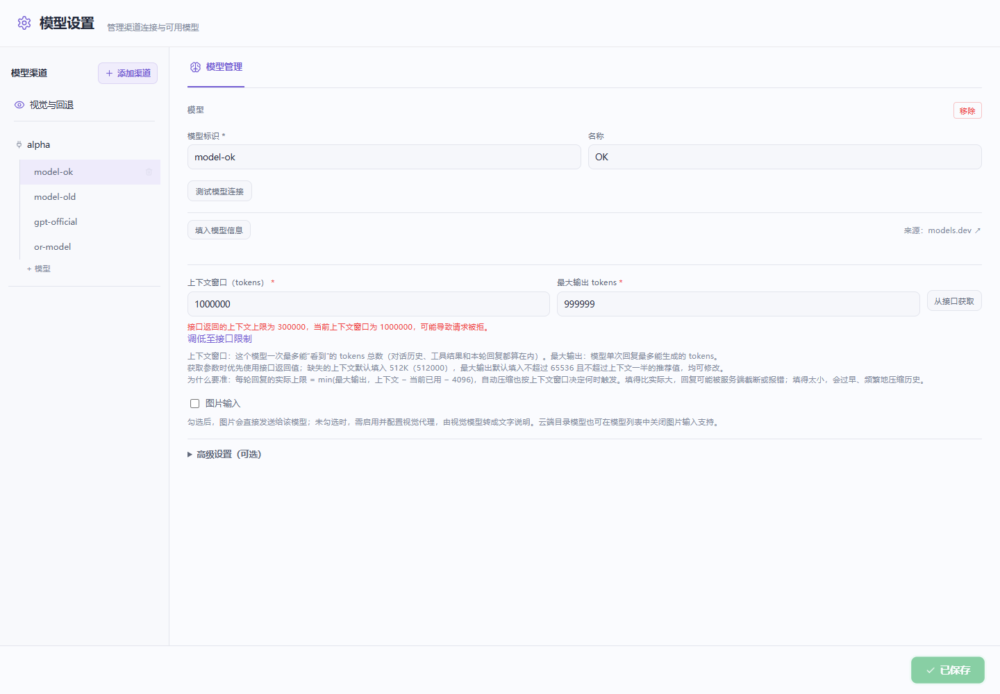

# #357：部署上下文上限与共享 Token 预算

## 问题与行为

关联 #357、#351。发现接口同时返回 `context_length=1000000` 和 `max_model_len=300000` 时，旧解析按字段顺序选中 100 万；`max_total_tokens` 未被读取。若上游输出上限也与窗口矛盾，旧逻辑还会丢弃窗口，转入缺省值。

现在仅对模型列表中各模型条目里的正安全整数 `max_model_len` / `max_total_tokens` 取较小值，并与标称窗口取最小值。响应根部的服务器内存池字段不作为单模型限制。冲突输出字段不再丢弃已知部署窗口；输出缺省仍是可见、可编辑的推荐值。

已有完整配置可以点击“从接口获取”。查询保留手工值，偏高时显示差异；“调低至接口限制”显式修改现有 `contextWindow` / `maxTokens`，支持撤销，保存后由 SDK 原生读取。这样输出裁剪、上下文压缩、模型显示复用同一窗口，无需添加一个会被 SDK 丢弃的 `serverMaxModelLen` 字段。接口未提供限制时提示向服务提供方核对，不推测模型限额，也不在聊天时增加网络探测或根据错误文本自动重试。

发送前使用 SDK 输入估算（包括系统指令与工具声明）校验扩展改写后的输出上限，输入和输出共享配置窗口，保留 SDK 的 4096 token 余量及剩余窗口内的一 token 下限。这是估算，不是服务端 tokenizer；扩展若改写实际输入内容，不能据此保证精确 token 数。

## 接口证据和未确认部分

- [vLLM 模型列表实现](https://github.com/vllm-project/vllm/blob/main/vllm/entrypoints/openai/models/serving.py) 的 `show_available_models()` 返回部署配置里的 `max_model_len`。
- [SGLang ModelCard](https://github.com/sgl-project/sglang/blob/main/python/sglang/srt/entrypoints/openai/protocol.py) 定义可选 `max_model_len`。
- 这些是上游协议证据，不是报告者接口的实测响应。#351 未提供脱敏模型列表、实际模型配置或可访问测试端点；991041/991040 可以通过特定本地配置重现，但不能证明报告者就用了该配置。`max_total_tokens` 仅作为逐模型响应兼容字段；不假定所有服务都会返回它。

## 开发验证

Windows 10.0.26340，Node 24.5.0，独立工作树及独立测试 agent 目录，复用已安装依赖。

- 定向逻辑回归 33/33：模型发现、限制校验、配置保存路由、SDK 保存重载、最终请求参数、ModelsConfig 静态契约。
- Edge 无头浏览器回归 2/2：真实 React 设置页查询、差异提示、调低、撤销、保存、刷新；错误提示中英文与原始详情保留。HTTP 发现/保存使用夹具，解析器及 UI 操作为真实代码，没有访问真实模型服务。
- Web `tsc --noEmit` 通过。
- 首次本地测试缺少生成的品牌模块、测试认证目录落到用户目录，以及旧 assistant 夹具缺少 SDK usage。已生成开发品牌资源、隔离测试目录并补全 usage 夹具后复测通过。浏览器首次受沙箱临时目录 `!` 和 Edge 管道限制阻断；在独立临时配置中于沙箱外复测通过。
- 未运行本地完整 CI、`next build`、发布包、Electron 原生窗口、真实模型或硬件验收。远端最终 head 的 CI 与审查以 PR 记录为准。

