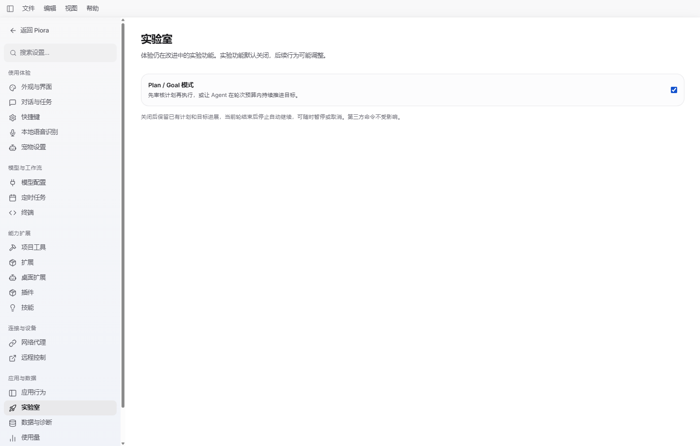
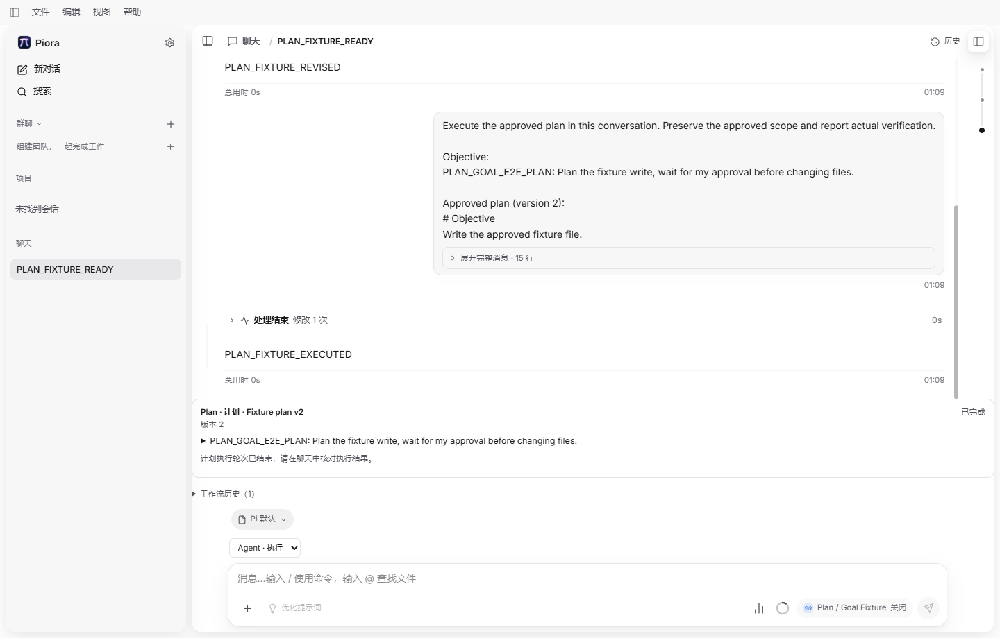
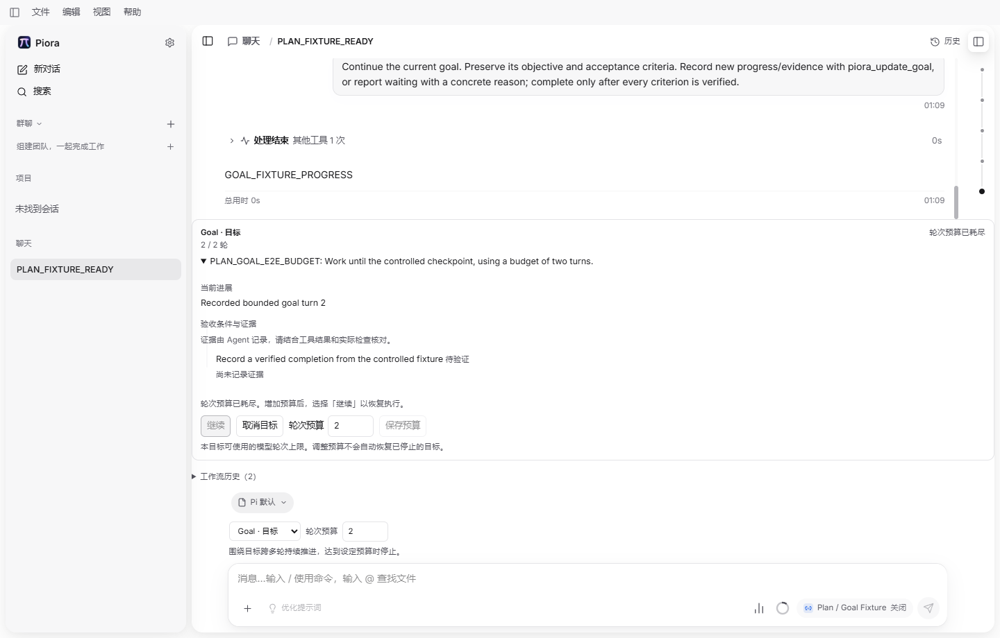

# #391 Plan / Goal 验证记录

初始基线：upstream/main `591595de`；提交前同步后的基线为 `a0fb860ef73f0656d3f7daf8b16aeddfac5213c6`。独立工作树 `codex/issue-391-plan-goal`。以下记录针对开发源码，未构建或验证发布安装包。旧轮次保留其原有基线，最新实验室桌面结果明确标注新基线。

提交前追加需求：Plan / Goal 通过“设置 → 实验室”的默认关闭开关启用。下文第六轮桌面结果针对加入开关前的实现；第七轮在新基线上完整复测，并加入默认关闭、设置 UI 开关及关闭期间停止/历史/续轮限制。

## 夹具范围

新增 `plan-goal` 桌面场景复用既有开发桌面生命周期。独立配置仅包含 loopback 模型端点和合成密钥；不读取或复制本机真实模型凭据。真实 Electron、Next API、Pi SDK、工作流扩展及文件工具参与执行。用户操作通过 UI，状态 API 与文件读取仅作核对。

模型返回固定工具调用，因此只能验证状态和工具执行链路。Goal 的完成证据明确标为模型自报的合成测试数据，不作为真实任务验收。

## 已执行的快速检查

- Node.js 24.22.1 对 `scripts/desktop-e2e/scenarios/plan-goal.mjs` 与 `scripts/desktop-e2e/workflow-model-fixture.mjs` 执行 `--check`，通过。
- 桌面运行器 `--list` 能加载并列出 `plan-goal`，通过。
- 新增模型夹具、场景及修改后的运行器执行定向 ESLint，通过；`changelog-fragments.mjs check` 通过。
- 本机默认 `node` 为指向未安装 Node.js 22.19.0 的 nvm shim，最初两次语法检查未运行。后续使用已安装的 Node.js 24.22.1 完成检查。

## 相关回归检查

以下按执行批次记录，存在重复覆盖，不相加为一个总测试数。除明确给出日志的批次外，结果来自相应实现负责人的已完成执行回报；本记录同时核对了测试源文件的断言范围。

| 批次 | 已完成结果 | 范围与证据 |
| --- | --- | --- |
| 路由、SDK 第三方兼容、输入恢复与会话 hook 回归 | 108/108 通过 | `.verification/workflow-regression.log`；末尾 `pass 108 / fail 0 / cancelled 0 / skipped 0`。日志中的配额错误是预期的存储失败注入，相关用例通过 |
| 工作流状态机 | 15/15 通过 | `lib/workflow-runtime.test.mjs`：工具边界、计划版本与过期操作、证据约束、预算、等待输入、无进展、迟到事件、重启和失败 |
| 真实 Pi SDK 工作流 | 原五项通过，追加一项定向通过 | `lib/workflow-sdk.test.mjs`：实际工具拦截/执行、多轮预算、完成证据、取消与恢复、真实 SDK 上下文压缩；追加验证旧写入在异步工具钩子中等待时，取消并 abort 后放行也没有创建文件。供应商响应使用本地夹具 |
| 真实 SDK 外层会话接入 | 原六项通过，追加一项定向通过 | `lib/workflow-wrapper.test.mjs`：材料/准入拒绝、扩展命令与 Shell 模式边界、终态供应商错误、SDK 重试。重试恢复后保留同一目标、只计一轮且不提前标记失败；追加验证替换会话等待旧扩展 shutdown |
| Router 重启专项 | 2 项通过，已包含在 108 项中 | `lib/session-message-router.test.mjs`：`approve` / `resume` × 5 种未完成队列状态共 10 种组合全部中断且不启动模型；有确证的仍存活同一运行不会被误中断 |
| UI hook 与输入重试回归 | 94/94 通过 | `hooks/useAgentSession.test.mjs` 79 项 + `components/ChatInput-retry.test.mjs` 15 项；包含模式提交快照、命令与 Shell 限制、工作流启动失败和取消/切换会话防护。与 108 项中的 hook 用例重叠；最后错误优先级改动另定向运行 `workflow approval clears` 1/1 通过 |
| 新任务交接与普通 composer 先前回归 | 87/87 与 26/26 分批通过 | 87 项为当时 hook 77 项 + `components/NewSessionProjectPicker.test.mjs` 10 项；`components/ChatInput.test.mjs` 另独立运行 26 项。先前 hook 批次与后续 94 项重叠，不累加 |
| 独立浏览器工作流组件 | 1/1 通过 | `components/Workflow.browser.test.mjs`：390px 视口、版本回看、迟到快照、切换会话、预算保存不恢复及暂停/取消。此层接口为夹具，不作为模式实际执行证据 |
| 类型与静态检查 | 通过 | TypeScript 6 `--noEmit`，`.verification/workflow-typecheck.log` 无错误；相关修改文件定向 ESLint。桌面场景脚本另有上述语法与更新片段检查 |

追加生命周期回归已通过：真实 SDK 扩展的 `session_shutdown` 被测试闸门挂起时，实际 `startRpcSession` 持有启动锁但不读取替换会话文件；放行后严格先完成 shutdown，再报告受控的会话文件缺失。该测试使用隔离配置，零模型请求。最终全树 `tsc6 --noEmit --incremental false`、最后修改文件的定向 ESLint 及 `git diff --check` 通过。

实验室追加检查由实现负责人回报并核对测试文件：相关完整 35 项通过，之后真实 SDK 中途关闭/开启后明确恢复、HTTP 关闭绕过拒绝、损坏配置的轮末停止各追加 1 项定向通过，共 38 项分批记录，不与前述旧批次累加。已加强的排队批准用例确认：在关闭状态下实际准入保留待确认计划且不调用模型。HTTP 回归同时验证跨 Jiti 实例的工作流拒绝仍返回 409；设置 API 覆盖默认关闭、严格布尔字段、损坏配置及请求体大小限制。新增 UI 快速回归 114/114 通过；TypeScript 与相关文件定向 ESLint 通过。以上追加测试与桌面执行结果分别记录。

UI 的 114 项由 `lib/settings-search.test.mjs`、`components/ChatInput-retry.test.mjs`、`components/NewSessionProjectPicker.test.mjs` 和 `hooks/useAgentSession.test.mjs` 组成。加强初次读取失败、保存失败与初始消息交接边界后，`components/Workflow.browser.test.mjs` 和 `components/NewSessionProjectPicker.test.mjs` 合计 11/11 复测通过；接口使用受控响应。浏览器首轮因异步开关的测试等待方式失败，改为点击后等待服务端确认并复测通过，未修改产品断言。

提交前再次执行全树 `tsc6 --noEmit --incremental false`、全部本次改动的 TS/TSX/MJS 文件定向 ESLint、更新片段检查和 `git diff --check`，均通过。对应本地日志为 `.verification/workflow-laboratory-typecheck.log`、`.verification/workflow-laboratory-lint.log`。没有运行本地完整 CI 或构建发布安装包。

## Issue #391 七项验收映射

验收项来自 [upstream #391](https://github.com/kexijiang/Piora/issues/391)。下表将实际执行证据与单元/组件层断言分开，避免把静态渲染或模型自报证据等同于完整运行。

| 验收项 | 对应实现及已验证证据 | 验证边界 |
| --- | --- | --- |
| 1. 新建和已有普通会话都能明确选择 Agent / Plan / Goal，模式含义和生效范围清楚 | `WorkflowModePicker`、`NewSessionProjectPicker`、`ChatInput`；新任务 handoff 回归验证模式和预算进入持久提交。第七轮先确认默认无入口，通过设置 UI 开启实验室功能，再从新任务选择 Plan、已有会话切换 Goal；关闭后两种入口都隐藏。Agent 保持普通执行入口。使用范围及预算说明见 `docs/plan-goal-modes.md` | 按追加需求默认关闭，需用户明确启用；群聊、定时任务与多代理编排未新增模式入口 |
| 2. Plan 能完成“研究 → 计划 → 修改/确认 → 执行”的闭环；未确认实施时，模式约束真实生效 | `piora-workflows` 的 `tool_call` 检查和 `workflow-runtime` 计划状态机；桌面三个 `plan-*` 步骤验证未确认的真实 SDK `write` 被阻止、刷新与修改保留旧版本、确认后只写入一次。状态机测试覆盖读取/搜索/指定浏览器观察动作允许，以及 Shell、写入、未知工具拒绝 | 模型计划内容来自夹具；没有把合成模型视为真实研究质量验收 |
| 3. Goal 能跨多轮持续推进，并区分完成、等待用户、暂停、取消、失败和预算耗尽 | SDK 测试确认跨 `agent_end` 继续；桌面覆盖预算耗尽、完成、暂停和取消；状态机用例覆盖 `waiting` 及用户澄清后保留原目标/条件继续、连续三轮无进展停止；wrapper 测试确认终态模型错误为失败、可重试错误不会提前失败 | 等待用户/失败状态以状态机及真实 SDK wrapper 验证，未另开对应桌面场景；完成条件验证的是证据记录完整性 |
| 4. 目标、计划、进展和完成证据可在历史中查看，刷新/重连不丢状态 | `workflow-store` 保存会话隔离的快照与历史，`WorkflowPanel` 展示原始目标、计划版本、进展和证据；桌面核对旧计划原文、Goal 证据及刷新后的同一运行，组件测试展开历史并隔离切换会话的迟到响应；会话 hook 的 SSE/状态协调回归确认终态前不提前断流 | 桌面实际刷新与进程恢复已覆盖；网络断线时序由 hook/组件回归覆盖，没有另做真实网络故障注入 |
| 5. 取消、预算限制、重复点击、迟到事件、上下文压缩及进程重启不会造成误续跑或重复执行 | 状态机校验 `runId`/revision、一次性确认和取消后的迟到完成；Router 并发相同确认返回同一 command，取消排队请求阻止准入，重启的 10 种控制命令组合不重放；真实 SDK 压缩后重新注入目标，取消后放行的旧工具不写文件；桌面验证预算停止、挂起请求取消、重启暂停且恢复前没有新增模型请求。UI hook 验证准备阶段取消/切换会话不发出迟到动作；实际启动测试确认旧 shutdown 完成后才恢复替换会话 | 重启为运行器终止其拥有的真实开发进程树再启动；不代表断电、原生退出或发布包恢复。追加生命周期与工具取消回归属于真实 SDK 集成测试，并非新一轮桌面运行 |
| 6. 保持现有扩展工作流兼容；对同名命令/工具冲突有明确处理 | 内置扩展不注册 `/plan`、`/goal`，使用 `piora_submit_plan`、`piora_update_goal` 命名空间避开现有通用名称。真实 SDK 测试注册并成功调用第三方同名命令；兼容回归覆盖扩展初始化及 follow-up。内置 Plan/Goal 下扩展命令与 `!` Shell 要先选 Agent，wrapper 与 UI hook 均验证不可绕过，文档说明此边界 | 未逐个验证任意第三方扩展或外部 MCP；使用宿主工具命名空间避免通用名称碰撞，不宣称任意同名工具实现可互换 |
| 7. 增加相关快速测试和桌面 UI 场景，分别记录已验证与未覆盖范围 | 本文上表记录分层回归；新增 `scripts/desktop-e2e/scenarios/plan-goal.mjs` 和本地 provider 夹具复用已有生命周期；下文逐轮保留失败与复测，最新报告为 `.verification/desktop-e2e-6xkbuD`，状态/文件/请求证据可复核 | 各组计数不累加；真实模型、其他平台、发布包及外部服务仍列为未覆盖 |

## 首轮生命周期套件未通过

沙箱内执行 `node --test lib/desktop-e2e.test.mjs` 时，旧有 Shell/浏览器夹具、端口及真实子进程检查失败，测试进程未正常结束。此轮不是通过结果。核实进程树后，仅停止本次测试 PID 12148 和子进程 15440、21004、13196，命令最终退出码 1。未为这些无关场景放宽断言，也未将已完成的部分用例写成全套通过。

## 桌面场景

首轮报告：`.verification/desktop-e2e-TZpsNr`，失败于 `launch`，尚未发送任何模型请求或执行 UI 场景。Turbopack 根目录为独立工作树，但 `node_modules` 使用指向主检出的 junction，触发 `Could not find the Next.js package`；其后的 `build-manifest.json` 缺失是派生错误。

定位后仅终止该报告拥有的 dev launcher 进程树，让运行器正常记录失败并清理。报告 `cleanupErrors` 为空，独占锁已释放。修正测试准备方式：核实后仅删除本树 junction，再以 `robocopy /E` 将主检出依赖复制到本树，保留源依赖和锁文件。未改变 Turbopack 工作区边界或产品断言。

第二轮报告：`.verification/desktop-e2e-lZiIgz`，仍失败于 `launch`。Next 正常启动，但工作树中的 Electron 副本在加载应用前退出 `2147483651`。源与副本整个 Electron `dist` 的 SHA-256 比较一致；分别执行 `--version`，源路径成功返回 `44.9.1`，工作树副本路径以相同异常码退出。未据此推断产品代码故障。

本地准备调整为：其他依赖保留工作树实体副本，仅 `node_modules/electron` 指向已验证可运行的源安装路径；原副本保留在本树 `.verification/electron-path-probe`。这两轮都未执行到业务 UI，不作为模式验收通过证据。完整场景继续重跑。

第三轮报告：`.verification/desktop-e2e-w0dgSD`，真实 Electron 页面启动成功，失败于 `plan-new-chat-read-only`。新任务页使用独立的 composer 分支，没有传入 workflow 属性，因而未显示模式选择器。只读 DOM 检查确认选择器数量为 0，未用直接 API 操作绕过此缺口；等待 UI 修复后完整重跑。

第四轮报告：`.verification/desktop-e2e-UUTDHO`，模式选择器已出现，但测试在点击发送后立即要求新会话 ID，早于异步创建/提交。此为场景等待条件问题：改为先观察真实 UI 提交请求中的 sessionId，再进行原有服务端和界面状态断言，不直接创建会话，不降低产品断言。

第五轮报告：`.verification/desktop-e2e-7xgKzP`，启动及前七个业务步骤通过：Plan 只读拦截、修改与确认后真实写文件，Goal 多轮预算、修改预算后显式恢复、暂停/刷新/恢复、取消。最后重启步骤失败：重启默认打开新任务页，场景未先打开原历史会话便等待工作流卡片，导致超时。服务端已记录原 Goal 为 `paused` / `host_restarted`，未自动重放；但本轮整体仍为失败，不能算完整通过。修正为重启后通过侧边栏点击原会话，再保留原有 UI、状态和模型请求数量断言。此轮 `cleanupErrors`、`pageErrors` 均为空。

## 加入实验室开关前的完整桌面复测

第六轮报告：`.verification/desktop-e2e-iUHrHY/result.json`。Windows x64、Node.js 24.22.1、已安装的 Electron 44.9.1 开发桌面；2026-11-11 00:43:24–00:44:43（UTC+8），耗时约 79 秒。退出码 0，报告 `status: passed`，启动和全部八个业务步骤通过，`cleanupErrors`、`pageErrors`、模型夹具 `failures` 均为空。

执行入口：`node scripts/run-desktop-e2e.mjs --scenario plan-goal --timeout-ms 1200000 --step-timeout-ms 180000`。本机使用前述已安装 Node 的绝对路径并将其目录前置 `PATH`，避免 nvm shim；没有更改项目运行版本要求。

| UI 场景 | 核对结果 |
| --- | --- |
| 新任务选择 Plan、发送任务 | 真实模型工具请求尝试写文件，SDK 执行前被拒绝，`plan-forbidden.txt` 不存在；计划进入等待确认 |
| 刷新、修改计划、再次提交 | 同一运行标识、版本递增，旧计划原文保留且确认前没有实施写入 |
| 点击执行计划 | 真实 SDK `write` 执行一次，`plan-approved.txt` 内容为 `APPROVED_BY_UI`，计划完成 |
| 已有会话切换 Goal，预算 2 | 自动继续至恰好 2 个 SDK 轮次，停在预算耗尽，刷新后保留同一目标和待验证条件 |
| 将目标预算增至 4、点击继续 | 保存预算没有模型请求；显式继续后同一目标完成，并保留明确标注的合成模型自报证据 |
| 执行中暂停、刷新、继续 | 挂起中的真实 provider 请求关闭；刷新保留暂停状态，继续沿用原目标 |
| 执行中取消、刷新 | 挂起请求关闭，取消状态持久保存 |
| 执行中重启真实桌面/Next 进程、重新打开历史、继续 | 同一目标恢复为暂停；重启没有新增工作流模型请求，点击继续后完成 |

报告目录保留 `workflow-evidence.json`（UI 请求、工作流快照、模型工具调用、请求关闭记录）、开发日志及五张场景截图。人工查看 Plan 等待确认、Goal 预算耗尽和重启恢复完成截图，确认模式、状态、操作区域及输入区可见。所有测试数据位于独立报告配置中，不读取、复制或改写用户模型配置与凭据。

场景最终版本再次执行语法检查、定向 ESLint 和更新片段检查，均通过。前五轮失败记录保留，不与第六轮结果合并成一次无失败运行。

## 实验室开关完整桌面复测通过

第七轮报告：`.verification/desktop-e2e-6xkbuD/result.json`，基线 `a0fb860ef73f0656d3f7daf8b16aeddfac5213c6` 及本任务未提交修改。Windows NT 10.0.26200.0 x64、Node.js 24.22.1、Electron 44.9.1；2026-11-11 01:08:53–01:10:13（UTC+8），耗时 79.452 秒。退出码 0，启动及全部 11 个业务步骤通过，`cleanupErrors`、`pageErrors`、provider 夹具 `failures` 均为空。

本轮完整重跑前述八个 Plan/Goal 步骤，并通过以下三个新增步骤：

| 新增 UI 场景 | 核对结果 |
| --- | --- |
| `laboratory-default-off-and-enable` | 新配置 GET 为 false、新任务无模式选择器；只通过设置页面开关启用，入口显示且没有模型请求 |
| `laboratory-disable-preserves-history-and-stop` | 目标运行中从设置关闭；暂停/取消仍可用，暂停关闭真实 provider 请求；原目标与历史保留，继续/预算按钮禁用，新任务无模式入口，刷新仍关闭；重新开启没有模型请求，点击继续后沿用原目标完成 |
| `laboratory-disable-stops-next-turn` | 关闭时当前请求仍运行；夹具返回该请求后目标在第 1 轮停为 `paused` / `laboratory_disabled`，没有下一轮请求；重新开启仍不自动执行，点击继续后完成 |

证据记录含 5 次由设置 UI 发出的 PUT（开、关、开、关、开），27 次工作流模型请求、11 次工具调用和 5 个挂起请求的关闭结果。用于轮末验证的最后一个请求明确记为 `released: true`，区别于暂停/取消或进程终止导致的关闭。设置 API 仅用于只读核对，没有直接写配置或伪造工作流状态。未授权文件仍不存在，授权写入仍只有一次。该轮没有新增失败；前六轮的历史结果保持原样。

本轮选取三张完整 UI 截图加入仓库供 PR 查看，均来自独立配置中的公开合成任务，无真实凭据、用户会话或外部模型数据。测试日志、profile 与 JSON 报告仍只保留在本机 `.verification`，不提交。

## 未覆盖

真实模型供应商的推理及证据真实性、发布安装包、其他操作系统、原生系统对话框、真实外部 MCP 服务、群聊与定时任务。
