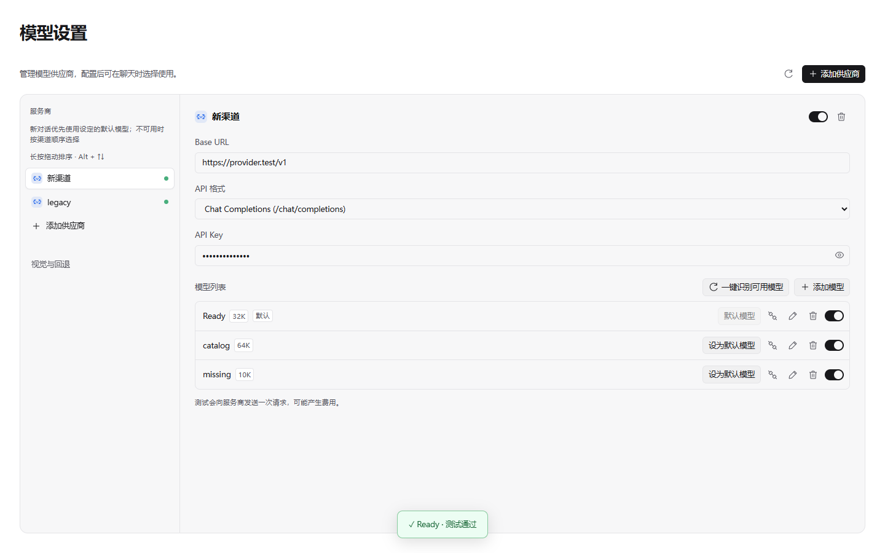

# GitHub issue 核查与默认模型修复

核查日期：2026-11-09。基线：`origin/main` 的 `54d31df3`。主工作区含未提交修改，本次使用独立 worktree `F:/Piora-worktrees/issue-358-default-model-20261109`。

## 未关闭 issue

| Issue | 当前证据与处理 |
| --- | --- |
| [#344](https://github.com/kexijiang/Piora/issues/344) 新任务选择失效 | PR #345 已合并，修复目录尚未就绪时模型选择显示的问题。原报告中的项目选择异常尚未复现，保留跟踪，不能据此宣布完全解决。 |
| [#351](https://github.com/kexijiang/Piora/issues/351)、[#357](https://github.com/kexijiang/Piora/issues/357) 输出预算超限 | PR #353、#362 已合并。部署上限解析、手动重新查询与最终共享预算检查已在主线；仍缺报告者的脱敏部署响应和实际配置，未验证该真实部署。 |
| [#358](https://github.com/kexijiang/Piora/issues/358) 显式默认模型 | 本次实现，验证结果见下。 |
| [#235](https://github.com/kexijiang/Piora/issues/235) Intelligent UI | 已有开发中的 PR #238；本次未修改。 |
| [#250](https://github.com/kexijiang/Piora/issues/250) DSH/Cordis 桌面插件体系 | 通用宿主属于独立功能项目，现有 pet 适配不能代表完成。 |

## 默认模型规则

- 显式选择写入 `<agentDir>/piora/default-model.json`，使用原有私有文件原子写入工具；保存失败返回错误，成功后才使模型缓存失效。
- 模型目录、设置页和新会话启动共用优先级：可用且启用的显式选择优先，否则取显示顺序中首个可用模型。以 provider 与 modelId 完整身份匹配。
- 首个自动默认模型仍可点击设定并固定。自定义渠道和已认证的内置渠道均提供按钮。
- 隐藏、移除渠道或失去认证后，原模型不再显示有效默认标签，新对话回退。保存的偏好保留，以便暂时不可用的模型恢复时继续使用；没有将暂时离线当成删除用户偏好。
- 原有 SDK `settings.json` 和启动器环境变量不自动迁移成显式选择。现有会话、会话恢复及新任务的手动模型选择继续优先，设置默认不修改当前聊天的模型。
- 设置、模型下拉和对话当前模型展示有效默认标签；标签依赖服务端目录状态，不通过名称猜测。

## 验证

Windows、Node 24.5.0，本地复用 `F:/Piora/node_modules`（Next 16.4.3），不修改共享依赖。精确锁文件依赖由远端 CI 安装验证。

- 58/58 定向逻辑/渲染用例通过：`node --test --test-concurrency=1 lib/default-model.test.mjs lib/model-policy.test.mjs lib/model-scope-settings.test.mjs lib/provider-order.test.mjs lib/removed-providers.test.mjs components/ChatInput.test.mjs`。新用例在临时 agent 目录使用真实 SDK ModelRuntime、实际持久存储与路由函数，覆盖保存、失败、排序、隐藏、渠道移除、模型删除及显式会话选择。
- Web 类型检查通过；首轮发现 nullable scope 的类型问题，已修复并完成复测。最终使用明确的 Node 入口 `node node_modules/@typescript/native/bin/tsc --noEmit`；中途未完成的重复调用和错误的标准 TypeScript 入口不计为通过。
- 浏览器首轮两项失败：旧断言要求没有默认按钮，以及新增菜单定位器遗漏同一菜单项中的模型名。已按新需求维护计数、持久选择断言和定位器，未降低原有布局、拖动、保存与错误断言；2/2 复测通过。覆盖失败后重试、刷新、内置/自定义渠道、长按排序后保留选择；输入框测试覆盖中英文和 320/420/480/590/900px 容器。
- 另有 20/20 模型范围、会话启动及真实 hook 浏览器回归通过：`node --test --test-concurrency=1 hooks/model-scope-startup.test.mjs lib/model-scope.test.mjs lib/new-chat-model-refresh-browser.test.mjs`。
- 本次全部修改代码与测试的定向 ESLint、`git diff --check`、`npm run changelog:check` 通过。更新说明按用户规则写入 Unreleased，新增具体说明原因的 skip 片段，避免发布汇总重复收录。
- 最后补齐不可用配置行的禁用按钮及提示，设置页 1/1 单独复测、对应 ESLint 与最终 Web 类型检查通过。
- 远端完整 CI、最终提交状态以本次 PR 的 Checks 为准；上述本地检查不等同完整 CI。
- 浏览器使用真实组件、样式和 headless Edge，HTTP/模型目录为离线夹具。未调用真实模型、未验证 Electron 原生窗口、未运行本地全量 CI、`next build` 或发布包构建；没有发布新版本。

