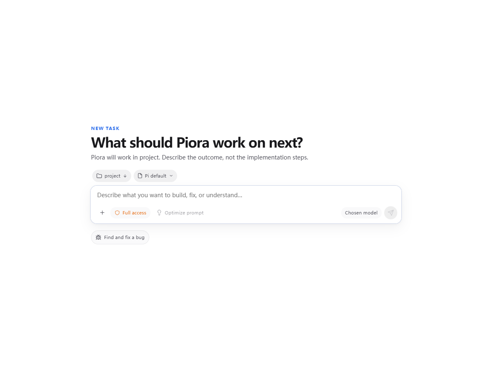

# 新任务选择与队列显示验证

日期：2026-11-06。初始基础提交：`4ab5dcdd`；提交前同步至 `55348e3d`（#339 依赖升级），保留双方更新说明。环境：Windows 10.0.26340、Node 24.5.0、headless Edge。

## #344

新任务页将默认工作目录准备状态混入 `isAutoModelSelection`。在 `/api/chat-workspace` 尚未返回时，点击模型虽然更新选择，标签仍显示“选择模型”。现将发送就绪状态独立传入输入框：目录未就绪时不能发送或清空草稿，已解析的模型选择仍立即显示。

`lib/new-task-selection-browser.test.mjs` 使用真实 `NewSessionProjectPicker`、`ChatInput`、生产 CSS 及浏览器 IndexedDB。API 返回受控模型和项目夹具，图标替换为空组件；没有连接真实模型或修改实际会话。测试通过真实点击选择模型和项目、键盘尝试发送及发送按钮，校验最终启动请求中的模型、项目目录和原消息。

- 未修改时，延迟工作目录用例失败：期望 `Chosen model`，实际 `Select model`。
- 修改后该用例通过，等待目录时发送被禁用且原文保留；目录返回后项目选择和发送参数正确。
- 正常目录就绪时，原代码的模型/项目点击用例已通过。尚未复现报告中的项目选不中；“Pi 默认”是系统提示词模板标签，不是模型标签。因此本次只修复已复现的模型显示问题，#344 保留跟踪剩余现象。

## #340

本地 accepted 记录和后端立即执行前的短暂 queued 状态曾进入队列操作条。现排除本地、accepted、dispatching 占位，按每条已确认 queued 记录观察 200 ms 后显示；删除、执行和运行时引导接收状态仍立即反映，不影响持久化记录或草稿恢复。

- `lib/chat-command-flow.browser.test.mjs`：通过。真实 hook → HTTP → 持久化路由 → 本地 SDK 夹具，MutationObserver 验证立即命令及普通消息从未插入队列条；显式排队在回执确认后显示，重载、暂停/恢复、编辑、取消和失败草稿恢复断言保留。
- `components/ChatCommands.browser.test.mjs`：真实队列/引导切换、失败恢复、键盘/IME、窄屏和主题用例通过；新增可见队列行及取消按钮断言复测通过。
- `components/ChatInput.test.mjs`：26 项通过。两个原来要求未确认占位立即出现的 SSR 断言改为首帧不显示；实际等待行与取消控制的正向覆盖移至浏览器用例。
- `components/NewSessionProjectPicker.test.mjs` 与 `lib/chat-command-views.test.mjs`：共 14 项通过，覆盖启动交接、原始输入和附件恢复、回执去重与乱序状态保护。

## 失败与验证边界

首次浏览器测试被沙箱临时目录中的 `!` 阻断（webpack 路径限制）；正常环境复测时先补齐生成品牌夹具，再修正重复命中工具权限按钮的测试选择器。队列用例首次新增观察器在页面重载后丢失，已改为每次文档初始化安装；仅过滤状态的实现仍捕获短暂真实 queued，补充逐条 200 ms 稳定时间后集成测试通过。

共 43 项定向测试分批通过。Web 类型检查、改动范围 ESLint 和 `git diff --check` 通过。没有运行 `next build`、本地发布包、真实模型、原生 Electron 窗口或其他平台实机验收。沙箱中的类型检查和一次定向 lint 长时间无进展，已中断并在正常权限下重跑通过。完整 CI 以 PR 的 GitHub Actions 结果为准。

本地测试复用主工作区已安装依赖（Next 16.4.3、React 19.3.1、Playwright 1.64.1）。同步 #339 后锁文件要求 Next 16.4.4；为保护主工作区，没有在共享依赖目录重装。合并后的锁文件组合必须由 GitHub Actions 安装并完成验证，不能把同步前的本地测试计作该组合的验证。

## 首轮 PR CI 跟进

PR #345 的首轮 CI（42156953886）在 Windows 第 2、4 分片发现两个旧测试夹具遗漏新增的 `sendDisabled` 状态：`composer-acknowledgement` 的 3 个用例、`ChatInput-retry` 的 9 个用例抛出 `ReferenceError`。已为两套生产回调夹具补齐默认值，保留原断言，并新增禁用发送时文字、附件及回复引用完整保留、就绪后正常发送的用例。

两份测试本地复测 15 项全部通过，定向 ESLint 与差异检查通过；连同此前的 43 项，共 58 项定向用例已分次通过。最终合并仍以更新提交后的完整 GitHub Actions 结果为准，首轮失败不计为通过。

## #341–#343 评估

- #341：`SidebarChatArea` 和 `RoomSidebarSection` 当前始终展开。需要独立且持久化的分组状态；收起不应停止后台轮询或丢失群聊恢复逻辑。
- #342：当前项目完全折叠时不显示会话，展开后的默认根会话预览数是 3。需明确将折叠视图改为前 5 个，并保留置顶和已有顺序、分支及运行中提示；“查看全部”应展开完整列表。
- #343：项目分组标题按钮目前仅随内容宽度；聊天与群聊标题是静态文本。适合与 #341 共用完整宽度的原生按钮，行尾功能按钮作为同级元素，避免折叠事件和按钮动作冲突。

这三项未在本次缺陷修复中实现，没有对应 PR 或测试通过结论。
