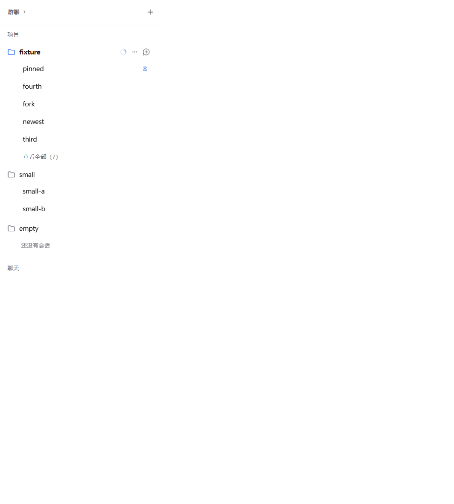

# 侧栏分组与项目预览验证

日期：2026-11-06。基线：`62b7856d`（PR #345 合并提交）。本机 Windows / Node 24.5.0 / headless Edge；工作区位于 `F:\Piora\.verification\issue-341-sidebar-groups`，主工作区未提交修改未动。

## 范围与行为

- #341：群聊、聊天可收起为标题行，localStorage 保存各自状态，刷新后恢复。群聊组件仍保持挂载，因此轮询和初始房间恢复不依赖列表展开。自动折叠、完全隐藏和标题未读数是 issue 中的可选项，本次未加入。
- #342：项目收起时按置顶和现有会话排序展示最多五个会话，包含分支会话；不因选中、运行或未读额外扩张预览。运行/未读提示保留在项目标题。超过五个时“查看全部（N）”恢复完整树，分支展开状态仍由原有存储管理；旧的“三条根会话 + 二级展开”状态不再用于项目列表。
- 扁平预览仅提供选择和会话操作，拖动排序在完整树中继续限制为同级，避免跨分支误排序。没有重写 parentSessionId 或会话文件。
- #343：三个分组标题的文字、箭头和空白区域属于同一个原生按钮，右侧功能按钮是同级元素，不会触发折叠。支持 Enter/Space，增加悬停背景和键盘焦点轮廓。

## 本地验证

43 项定向用例分次通过：

| 测试 | 通过 |
| --- | ---: |
| SessionSidebar | 24 |
| SessionOrdering | 6 |
| session-project-groups | 8 |
| sidebar-tree-window（含多个置顶会话按置顶时间截取） | 3 |
| SidebarDisclosure.browser | 1 |
| RoomMembers.browser | 1 |

类型检查、改动范围 ESLint、`git diff --check` 通过。新增浏览器场景使用真实侧栏组件、CSS 和 localStorage，API 与会话为合成夹具，通过 UI 执行折叠、键盘切换、新建入口、预览选择、查看全部和拖动。覆盖英文/中文、空项目和两个会话的小项目、七个会话的五条预览、置顶与手动顺序、分支层级恢复、隐藏运行提示、折叠时群聊轮询及刷新后的初始恢复。

首轮新浏览器场景因测试夹具把会话对象当作 selectedSessionId，导致选择断言及分支恢复等待失败。已修正夹具传参，保留并新增选择状态断言；后续完整浏览器场景通过。没有删除或降低布局、排序、分支及成员设置断言。

本地复用主工作区已安装的 Next 16.4.3；锁文件要求的 Next 16.4.4 留给 GitHub Actions 安装验证。没有运行本地 `next build`、发布包构建、原生 Electron 验收、真实模型或 Harmony 设备测试。最终 CI 以 PR 对应提交的 GitHub Actions 结果为准。

## 上一批修复的合并后检查

PR #345 合并后的 main CI [42159729973](https://github.com/kexijiang/Piora/actions/runs/42159729973) 已完成且成功，对应 `62b7856de6e366e6d9fd788f4e2606700067d322`。网站、六个 Windows 测试分片、两平台质量验证和两个汇总门禁共 11 项全部成功；Harmony 硬件任务按条件跳过，未计为通过。
