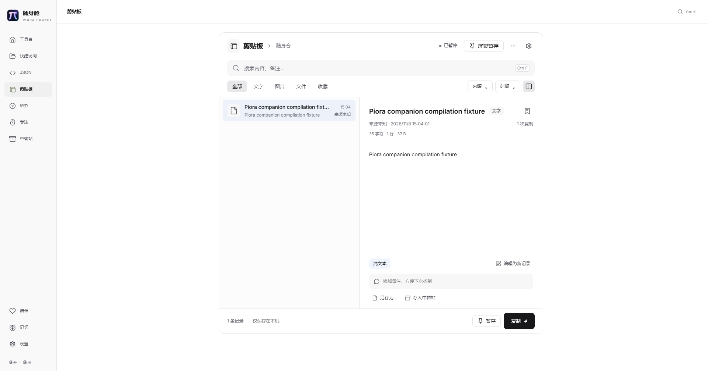

# #359–#361 桌面修复验证

基线：upstream/main `9eaf6481`，已包含 PR #364。独立工作树 `issues-359-361`，分支 `codex/issues-359-361`。Windows 10.0.26300 / Node 24.5.0 / Next 16.4.4 / Electron 45.2.1。以下结果针对本次工作树修改，未发布安装包。

## 实现范围

- #359：在调用原生窗口及显示器接口前检查有限坐标、int32 范围和有效矩形，并对位置取整；异常工作区跳过定位，原生调用异常不逃逸到周期回调。移动失败后停止计时器，不再用失败坐标移动气泡；窗口守卫的错误日志限频。气泡定位独立捕获异常，保留固定尺寸，避免 DPI 漂移。
- #360：Turbopack 共享桌面模块规则增加 clipboard-content 和 clipboard-messages，继续采用现有虚拟 ESM loader。桌面 CommonJS 构建保持原有机制。
- #361：文件菜单增加重启入口，和托盘共用同一函数。运行任务时确认，等待服务退出后才安排 relaunch；重复点击、取消退出、保存草稿失败或关闭服务失败不会留下重启请求。没有增加快捷键。
- 遵循 #364 的新规范，更新说明写入两个独立 changelog.d 片段。

## 已通过

- 32/32 定向测试：companion-motion-window、companion-window-guard、companion-motion、desktop-tray-restart、desktop-dev-loader、desktop-window-style、companion-ui。覆盖非法工作区/坐标、负坐标显示器、正常定位恢复、窗口和渲染器消失、日志限频、两入口退出顺序、重复点击、确认/取消及保存失败。菜单和关闭服务使用受控对象，不能视作原生菜单 UI 验收。
- companion-bubble-position 3/3：正常与异常几何、原生调用失败，以及真实 Electron 隐藏气泡窗口在 100%、125%、150%、175%、200% DPI 下各 120 次定位的尺寸/位置验证。
- desktop-e2e 运行器回归 18/18。
- Web `tsc --noEmit --incremental false`、桌面 `tsc -p desktop/tsconfig.json --noEmit`、修改范围 ESLint、`git diff --check`、`npm run changelog:check`。
- `node scripts/run-desktop-e2e.mjs --scenario companion-panel --timeout-ms 600000 --step-timeout-ms 120000`：真实开发桌面快捷键打开随身舱、点击剪贴板、刷新后再次打开均通过，无页面异常和清理错误。运行产物：`.verification/desktop-e2e-3gyYqm/result.json` 与 `companion-clipboard.png`。使用独立 profile、端口、Next 输出目录，预置一条合成记录并关闭系统剪贴板采集；模型与用户凭据未参与。截图已视觉核对。

## 失败与复测

- 初次类型检查误用了当前 TypeScript npm 别名包不存在的 `bin/tsc` 路径，未执行；改用 `.bin/tsc.cmd` 后通过。
- 两项旧源码断言要求使用未验证的气泡回退坐标和原始 x/y。更新为明确断言停止失败移动、禁止回退、只传规范化坐标，并补充运行时失败测试；完整定向组复测通过。
- 初次桌面运行 `.verification/desktop-e2e-hEHunA` 在 Electron 下载阶段未完成；原生气泡测试同样超时。终止本工作树的挂起下载进程后保留失败记录。通过镜像取得锁定版本 Electron 45.2.1，核对 GitHub 官方 SHASUMS256 的 SHA-256 `7c342aee45d5b4ccafe5dfe9037028796b082735a576e21e2b4e2d8422ebb727` 后安装运行文件，原生气泡复测通过。未替换依赖版本或构建发布包。
- 第二次桌面运行 `.verification/desktop-e2e-isAvIJ` 页面已正常打开，但通用 input 选择器匹配了隐藏的待办输入框而超时。改为精确定位“搜索剪贴板”文本框，并隔离剪贴板数据，第三次运行通过；未放宽断言或时限。

## 未覆盖

未运行完整本地 CI、其他操作系统、物理显示器热插拔、真实模型调用、原生菜单人工点击与安装包验收。没有执行 next build 或本地发布构建。此文仅记录本地检查，远端 CI 状态以 PR checks 为准。
